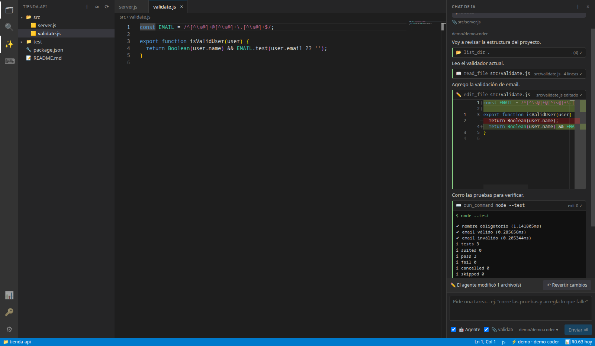

# Zinarix Studio

<p align="center"></p>

**El editor de código que funciona con cualquier IA.** 62 proveedores y 300+ modelos (de los más potentes a los de centavos, o locales y gratis con Ollama), un agente que lee tu proyecto y usa la terminal con tu aprobación, y el consumo de créditos por proveedor a la vista.

**[⬇ Descargar](https://github.com/abrahamtobal120-sudo/zinarix-studio/releases/latest)** · Windows · macOS · Linux (Ubuntu/Debian `.deb`, Arch `.pacman`, Fedora y otras con `.AppImage`)

### Instalar desde la terminal

**Linux** (Ubuntu/Debian → `.deb`, Arch → `pacman`, otras → AppImage) y **macOS**:

```bash
curl -fsSL https://zinarix-studio.vercel.app/install.sh | bash
```

**Windows** (PowerShell):

```powershell
irm https://zinarix-studio.vercel.app/install.ps1 | iex
```

El script descarga la última versión desde GitHub Releases y comprueba su SHA-256 (el `digest` que publica GitHub o el archivo `SHA256SUMS` del release) antes de instalar; si no puede obtener la suma, se detiene. Opciones: `bash -s -- --appimage` (Linux sin sudo), `--version X.Y.Z`, `--uninstall`, `--dry-run`, `--insecure` (instalar sin verificar; no recomendado). En Windows: `$env:ZINARIX_VERSION='X.Y.Z'`, `$env:ZINARIX_UNINSTALL='1'` para desinstalar, `$env:ZINARIX_INSECURE='1'` para instalar sin verificar.

> La suma SHA-256 viene del mismo release que el binario: comprueba que la descarga llegó íntegra, no quién la publicó. Los binarios todavía **no tienen firma de código** (Authenticode / notarización de Apple) y `SHA256SUMS` aún no está firmado con minisign o cosign.



## Funciones

- **Cualquier modelo, un clic** — selector por proveedor con precio, contexto y capacidades; un modelo distinto para chat, agente y edición (Ctrl+K).
- **Modo agente** — lee muchos archivos a la vez (`tree`, `glob`, `read_many_files`, en paralelo), busca, edita con vista de diferencias y ejecuta comandos. Las escrituras y los comandos piden aprobación ("Siempre" en un comando aprueba solo ese mismo comando); las ediciones de archivos se pueden revertir durante la sesión, pero lo que hace un comando (`run_command`) no.
- **Navegador que controla la IA** — pestaña 🌐 con un navegador aislado: el agente abre páginas, las lee, hace clic y escribe (permiso por sitio; evita escribir en campos de contraseña o de pago, pero esa detección es heurística, no una garantía: no inicies sesión con cuentas sensibles en ese navegador).
- **Centro de seguridad (defensivo)** — auditoría del proyecto (secretos filtrados, código inseguro, .env en git), dependencias vulnerables (osv.dev), revisión de tu equipo (puertos, firewall, actualizaciones, SSH, cifrado), escaneo de puertos de tu red local, revisión de sitios web (certificado, TLS, encabezados, cookies) y verificación de archivos por hash. Solo sistemas propios o con autorización.
- **Escáner de puertos estilo nmap (con interfaz)** — elige objetivo (localhost, tu red local /24 o un dominio) y puertos; descubre puertos abiertos, servicio y versión por su _banner_. Tu red local va directo; un objetivo público exige que confirmes que es tuyo o que tienes autorización por escrito.
- **Más allá del proyecto, con permiso y advertencia** — el agente puede revisar la red (conexiones, puertos, pruebas DNS/TCP/HTTP), llamar APIs externas, consultar bases de datos (SQLite, PostgreSQL, MySQL), leer y modificar archivos del sistema (con respaldo y reversibles), definir variables de entorno y ejecutar comandos como administrador (la contraseña la pide tu sistema operativo, la IA nunca la ve). Cada acción muestra su nivel de riesgo; las de riesgo alto se aprueban una por una. Las rutas conocidas de llaves, contraseñas y perfiles de navegador están en una lista de bloqueo para las herramientas de archivos; es una protección de mejor esfuerzo, y un comando aprobado se ejecuta con tus permisos.
- **Google Cloud Vertex AI** — con llave de API de Vertex, JSON de cuenta de servicio o token de `gcloud`.
- **Consumo de créditos** — gasto de hoy y del mes por proveedor, gráfica de 30 días y presupuestos con aviso al 80 %.
- **Local y privado** — detecta Ollama / LM Studio / vLLM; modo 100 % local.
- **Llaves seguras** — en el llavero del sistema (o en una bóveda cifrada con `--file-vault`), no en texto plano ni en logs; redacción automática de secretos. Los headers extra de endpoints personalizados sí se guardan en `~/.omni/config.json`.
- **Git y GitHub integrados** — panel de control de versiones (cambios con vista de diferencias, _stage_, commit con mensaje generado por IA, historial, ramas, _stash_, pull/push) y conexión con tu cuenta de GitHub mediante `gh`: lista tus repositorios, clónalos y ábrelos para que la IA los edite, y publica cualquier carpeta como repositorio nuevo (privado o público) con un clic.
- **Editor completo** — Monaco, terminal integrada, búsqueda global, paleta de comandos, arrastrar y soltar carpetas.
- **CLI `omni`** — los mismos modelos desde la terminal.

## Desarrollo

```bash
pnpm install
pnpm build
pnpm desktop        # compila y abre la app
pnpm test           # pruebas
```

Instaladores: `pnpm --filter @omni/desktop dist` (local) o empuja un tag `vX.Y.Z`: GitHub Actions crea un release en borrador, sube los de Windows, macOS y Linux, genera `SHA256SUMS` y solo entonces lo publica. Sitio web: carpeta `website/` (Vercel).

---

## Núcleo de IA y CLI (Fase 1)

**Estado: Fase 1 completa** — núcleo de IA (`@omni/core`), adaptadores de proveedores, catálogo verificado de 62 proveedores, bóveda de llaves y la CLI `omni`.

> _English version below._

## Requisitos

- Node.js **≥ 24.7** (usa `node:sqlite` y `crypto.argon2` nativos: cero compilación de módulos nativos)
- pnpm ≥ 10 (`npm i -g pnpm`)

## Instalación

```bash
pnpm install
pnpm build
pnpm link --global --dir apps/cli   # deja `omni` en el PATH (opcional)
```

## Uso rápido

```bash
omni providers                         # catálogo de 62 proveedores (● = conectado)
omni auth add anthropic                # pide la llave oculta → keychain del SO → prueba conexión
omni auth add cloudflare-workers-ai --param account_id=abc123
omni auth add ollama                   # locales: sin llave
omni auth list                         # llaves enmascaradas (sk-…a9F2)
omni models --tools --min-context 100000
omni use anthropic/claude-opus-5-5     # modelo por defecto
omni use groq/<modelo> --role commit   # modelo por rol
omni ask "explica este error" -f src/app.ts
cat app.log | omni ask "resume los errores críticos"
omni ask --json "…" > respuesta.json   # para scripts
omni chat                              # TUI; /model <p/m> cambia de modelo a media conversación
omni compare "parser CSV en Rust" -m openai/<a> -m anthropic/<b>
omni usage --month                     # tokens y costo por proveedor/modelo
omni history search jwt
omni config set privacy.localOnly true # modo 100 % local
omni config set budgets.anthropic '{"daily":5}'
omni config set fallbacks '["groq/<modelo>"]'
omni providers add-custom --id mi-vllm --base-url http://gpu:8000/v1 --no-auth --local
omni providers add-custom --id mi-api --base-url https://api.ejemplo.com/v1 --auth-header x-api-key
omni auth add mi-api                   # la llave de x-api-key va al keychain, no a config.json
omni completion zsh                    # bash | zsh | fish | powershell
```

Llaves para CI: variables de entorno estándar (`ANTHROPIC_API_KEY`, `GROQ_API_KEY`, …) o `OMNI_KEY_<ID>`.
Servidores sin keychain: `omni auth add <p> --file-vault` (AES-256-GCM + Argon2id; contraseña en `OMNI_VAULT_PASSWORD` o interactiva).

**Códigos de salida:** 0 ok · 1 error (incluye red, timeout y error del servidor) · 2 uso/config · 3 llave inválida (401/403) · 4 rate limit · 5 presupuesto · 130 cancelado (Ctrl+C, también en los prompts ocultos). `omni auth test` devuelve 3 solo si el proveedor rechaza la llave y 1 si no se pudo conectar o verificar; `omni compare` devuelve distinto de 0 si fallan todos los modelos.

Headers con secretos en endpoints personalizados: no los pases con `--header` (quedan en el historial del shell y en `ps`). Usa `--auth-header <nombre>` + `omni auth add`, `--header-prompt <nombre>` (entrada oculta) o `--header-stdin`; si hay un solo header de credenciales (o el indicado con `--auth-header`), su valor se guarda en el keychain o la bóveda en vez de `config.json`.

## Desarrollo

```bash
pnpm build          # tsc -b de todo el monorepo
pnpm test           # build + más de 180 pruebas (Vitest), incluye prueba canario anti-fugas de llaves
pnpm test:coverage  # umbral 80 % en líneas
pnpm lint && pnpm format:check
pnpm catalog:check  # valida catalog/providers.json con Zod
OMNI_LIVE_TESTS=1 ANTHROPIC_API_KEY=… OPENAI_API_KEY=… GROQ_API_KEY=… pnpm vitest run tests/live
```

## Estructura

```
apps/cli            CLI `omni` (commander + Ink)
apps/desktop        App de escritorio Electron (v0.4.0): editor, agente, navegador IA, Git y GitHub, centro de seguridad
apps/web            Fase 6 — PWA (pendiente)
packages/shared     Esquemas Zod, tipos, errores, i18n es/en
packages/security   Secret opaco, redactor de secretos, logger que redacta
packages/providers  Cliente HTTP (retry/backoff/Retry-After/timeout/abort), SSE, adaptadores
packages/core       Config, catálogo firmado, bóveda, descubrimiento de modelos, router,
                    fallback, presupuestos, costos, historial, auditoría (SQLite)
catalog/            providers.json (62 proveedores, catálogo del 2026-10-07) + firma Ed25519
docs/               Arquitectura, cómo agregar proveedores, entrega de Fase 1
```

Más: [docs/es/arquitectura.md](docs/es/arquitectura.md) · [docs/es/agregar-proveedor.md](docs/es/agregar-proveedor.md) · [docs/es/fase-1-entrega.md](docs/es/fase-1-entrega.md)

---

## English

Zinarix Studio is a VS Code–style, multi-AI IDE: bring your own API keys for 62 providers and pick any model in one click.
**Status: Phase 1 complete** — editor-independent AI core, provider adapters (OpenAI-compatible, OpenAI Responses, Anthropic, Gemini), a verified 62-provider catalog with signed hot updates, an OS-keychain key vault, and the `omni` CLI (`auth`, `providers`, `models`, `use`, `ask`, `chat`, `compare`, `usage`, `history`, `catalog`, `config`, `completion`, `wipe`).

Requires Node ≥ 24.7 and pnpm. `pnpm install && pnpm build && pnpm test`. Set `OMNI_LANG=en` or pass `--lang en` for English UI strings.
See [docs/en/architecture.md](docs/en/architecture.md) and [docs/en/adding-a-provider.md](docs/en/adding-a-provider.md).

License: MIT.

## Créditos

Logos de proveedores: [Lobe Icons](https://github.com/lobehub/lobe-icons) (MIT). Las marcas pertenecen a sus respectivos dueños.
