# Rediseño Zinarix Studio

Plan ejecutable del rediseño de la interfaz de escritorio. Lo lee una IA orquestadora y reparte las tareas entre los agentes de Zinarix Studio. Los hallazgos que lo justifican están en [`INVESTIGACION.md`](./INVESTIGACION.md); los códigos `C-01`, `A-05`, `M-12`, `B-03` de este documento son problemas de esa lista.

**Estado general:** sin empezar · **Versión de partida:** 0.6.6 (`c63f004`) · **Versión de llegada:** 0.7.0

| Fase | Nombre                                                 | Tareas  | Hechas |
| ---- | ------------------------------------------------------ | ------- | ------ |
| 1    | Fundaciones: tokens, temas y componentes base          | 24      | 0      |
| 2    | Estabilidad: barreras de error, bugs críticos y render | 15      | 0      |
| 3    | Layout y navegación                                    | 11      | 0      |
| 4    | Rediseño panel por panel                               | 41      | 0      |
| 5    | Animaciones y microinteracciones                       | 20      | 0      |
| 6    | Accesibilidad extra                                    | 22      | 0      |
| 7    | Versión detallada y modo desarrollador                 | 18      | 0      |
| 8    | QA y documentación                                     | 11      | 0      |
| 9    | Release                                                | 5       | 0      |
|      | **Total**                                              | **167** | **0**  |

---

## 0. Contexto y reglas globales

### 0.1 Stack

- **App:** `apps/desktop` (paquete `@omni/desktop`). Electron 44, React 19, TypeScript 6, Vite 8 (renderer), esbuild (`build.mjs`, proceso principal y preload), Monaco 0.57, xterm 6, Radix (`radix-ui`), Zod 4.
- **Monorepo:** pnpm 12 + Turborepo. Node 24.7 o superior. Antes de tocar `turbo.json` o comandos de `turbo`, leer `AGENTS.md` en la raíz.
- **Estilos:** CSS propio con capas (`@layer reset, tokens, base, components, features, utilities`). **No hay Tailwind y no se añade.**
- **Estado:** store propio en `apps/desktop/src/renderer/store.ts` (`useStore`, `setState`, `getState`).
- **Idiomas:** español e inglés. Todo texto visible va en los dos.

### 0.2 Rutas

Salvo que una tarea diga otra cosa, las rutas son relativas a `apps/desktop/src/renderer/`. Las que empiezan por `main/`, `shared/` o `preload/` son relativas a `apps/desktop/src/`. Las que empiezan por `apps/`, `docs/`, `scripts/` o `.github/` son relativas a la raíz del repo. `test/` es `apps/desktop/test/`. Un archivo marcado **NUEVO** no existe todavía.

Los números de línea son del commit `c63f004`. **Localiza siempre el símbolo por nombre antes de editar;** si la línea no coincide, busca el nombre con `grep`.

### 0.3 Convenciones de código

1. **Colores, tamaños de letra y capas:** solo con tokens de `ui/tokens.css`. Un color hex fuera de ese archivo rompe `pnpm lint`; un `font-size` en px o un `z-index` mayor de 10 sin nombre rompe `pnpm test` (`test/uiTokens.test.ts`).
2. **La escala de texto tiene exactamente 10 tamaños** (hay una prueba que lo exige). No se añaden tamaños.
3. **Componentes base:** todo control nuevo sale de `ui/` (`import { Button } from '../ui'`). No se escriben `<button className="…">` nuevos.
4. **Textos:** claves en `i18n.ts` (objeto `es` y objeto `en`) o en el archivo de textos del panel (`video/strings.ts`, `cad/cadStrings.ts`…). Nunca texto visible escrito en el `.tsx`.
5. **IPC:** un canal nuevo se declara en `shared/api.ts` (`CHANNELS`), se registra en `main/main.ts` con `handle('canal', z.tuple([...]), …)` y se expone en `preload/preload.ts`. `test/ipc-contract.test.ts` falla si falta alguno de los tres.
6. **Preferencias:** las claves nuevas de `Prefs` están todas en la tabla 0.7 y las añade una sola tarea (`F1.5.1`). Ninguna otra tarea añade claves a `Prefs`.
7. **Animación:** solo `transform` y `opacity`. Duraciones y curvas solo con tokens (tabla 0.6).
8. **Formato:** después de editar, `npx prettier --write <archivos tocados>`.
9. **Comentarios en el código:** en inglés, como el resto del código.

### 0.4 Rama, commits y trabajo en paralelo

- **Rama de trabajo:** `rediseno/ui-2`, creada desde `main` por la tarea `F1.1.1`. Todo el rediseño vive ahí hasta la Fase 9.
- **Un commit por tarea**, con el mensaje `Rediseño F{N}.{M}.{K}: <título de la tarea>`.
- **Nunca** `git stash`, `git reset --hard`, `git push --force` ni `git checkout -- <archivo>`: suele haber otras sesiones de IA con cambios sin confirmar en el mismo árbol.
- **Antes de editar un archivo,** mira `git status`. Si el archivo tiene cambios que no son tuyos, no lo toques: avisa a la orquestadora.
- **Archivos calientes** (los toca mucha gente; dos tareas que los editen nunca van en paralelo): `main/main.ts`, `shared/api.ts`, `preload/preload.ts`, `store.ts`, `i18n.ts`, `App.tsx`, `components/Chat.tsx`, `components/Settings.tsx`, `ui/tokens.css`, `ui/ui.css`, `ui/index.ts`.
- **`i18n.ts`:** cada tarea añade sus claves juntas, al final del objeto `es` y al final del objeto `en`, con un comentario `// Rediseño F{N}.{M}.{K}`. Así dos tareas no chocan en la misma zona.

### 0.5 Cómo probar

**Verificación base (VB).** Toda tarea la corre desde la raíz del repo antes de darse por hecha:

```bash
pnpm typecheck
pnpm lint
npx vitest run apps/desktop/test
pnpm format:check
```

Fallos conocidos que **no** cuentan: `apps/desktop/test/platformio.test.ts` (solo en la PC del dueño) y `apps/desktop/test/watch.test.ts` (intermitente en Windows).

**Una sola prueba:** `npx vitest run apps/desktop/test/<archivo>.test.ts` desde la raíz (dentro de `apps/desktop` no encuentra las pruebas).

**Verificación en la app (VA).** Para tareas que cambian lo que se ve:

```bash
pnpm --filter @omni/desktop build
pnpm e2e                                   # abre la app compilada y revisa que no haya errores
ZINARIX_E2E_SIZE=1024x728 pnpm e2e         # la pantalla pequeña del CI
node apps/desktop/scripts/ui-audit.mjs <carpeta-de-salida> dark light
```

`ui-audit.mjs` recorre las pantallas, guarda una captura de cada una y cuenta texto cortado, botones sin nombre, contraste bajo e imágenes rotas.

**Abrir la app a mano:** `pnpm desktop`. Para no chocar con la app instalada del usuario, definir `OMNI_HOME=<carpeta temporal>`.

**Aviso sobre la barra de título:** los clics de Playwright ignoran la zona de arrastre y los botones − □ × de Windows. Todo lo que quede en los 34 px de arriba se prueba **con el ratón real**.

### 0.6 Especificación de diseño (valores fijos)

Estos valores no se discuten en las tareas: se aplican.

**Movimiento**

| Token               | Valor                                    | Uso                                                             |
| ------------------- | ---------------------------------------- | --------------------------------------------------------------- |
| `--motion-micro`    | `80ms`                                   | hover, press, foco                                              |
| `--motion-short`    | `140ms`                                  | menús, tooltips, avisos, pestañas                               |
| `--motion-medium`   | `220ms`                                  | modales, paneles, cambio de chat                                |
| `--motion-long`     | `360ms`                                  | estudios a pantalla completa, desbloqueo del modo desarrollador |
| `--ease-standard`   | `cubic-bezier(0.2, 0, 0, 1)` (ya existe) | cambios en el sitio                                             |
| `--ease-enter`      | `cubic-bezier(0, 0, 0, 1)` (ya existe)   | lo que aparece                                                  |
| `--ease-exit`       | `cubic-bezier(0.3, 0, 1, 1)` (ya existe) | lo que se va                                                    |
| `--ease-spring`     | `cubic-bezier(0.34, 1.4, 0.64, 1)`       | éxito, soltar, desbloqueo                                       |
| `--motion-distance` | `8px`                                    | desplazamiento de entrada                                       |
| `--press-scale`     | `0.97`                                   | pulsar                                                          |

Reglas: la salida dura el 70 % de la entrada. Los tokens viejos `--duration-instant/fast/normal/slow` quedan como alias de `micro/short/medium/long`. Con movimiento reducido, los desplazamientos y escalas se cambian por un fundido de `--motion-micro`; los giros de carga se quedan.

**Color y superficie (tokens nuevos)**

| Token           | Oscuro                                               | Claro               | Uso                                            |
| --------------- | ---------------------------------------------------- | ------------------- | ---------------------------------------------- |
| `--info`        | `#6cb6ff`                                            | `#0b5cad`           | estado informativo                             |
| `--scrim`       | `rgb(0 0 0 / 0.5)`                                   | `rgb(0 0 0 / 0.35)` | velo de modales                                |
| `--scrim-soft`  | `rgb(0 0 0 / 0.25)`                                  | `rgb(0 0 0 / 0.15)` | velo de zona para soltar                       |
| `--diff-add`    | `color-mix(in srgb, var(--ok) 18%, transparent)`     | igual               | línea añadida                                  |
| `--diff-del`    | `color-mix(in srgb, var(--danger) 18%, transparent)` | igual               | línea quitada                                  |
| `--focus-width` | `2px`                                                | `2px`               | grosor del anillo (3px con "anillo grueso")    |
| `--target-min`  | `24px`                                               | `24px`              | objetivo mínimo (32px con "objetivos grandes") |
| `--safe-top`    | `var(--titlebar-h)`                                  | igual               | borde superior para todo lo flotante           |

**Tamaños que escalan**

| Token               | Valor                                             |
| ------------------- | ------------------------------------------------- |
| `--font-scale`      | `1` (lo fija la preferencia `fontScale / 100`)    |
| `--text-*` (los 10) | `calc(<px actual> * var(--font-scale))`           |
| `--control-h`       | `calc(28px * var(--font-scale))`; compacto `24px` |
| `--control-h-sm`    | `calc(24px * var(--font-scale))`                  |
| `--row-h`           | `calc(26px * var(--font-scale))`; compacto `22px` |

**Temas de alto contraste (nuevos):** `hc-dark` (fondo `#000000`, texto `#ffffff`, bordes `#ffffff`, acento `#ffd400`, foco `#00e5ff`) y `hc-light` (fondo `#ffffff`, texto `#000000`, bordes `#000000`, acento `#0000c8`, foco `#b5007f`). Contraste de texto 7:1 o más; sin sombras; todo borde visible.

**Modo daltónico:** atributo `data-cv` en `<html>` con `protan`, `deutan` o `tritan`. Cambia `--ok`, `--danger`, `--warn`, `--diff-add` y `--diff-del` a una pareja azul/naranja (protan y deutan) o magenta/verde azulado (tritan). Además, **siempre** (con o sin el modo) los estados llevan icono o texto además del color.

### 0.7 Preferencias nuevas (`Prefs` en `shared/api.ts`)

| Clave                    | Tipo                                         | Por defecto | Efecto en `<html>`                                        |
| ------------------------ | -------------------------------------------- | ----------- | --------------------------------------------------------- |
| `reduceMotion`           | `'system' \| 'on' \| 'off'`                  | `'system'`  | `data-motion="reduce"` o `"full"`                         |
| `fontScale`              | entero 80–200, paso 10                       | `100`       | `style="--font-scale: 1.0"`                               |
| `colorVision`            | `'none' \| 'protan' \| 'deutan' \| 'tritan'` | `'none'`    | `data-cv`                                                 |
| `followSystemContrast`   | booleano                                     | `true`      | con alto contraste del sistema usa `hc-dark` o `hc-light` |
| `focusRing`              | `'normal' \| 'thick'`                        | `'normal'`  | `data-focus`                                              |
| `largeTargets`           | booleano                                     | `false`     | `data-targets="large"`                                    |
| `singleKeyShortcuts`     | booleano                                     | `true`      | (lo leen video, pintura, vector y 3D)                     |
| `announce`               | `'off' \| 'brief' \| 'full'`                 | `'brief'`   | (lo lee `announce.ts`)                                    |
| `captionsDefault`        | booleano                                     | `false`     | (lo lee Video Studio al exportar)                         |
| `showVersionInStatusBar` | booleano                                     | `false`     | —                                                         |
| `devMode`                | booleano                                     | `false`     | `data-dev`                                                |
| `flags`                  | `Record<string, boolean>`                    | `{}`        | —                                                         |

### 0.8 Receta de migración de panel (RM)

Las tareas de la Fase 4 dicen "aplica RM a estos archivos". Significa hacer esto, en este orden, **sin cambiar el comportamiento**:

1. Cambiar cada `<button>` por `Button` o `IconButton` de `ui/` (variante `primary`, `secondary`, `ghost` o `danger`). Un botón de solo icono lleva `aria-label`.
2. Cambiar cada `<input>`, `<textarea>`, `<select>` e interruptor por `Input`, `Textarea`, `Select` o `Switch` de `ui/`, dentro de `Field` con su etiqueta visible o `aria-label`.
3. Cambiar menús, pestañas y diálogos hechos a mano por `Menu`, `Tabs` y `Modal` de `ui/`.
4. Cambiar `title="…"` por `Tooltip` en botones de solo icono. En el resto, quitar el `title` si repite el texto visible.
5. Usar `PanelState` para los tres estados: `kind="loading"` (esqueleto), `kind="empty"` (icono, frase y acción) y `kind="error"` (mensaje, botón "Reintentar" y `role="alert"`). **Un fallo nunca se muestra como vacío.**
6. Quitar del CSS del panel las reglas que quedaron sin uso y cambiar `padding`, `margin`, `gap` y `border-radius` en px por tokens `--space-*` y `--radius-*`.
7. Mover a las claves de textos lo que estuviera escrito en el `.tsx`.

Criterios de aceptación comunes de RM (se suman a los de cada tarea):

- [ ] En los archivos de la tarea no queda ningún `<button`, `<input`, `<select` ni `<textarea` en minúscula (comprobar con `grep -n "<button\|<input\|<select\|<textarea" <archivo>`), salvo los que la tarea exceptúe.
- [ ] Cada estado (cargando, vacío, error) se ve al forzarlo.
- [ ] `ui-audit.mjs` da 0 en "unnamed" y 0 en "contrast" para esa pantalla.

### 0.9 Qué NO tocar

- `apps/cli`, `packages/*`, `apps/remote-android`, `plataformas/`, `website/` (salvo la tarea `F9.1.5`), `catalog/`, `evals/`, `vendor/`, `blender/`, `community/`.
- La lógica del agente y de los proveedores: `main/agent.ts`, `main/ai.ts`, `main/tasks.ts`, `packages/core`, `packages/providers`. Excepciones únicas: `F7.4.5` (un punto de registro en `main/ai.ts`) y `F8.4.2` (el texto que describe la app en `main/agent.ts`).
- Seguridad y permisos: `main/guard.ts`, `main/sandbox*.ts`, `main/license*.ts`, la comprobación de remitente de `handle()` en `main/main.ts`.
- La forma de los datos guardados: `desktop.json`, conversaciones, proyectos de video. Solo se **añaden** campos opcionales.
- `styles/overrides.css` (retoques a Monaco y xterm) salvo que una tarea lo nombre.
- Los modelos de Monaco, el motor de render de video (`shared/videoRender.ts`) y FFmpeg.
- Dependencias: **no se añade ninguna** sin aprobación del usuario. La única prevista es `axe-core` (`F8.1.2`), **ya aprobada por el usuario el 2026-11-25** como dependencia de desarrollo.
- No se copian marcas ni diseños exactos de otros editores.

---

## A. Tabla de agentes

Antes de repartir, la orquestadora llama a `list_ai_models` y elige, de lo que esté conectado, un modelo por nivel:

- **Potente:** el modelo de mayor capacidad disponible, con herramientas y contexto de 200 000 tokens o más. Para decisiones de arquitectura y archivos grandes.
- **Medio:** un modelo de gama media con herramientas. Para implementar con criterio.
- **Económico:** el modelo con herramientas más barato (o uno local de Ollama, de 7 000 millones de parámetros o más). Para cambios mecánicos y repetitivos. Si falla dos veces la misma tarea, se sube a Medio.

| Sigla    | Rol                           | Responsabilidad                                                                             | Nivel                                               | Tareas                                                                                                                                                          |
| -------- | ----------------------------- | ------------------------------------------------------------------------------------------- | --------------------------------------------------- | --------------------------------------------------------------------------------------------------------------------------------------------------------------- |
| **ARQ**  | Arquitecto UI                 | Armazón, regiones, store, rendimiento de render, refactors de archivos grandes, canales IPC | Potente                                             | F1.5.1, F1.5.2, F2.1.4, F2.2.2, F2.3.1–F2.3.3, F3.1.1–F3.1.3, F4.1.1, F4.11.1, F4.11.2, F7.1.1, F7.3.3 (15)                                                     |
| **DIS**  | Diseñador de Sistema          | Tokens, temas, alto contraste, modo daltónico, consolidación de CSS                         | Potente                                             | F1.2.1–F1.2.6, F1.3.1–F1.3.3, F4.1.2, F6.3.3, F6.3.5 (12)                                                                                                       |
| **COMP** | Ingeniero de Componentes      | Componentes de `ui/` y migración de paneles con la receta RM                                | Medio (Económico en las tareas marcadas _mecánica_) | F1.4.1–F1.4.11, F2.1.1–F2.1.3, F2.2.1, F2.2.3–F2.2.6, F2.3.4, F2.3.5, F3.1.4–F3.1.6, F3.2.1–F3.2.5, toda la Fase 4 salvo F4.1.1, F4.1.2, F4.11.1 y F4.11.2 (66) |
| **ANIM** | Especialista en Animación     | Sistema de movimiento, transiciones y microinteracciones                                    | Medio                                               | F5.1.1–F5.5.2 (20); apoya en F7.3.2 (la animación de desbloqueo)                                                                                                |
| **A11Y** | Especialista en Accesibilidad | Teclado, foco, ARIA, lectores de pantalla, video accesible, panel de Accesibilidad          | Potente en F6.2.x y F6.4.3; Medio en el resto       | F6.1.1–F6.5.2 salvo F6.3.3 y F6.3.5 (20)                                                                                                                        |
| **DEV**  | Ingeniero de Herramientas Dev | Información de build, "Acerca de", modo desarrollador                                       | Medio                                               | F7.1.2, F7.1.3, F7.2.1, F7.2.2, F7.3.1, F7.3.2, F7.4.1–F7.4.9 (15)                                                                                              |
| **QA**   | QA / Testing                  | Línea base, guardas, pruebas visuales, axe, rendimiento, regresión                          | Medio                                               | F1.1.1, F1.1.2, F7.4.10, F8.1.1–F8.1.3, F8.2.1, F8.2.2, F8.3.1, F8.5.1, F8.5.2 (11)                                                                             |
| **DOC**  | Documentación                 | Guías, novedades, changelog, textos de ayuda                                                | Económico                                           | F8.4.1, F8.4.2, F9.1.1 (3)                                                                                                                                      |
| —        | Orquestadora (con el usuario) | Reparto, revisión, fusión, etiqueta de versión                                              | Potente                                             | F8.3.2, F9.1.2–F9.1.5 (5)                                                                                                                                       |

---

## B. Grafo de dependencias

Cada tarea lista además sus dependencias exactas en "Depende de". El grafo muestra las subfases; dos cajas sin flecha entre ellas pueden ir en paralelo.

```mermaid
flowchart TD
  subgraph F1[Fase 1 · Fundaciones]
    S11[1.1 Rama y línea base]
    S12[1.2 Tokens]
    S13[1.3 Temas]
    S14[1.4 Componentes base]
    S15[1.5 Preferencias]
    S11 --> S12 --> S13
    S12 --> S14
    S11 --> S15
  end
  subgraph F2[Fase 2 · Estabilidad]
    S21[2.1 Barreras de error]
    S22[2.2 Bugs críticos]
    S23[2.3 Render]
  end
  subgraph F3[Fase 3 · Layout y navegación]
    S31[3.1 Armazón]
    S32[3.2 Navegación]
    S31 --> S32
  end
  subgraph F4[Fase 4 · Paneles]
    S41[4.1 Chat]
    S42[4.2 Agente]
    S43[4.3 Editor]
    S44[4.4 Terminal]
    S45[4.5 Navegador]
    S46[4.6 Git]
    S47[4.7 Seguridad]
    S48[4.8 Edición]
    S49[4.9 Video]
    S410[4.10 Uso]
    S411[4.11 Ajustes]
    S412[4.12 Servicios]
    S413[4.13 Otras herramientas]
    S414[4.14 Modales e inicio]
    S41 --> S42
  end
  subgraph F5[Fase 5 · Animación]
    S51[5.1 Sistema de movimiento]
    S52[5.2 Estructura]
    S53[5.3 Chat y agente]
    S54[5.4 Microinteracciones]
    S55[5.5 Presupuesto]
    S51 --> S52
    S51 --> S53
    S51 --> S54
    S52 --> S55
    S53 --> S55
    S54 --> S55
  end
  subgraph F6[Fase 6 · Accesibilidad]
    S61[6.1 Teclado y foco]
    S62[6.2 ARIA y lectores]
    S63[6.3 Visual]
    S64[6.4 Video e imágenes]
    S65[6.5 Panel Accesibilidad]
  end
  subgraph F7[Fase 7 · Versión y modo dev]
    S71[7.1 Información de build]
    S72[7.2 Acerca de]
    S73[7.3 Desbloqueo]
    S74[7.4 Panel de desarrollador]
    S71 --> S72 --> S73 --> S74
  end
  S8[Fase 8 · QA y documentación]
  S9[Fase 9 · Release]

  S14 --> S21
  S14 --> S22
  S11 --> S23
  S14 --> S31
  S21 --> S31
  S14 --> F4
  S22 --> F4
  S31 --> S43
  S411 --> S65
  S411 --> S72
  S12 --> S51
  S15 --> S51
  S14 --> S54
  S41 --> S53
  S42 --> S53
  S32 --> S52
  S14 --> S61
  S14 --> S62
  S13 --> S63
  S15 --> S63
  S49 --> S64
  S15 --> S65
  S51 --> S65
  S63 --> S65
  S11 --> S71
  S15 --> S73
  S21 --> S74
  F4 --> S8
  F5 --> S8
  F6 --> S8
  F7 --> S8
  S8 --> S9
```



**Lo que puede ir en paralelo, en resumen:**

- En cuanto termina 1.1: 1.2, 1.5, 2.3 y 7.1 a la vez.
- En cuanto termina 1.4: 2.1, 2.2, 6.1 y 6.2 a la vez.
- La Fase 4 son 14 subfases independientes entre sí (salvo 4.2, que va después de 4.1): hasta 6 agentes a la vez, siempre que no compartan un archivo caliente.
- Las Fases 5, 6 y 7 avanzan en paralelo entre sí.

---

## C. Instrucciones para la IA orquestadora

### C.1 Cómo leer este documento

1. Lee la sección 0 completa. Va **entera** dentro de cada encargo: los ayudantes no ven esta conversación.
2. Recorre las fases en orden. Una tarea está **lista** cuando todas las de su línea "Depende de" tienen marcado `- [x] Hecha`.
3. De las tareas listas, toma las que pueden ir juntas según "Paralelo con" y que no compartan un archivo caliente (0.4).

### C.2 Cómo repartir con `delegate_to_ai`

Una tarea por llamada, en modo `agent`. Como máximo 4 ayudantes a la vez (6 en la Fase 4). El texto del encargo sigue esta plantilla:

```text
Eres <rol> en el rediseño de Zinarix Studio. Trabajas en el repo abierto, en la rama rediseno/ui-2.

REGLAS GLOBALES
<pega aquí la sección 0 completa de docs/rediseno/README.md>

TU TAREA
<pega aquí el bloque completo de la tarea F{N}.{M}.{K}>

CONTEXTO
<pega las filas de docs/rediseno/INVESTIGACION.md que la tarea cita (C-xx, A-xx, M-xx, B-xx)>

ENTREGA
1. Haz solo esta tarea. Si descubres otro problema, anótalo en tu respuesta; no lo arregles.
2. Corre la verificación base (VB) y lo que diga "Prueba".
3. Haz un commit con el mensaje: Rediseño F{N}.{M}.{K}: <título>.
4. Responde con: hash del commit, archivos cambiados y número de líneas, resultado de cada criterio
   de aceptación (cumplido o no, con la salida que lo demuestra) y problemas encontrados.
Si no puedes cumplir un criterio, no lo des por bueno: dilo y explica por qué.
```

### C.3 Cómo marcar avances

Cuando un ayudante entrega:

1. Revisa su respuesta contra los criterios de aceptación. Corre tú la VB.
2. Si todo se cumple: cambia `- [ ] Hecha` por `- [x] Hecha (<hash corto>)` en la tarea, marca cada criterio con `[x]` y suma 1 en la columna "Hechas" de la tabla del inicio. Confirma ese cambio del README en su propio commit: `Rediseño: avance F{N}.{M}.{K}`.
3. Cuando una fase llega a su total, cambia "Estado general" al nombre de la fase siguiente.

### C.4 Si una tarea falla

| Situación                                     | Qué hacer                                                                                                                                                         |
| --------------------------------------------- | ----------------------------------------------------------------------------------------------------------------------------------------------------------------- |
| La VB falla por algo de la tarea              | Devuélvela al mismo ayudante con la salida del error. Un reintento.                                                                                               |
| Falla otra vez                                | Reasígnala a un modelo del nivel siguiente (Económico → Medio → Potente).                                                                                         |
| Falla en el nivel Potente                     | Revierte su commit (`git revert <hash>`), marca la tarea `- [ ] Hecha — BLOQUEADA: <motivo>` y pregunta al usuario. Sigue con las tareas que no dependan de ella. |
| La tarea pasa de 300 líneas cambiadas         | Pártela en dos (`F{N}.{M}.{K}a` y `b`), añade ambas al README y reparte de nuevo.                                                                                 |
| Dos ayudantes chocan en un archivo            | Conserva el commit que entró primero; el otro rehace su tarea sobre el estado nuevo.                                                                              |
| Una prueba falla y no es de la tarea          | Comprueba si falla también en `main`. Si sí, anótalo en la sección E y sigue.                                                                                     |
| El archivo tiene cambios ajenos sin confirmar | No lo toques. Pasa a otra tarea y vuelve después.                                                                                                                 |

### C.5 Cuándo pedir aprobación al usuario

Siempre antes de:

1. Añadir cualquier dependencia. Excepción: `axe-core` como dependencia de desarrollo (`F8.1.2`) ya está aprobada (2026-11-25).
2. Fusionar `rediseno/ui-2` en `main`, subir la versión, crear la etiqueta o publicar (`F9.1.2`–`F9.1.4`). El número `0.7.0` ya está aprobado (2026-11-25); el momento de subirlo, fusionar y publicar sigue necesitando aprobación.
3. Borrar un archivo que no esté marcado NUEVO en este plan, o cambiar la forma de un dato guardado.
4. Tocar algo de la lista 0.9.
5. Cambiar un valor de la especificación 0.6 o una clave de 0.7.
6. Un cambio de comportamiento que el usuario vaya a notar y que el plan no describa.
7. Seguir cuando haya 3 tareas bloqueadas a la vez.

Al cerrar cada fase, muéstrale al usuario un resumen corto (tareas hechas, bloqueadas, capturas de antes y después) y espera su visto bueno para las Fases 3, 4 y 9. Las demás siguen sin esperar.

---

## D. Definición de "terminado" y métricas de éxito

**Una tarea está terminada cuando:** cumple todos sus criterios, la VB pasa, tiene su commit y su casilla está marcada.

**El rediseño está terminado cuando se cumple todo esto:**

- [ ] Las 167 tareas están marcadas o tienen una excepción aprobada por el usuario.
- [ ] El CI pasa en Windows, macOS y Linux sobre `rediseno/ui-2`.
- [ ] El usuario probó la versión candidata y dio su visto bueno.

| Métrica                                          | Hoy                  | Meta                                       | Cómo se mide                         |
| ------------------------------------------------ | -------------------- | ------------------------------------------ | ------------------------------------ |
| `<button>` sueltos fuera de `ui/`                | 1347                 | menos de 40 (lienzos y casos justificados) | `grep -rn "<button" --include=*.tsx` |
| Archivos que importan `ui/`                      | 1 de 144             | 120 o más                                  | `grep -rl "from '.*ui'"`             |
| Sistemas de avisos                               | 2                    | 1                                          | `F1.4.6`                             |
| Transiciones con tokens                          | 2 de 66              | 100 %                                      | guarda de `F1.2.6`                   |
| Transiciones o `@keyframes` que animan layout    | 9                    | 0                                          | guarda de `F5.5.1`                   |
| Violaciones axe graves o críticas                | sin medir            | 0                                          | `F8.1.2`                             |
| Texto con contraste menor de 4.5:1 (10 temas)    | sin medir en 6 temas | 0                                          | `F1.3.3` y `ui-audit.mjs`            |
| Botones sin nombre                               | sin medir            | 0                                          | `ui-audit.mjs`                       |
| Objetivos menores de 24 px                       | sin medir            | 0                                          | `F6.3.4`                             |
| Paneles con los tres estados                     | parcial              | todos                                      | lista de `F8.2.2`                    |
| Fallos mostrados como vacío o carga infinita     | 10                   | 0                                          | `F2.2.3`–`F2.2.5`                    |
| Cuadros a menos de 50 fps en animaciones propias | sin medir            | menos del 5 %                              | `F5.5.2`                             |
| Arranque hasta poder usar                        | 740 ms               | 815 ms o menos (+10 %)                     | `pnpm e2e --runs 5`                  |
| Interfaz al 200 % de texto, 1280×800             | sin probar           | sin texto cortado ni solapes               | `F6.3.2`                             |
| Llaves de API visibles en el modo desarrollador  | —                    | 0                                          | `test/devMode.test.ts` (`F7.4.10`)   |

---

## E. Notas de la orquestadora

(Apunta aquí pruebas que ya fallaban en `main`, tareas partidas y decisiones tomadas con el usuario.)

---

## Fase 1 — Fundaciones: tokens, temas y componentes base

### Objetivo

Dejar listo todo lo que las demás fases consumen: rama, capturas de partida, tokens completos, dos temas de alto contraste, componentes base suficientes para reemplazar lo hecho a mano, y las preferencias nuevas.

### Dependencias

Ninguna. Es la primera fase.

### Subfase 1.1 — Rama y línea base

#### F1.1.1 — Crear la rama de trabajo

- [ ] Hecha
- **Agente:** QA
- **Depende de:** nada
- **Archivos:** ninguno (solo git)
- **Pasos:**
  1. `git status`. Si hay cambios sin confirmar que no son tuyos, para y avisa a la orquestadora.
  2. `git switch -c rediseno/ui-2 main` y `git push -u origin rediseno/ui-2`.
  3. Corre la VB y guarda la lista de pruebas que fallan en la sección E de este README.
- **Aceptación:**
  - [ ] `git branch --show-current` responde `rediseno/ui-2`.
  - [ ] La sección E lista las pruebas rojas de partida (o dice "ninguna").
- **Prueba:** VB.
- **Paralelo con:** nada (bloquea todo lo demás).
- **Riesgo y reversa:** bajo. Reversa: `git switch main && git branch -D rediseno/ui-2`.

#### F1.1.2 — Capturas y mediciones de partida

- [ ] Hecha
- **Agente:** QA
- **Depende de:** F1.1.1
- **Archivos:** `docs/rediseno/base/` (NUEVO, carpeta con PNG y `medidas.json`)
- **Pasos:**
  1. `pnpm --filter @omni/desktop build`.
  2. `node apps/desktop/scripts/ui-audit.mjs docs/rediseno/base dark light`.
  3. `pnpm e2e --runs 5` y anota la mediana de arranque.
  4. Escribe `docs/rediseno/base/medidas.json` con: los contadores que imprime `ui-audit.mjs` por pantalla, la mediana de arranque y los conteos de la tabla D (columna "Hoy") recalculados con los `grep` indicados.
- **Aceptación:**
  - [ ] Hay una captura por pantalla y por tema en `docs/rediseno/base/`.
  - [ ] `medidas.json` existe y es JSON válido.
- **Prueba:** abrir tres capturas y comprobar que no están en blanco.
- **Paralelo con:** F1.2.1, F1.5.1, F7.1.1.
- **Riesgo y reversa:** bajo. Reversa: borrar la carpeta.

### Subfase 1.2 — Tokens

#### F1.2.1 — Tokens de movimiento

- [ ] Hecha
- **Agente:** DIS
- **Depende de:** F1.1.1
- **Archivos:** `ui/tokens.css`
- **Pasos:**
  1. En el bloque `/* ---- Motion ---- */` (línea 161) añade los tokens de la tabla "Movimiento" de 0.6.
  2. Redefine `--duration-instant`, `--duration-fast`, `--duration-normal` y `--duration-slow` como alias: `var(--motion-micro)`, `var(--motion-short)`, `var(--motion-medium)`, `var(--motion-long)`.
- **Aceptación:**
  - [ ] Existen los 4 `--motion-*`, `--ease-spring`, `--motion-distance` y `--press-scale` con los valores de 0.6.
  - [ ] `npx vitest run apps/desktop/test/uiTokens.test.ts` pasa.
- **Prueba:** VB.
- **Paralelo con:** F1.1.2, F1.5.1, F7.1.1. **No** con F1.2.2 ni F1.2.4 (mismo archivo).
- **Riesgo y reversa:** bajo (los alias cambian 60→80, 120→140, 200→220 y 320→360 ms en 2 transiciones). Reversa: `git revert`.

#### F1.2.2 — Tokens de color, superficie y medidas

- [ ] Hecha
- **Agente:** DIS
- **Depende de:** F1.2.1
- **Archivos:** `ui/tokens.css`, `themes.ts`, `test/themes.test.ts`
- **Pasos:**
  1. Añade a los bloques oscuro y claro de `ui/tokens.css` los tokens de la tabla "Color y superficie" de 0.6.
  2. Añade `--info` a `REQUIRED_VARS` en `themes.ts:14` y dale valor en cada uno de los 6 temas de `CUSTOM_THEMES` (`themes.ts:69`), con contraste 4.5:1 o más sobre su `--bg`.
  3. Añade a `:root` los tokens `--focus-width`, `--target-min` y `--safe-top`.
- **Aceptación:**
  - [ ] Los 8 tokens existen en los temas oscuro y claro.
  - [ ] Los 6 temas extra definen `--info`.
  - [ ] `test/themes.test.ts` y `test/uiTokens.test.ts` pasan.
- **Prueba:** VB.
- **Paralelo con:** F1.5.1, F7.1.1.
- **Riesgo y reversa:** bajo. Reversa: `git revert`.

#### F1.2.3 — Cambiar los `rgba()` sueltos por tokens (_mecánica_)

- [ ] Hecha
- **Agente:** DIS (nivel Económico)
- **Depende de:** F1.2.2
- **Archivos:** `components/video/video.css`, `components/video/video-fx.css`, `components/image/image-editor.css`, `components/vector/vector.css`, `components/paint/paint.css`, `styles/03-layout.css`, `styles/07-modals.css`, `styles/09-start.css`, `styles/10-browser.css`, `styles/15-onboarding.css`, `styles/18-mail.css`, `styles/19-whatsapp.css`
- **Pasos:**
  1. Lista los casos: `grep -rnE "rgba?\(" --include=*.css apps/desktop/src/renderer | grep -v tokens.css` (hoy son 50; `overrides.css` queda fuera).
  2. Velos de fondo → `var(--scrim)` o `var(--scrim-soft)`. Sombras → `var(--elevation-N)` o `var(--shadow-color)`. Tintes de diff → `var(--diff-add)` y `var(--diff-del)`. Cualquier otro → `color-mix(in srgb, <token> N%, transparent)`.
- **Aceptación:**
  - [ ] El `grep` del paso 1 devuelve 0 líneas fuera de `overrides.css`.
  - [ ] Las capturas de Video Studio, editor de imagen y un modal no cambian a simple vista respecto de `docs/rediseno/base/`.
- **Prueba:** VB y VA.
- **Paralelo con:** F1.3.1, F1.4.x.
- **Riesgo y reversa:** medio (un velo puede quedar más oscuro o claro). Reversa: `git revert`.

#### F1.2.4 — Texto y controles que escalan

- [ ] Hecha
- **Agente:** DIS
- **Depende de:** F1.2.2
- **Archivos:** `ui/tokens.css`, `layout/layout.css`, `test/uiTokens.test.ts`
- **Pasos:**
  1. En `ui/tokens.css` añade `--font-scale: 1` y reescribe los 10 `--text-*` como `calc(<px> * var(--font-scale))`.
  2. Añade `--control-h`, `--control-h-sm` y `--row-h` (tabla "Tamaños que escalan" de 0.6).
  3. En `layout/layout.css`, dentro de la regla de densidad compacta que ya existe, fija `--control-h: 24px` y `--row-h: 22px` (multiplicados por `--font-scale`).
  4. En `test/uiTokens.test.ts` añade un caso: los 10 `--text-*` contienen `var(--font-scale)`.
- **Aceptación:**
  - [ ] Con `document.documentElement.style.setProperty('--font-scale','1.5')` en la consola, todo el texto de la interfaz crece.
  - [ ] La prueba "8 interface sizes and 2 display sizes" sigue pasando.
- **Prueba:** VB; VA con `--font-scale` en 0.8 y 2.
- **Paralelo con:** F1.5.1, F7.1.1.
- **Riesgo y reversa:** medio (texto dentro de contenedores de alto fijo puede cortarse a escalas altas; eso lo arregla `F6.3.2`). Reversa: `git revert`.

#### F1.2.5 — Una sola familia de radios y sombras (_mecánica_)

- [ ] Hecha
- **Agente:** DIS (nivel Económico)
- **Depende de:** F1.2.2
- **Archivos:** todos los `.css` bajo `styles/` y `components/` que usen `var(--radius)`, `var(--radius-sm)`, `var(--shadow)` o `var(--elev)` (167 usos); `ui/tokens.css`
- **Pasos:**
  1. Reemplaza: `var(--radius)` → `var(--radius-md)`; `var(--radius-sm)` → `var(--radius-xs)`; `var(--shadow)` → `var(--elevation-4)`; `var(--elev)` → `var(--elevation-2)`.
  2. En `ui/tokens.css` deja los cuatro nombres viejos como alias de los nuevos, con el comentario `/* deprecated: remove in F8.5.1 */`.
  3. Si pasa de 300 líneas, parte la tarea en `a` (`styles/`) y `b` (`components/`).
- **Aceptación:**
  - [ ] `grep -rnE "var\(--(radius|radius-sm|shadow|elev)\)" --include=*.css apps/desktop/src/renderer | grep -v tokens.css` devuelve 0.
  - [ ] Las capturas no cambian a simple vista.
- **Prueba:** VB y VA.
- **Paralelo con:** F1.3.x, F1.4.x (no tocan los mismos `.css`).
- **Riesgo y reversa:** bajo (mismos valores). Reversa: `git revert`.

#### F1.2.6 — Guardas nuevas para que no se vuelva atrás

- [ ] Hecha
- **Agente:** DIS
- **Depende de:** F1.2.3, F1.2.5
- **Archivos:** `test/uiTokens.test.ts`, `test/fixtures/uiTokensBaseline.json` (NUEVO)
- **Pasos:**
  1. Añade tres casos a `test/uiTokens.test.ts`: (a) ningún `rgb(`/`rgba(` fuera de `ui/tokens.css` y `styles/overrides.css`; (b) toda `transition` y `animation` toma su duración de `var(--motion-*)` o `var(--duration-*)`; (c) ningún `var(--radius)`, `var(--radius-sm)`, `var(--shadow)` ni `var(--elev)`.
  2. El caso (b) hoy fallaría en unas 64 líneas. Genera con el propio test la lista actual de infractores (`archivo:línea texto`) y guárdala en `test/fixtures/uiTokensBaseline.json`. El test falla solo si aparece un infractor que **no** está en la lista, o si la lista contiene entradas que ya no existen (para obligar a irla vaciando).
- **Aceptación:**
  - [ ] Los tres casos pasan.
  - [ ] Añadir a mano `transition: color 0.2s` en un `.css` hace fallar el test.
- **Prueba:** VB.
- **Paralelo con:** F1.3.x, F1.4.x.
- **Riesgo y reversa:** bajo. Reversa: `git revert`.

### Subfase 1.3 — Temas

#### F1.3.1 — Temas de alto contraste

- [ ] Hecha
- **Agente:** DIS
- **Depende de:** F1.2.2
- **Archivos:** `shared/api.ts` (`THEME_IDS`, línea 277), `themes.ts`, `test/themes.test.ts`, `i18n.ts`
- **Pasos:**
  1. Añade `'hc-dark'` y `'hc-light'` a `THEME_IDS`.
  2. Define ambos en `CUSTOM_THEMES` (`themes.ts:69`) con los valores de 0.6. Todas las `REQUIRED_VARS` con contraste 7:1 o más sobre `--bg`; `--border` igual a `--fg`; `--shadow` y `--elev` en `none`.
  3. Dales su tema de Monaco (`monacoTheme`, `themes.ts:416`): base `hc-black` y `hc-light`.
  4. Añade sus nombres en `i18n.ts` ("Alto contraste oscuro", "Alto contraste claro").
  5. En `test/themes.test.ts` añade: para los dos temas, `--fg`, `--fg-dim`, `--accent-text`, `--danger`, `--ok`, `--warn` e `--info` tienen 7:1 o más sobre `--bg`, `--bg-2`, `--bg-3` y `--bg-4`.
- **Aceptación:**
  - [ ] Los dos temas aparecen en Ajustes → Apariencia y se aplican.
  - [ ] La prueba de 7:1 pasa.
  - [ ] El editor Monaco cambia a su tema de alto contraste.
- **Prueba:** VB; VA con `node apps/desktop/scripts/ui-audit.mjs <salida> hc-dark hc-light` (si el script no acepta el tema, añádele esos dos nombres a su lista).
- **Paralelo con:** F1.4.x. **No** con F1.5.1 (ambas tocan `shared/api.ts`).
- **Riesgo y reversa:** medio (`THEME_IDS` lo valida también `main/phone.ts`). Reversa: `git revert`.

#### F1.3.2 — Respetar el contraste del sistema

- [ ] Hecha
- **Agente:** DIS
- **Depende de:** F1.3.1
- **Archivos:** `styles/24-contrast.css` (NUEVO), `styles/index.ts`
- **Pasos:**
  1. Crea `styles/24-contrast.css` en la capa `features` con dos bloques: `@media (forced-colors: active)` (bordes `CanvasText` en botones, campos, pestañas, tarjetas y filas elegidas; `forced-color-adjust: none` solo en muestras de color y en el lienzo de video) y `@media (prefers-contrast: more)` (`--border` pasa a `var(--fg-dim)` y se quitan las sombras).
  2. Impórtalo al final de `styles/index.ts`.
- **Aceptación:**
  - [ ] Con el alto contraste de Windows activo, todos los botones y campos de la pantalla principal tienen borde visible.
  - [ ] La fila elegida del explorador se distingue sin color de fondo.
- **Prueba:** VB; a mano con Windows → Accesibilidad → Temas de contraste.
- **Paralelo con:** F1.4.x.
- **Riesgo y reversa:** bajo (solo actúa con esas preferencias del sistema). Reversa: `git revert`.

#### F1.3.3 — Contraste comprobado en todos los temas

- [ ] Hecha
- **Agente:** DIS
- **Depende de:** F1.3.1
- **Archivos:** `test/themes.test.ts`, `themes.ts`, `ui/tokens.css`
- **Pasos:**
  1. Añade a `test/themes.test.ts` un caso que recorra los 10 temas y exija: texto (`--fg`, `--fg-dim`, `--status-fg`, `--accent-text`, `--danger`, `--ok`, `--warn`, `--info`) 4.5:1 o más sobre `--bg`, `--bg-2`, `--bg-3`, `--bg-4`, `--sel` y `--hover`; `--accent-fg` 4.5:1 sobre `--accent` y `--accent-hover`; `--border` y `--focus` 3:1 sobre `--bg`.
  2. Corrige los valores que fallen, moviendo solo la luminosidad del color.
- **Aceptación:**
  - [ ] El caso nuevo pasa en los 10 temas.
  - [ ] Ningún tema cambia de matiz de forma visible.
- **Prueba:** VB; `ui-audit.mjs` con los 10 temas da "contrast 0".
- **Paralelo con:** F1.4.x.
- **Riesgo y reversa:** bajo. Reversa: `git revert`.

### Subfase 1.4 — Componentes base

Todas las tareas de esta subfase añaden su prueba en `test/ui/primitives.test.tsx` y exportan desde `ui/index.ts`. Como `ui/ui.css` y `ui/index.ts` son archivos calientes, **cada componente nuevo lleva su propio CSS** (`ui/<nombre>.css`, importado desde el `.tsx`) y la orquestadora fusiona las exportaciones de `ui/index.ts` en orden.

#### F1.4.1 — Button e IconButton completos

- [ ] Hecha
- **Agente:** COMP
- **Depende de:** F1.2.4
- **Archivos:** `ui/Button.tsx`, `ui/ui.css`, `test/ui/primitives.test.tsx`
- **Pasos:**
  1. Añade la variante `danger` y la propiedad `loading` (muestra un giro, pone `aria-busy` y bloquea el clic sin `disabled`, para no perder el foco).
  2. Alturas: `md` = `var(--control-h)`, `sm` = `var(--control-h-sm)` (hoy 22 px: problema M-19).
  3. `IconButton` exige `aria-label` en su tipo y mide como mínimo `var(--target-min)` de lado.
  4. Añade la propiedad `pressed` (pone `aria-pressed`) para botones de alternar.
- **Aceptación:**
  - [ ] Ningún botón mide menos de 24 px de alto.
  - [ ] Pruebas nuevas: `loading` no dispara `onClick`; `IconButton` sin `aria-label` no compila.
- **Prueba:** VB.
- **Paralelo con:** F1.4.2–F1.4.11 (salvo las que toquen `ui/ui.css`: F1.4.2 y F1.4.3 van una tras otra con esta).
- **Riesgo y reversa:** bajo (casi nadie lo usa aún). Reversa: `git revert`.

#### F1.4.2 — Campos: Input, Textarea, Select, Checkbox y Switch

- [ ] Hecha
- **Agente:** COMP
- **Depende de:** F1.4.1
- **Archivos:** `ui/Input.tsx`, `ui/Select.tsx` (NUEVO), `ui/Checkbox.tsx` (NUEVO), `ui/Switch.tsx` (NUEVO), `ui/fields.css` (NUEVO), `ui/index.ts`, `test/ui/primitives.test.tsx`
- **Pasos:**
  1. `Select`: sobre `<select>` nativo con estilo propio (flecha, alto `--control-h`).
  2. `Checkbox` y `Switch`: sobre `<input type="checkbox">` nativo; `Switch` añade `role="switch"`.
  3. `Field` acepta `label`, `hint` y `error`; enlaza `htmlFor`, `aria-describedby` y `aria-invalid`.
  4. Todos muestran el anillo de foco con `var(--focus-width)`.
- **Aceptación:**
  - [ ] Cada campo dentro de `Field` es localizable con `getByLabelText`.
  - [ ] `Switch` responde a Espacio y expone `aria-checked`.
- **Prueba:** VB.
- **Paralelo con:** F1.4.4–F1.4.11.
- **Riesgo y reversa:** bajo. Reversa: `git revert`.

#### F1.4.3 — Tabs con cierre y SegmentedControl

- [ ] Hecha
- **Agente:** COMP
- **Depende de:** F1.4.2
- **Archivos:** `ui/Tabs.tsx`, `ui/SegmentedControl.tsx` (NUEVO), `ui/tabs.css` (NUEVO), `ui/index.ts`, `test/ui/primitives.test.tsx`
- **Pasos:**
  1. `Tabs`: añade a `TabItem` los campos opcionales `closable`, `onClose`, `badge`, `icon` y `dirty`. El botón de cerrar **no** va dentro del elemento con `role="tab"`: va a su lado, en un contenedor común (problema M-11). Supr y Ctrl+W cierran la pestaña enfocada y pasan el foco a la vecina.
  2. Añade el modo `overflow="menu"`: las pestañas que no caben pasan a un botón "más" con lista.
  3. `SegmentedControl`: grupo `role="radiogroup"` de 2 a 5 opciones con flechas, para cambios de vista (Git, visores, Uso).
- **Aceptación:**
  - [ ] Pruebas: ←/→/Inicio/Fin mueven el foco; Supr cierra y el foco queda en una pestaña.
  - [ ] Ningún botón queda dentro de un `role="tab"`.
- **Prueba:** VB.
- **Paralelo con:** F1.4.4–F1.4.11.
- **Riesgo y reversa:** bajo. Reversa: `git revert`.

#### F1.4.4 — Modal único

- [ ] Hecha
- **Agente:** COMP (nivel Potente)
- **Depende de:** F1.4.1
- **Archivos:** `ui/Modal.tsx` (NUEVO), `ui/modal.css` (NUEVO), `components/ModalShell.tsx`, `ui/index.ts`, `test/ui/primitives.test.tsx`
- **Pasos:**
  1. Crea `Modal` sobre `ui/Dialog.tsx` (Radix) con: `title`, `description`, `size` (`sm`, `md`, `lg`, `full`), `onClose`, `dismissable` (Esc y clic fuera), `footer`, y botón de cerrar incluido (resuelve B-05).
  2. El velo empieza en `top: var(--safe-top)`, no en 0 (resuelve C-03).
  3. Convierte `components/ModalShell.tsx` en un adaptador fino que traduce sus propiedades actuales a `Modal`, de modo que sus 28 usos sigan funcionando sin tocarse.
  4. Conserva estas conductas de `ModalShell`: pila de diálogos (solo el de arriba atrapa el foco), `onBackdrop={null}` y no cerrar con Esc mientras haya un `.confirm-dialog` abierto.
- **Aceptación:**
  - [ ] Abrir Ajustes, Proveedores y Uso: el foco entra, Tab no sale, Esc cierra y el foco vuelve al botón que abrió.
  - [ ] Con una confirmación encima de un modal, Esc cierra solo la confirmación.
  - [ ] `test/ui/primitives.test.tsx` cubre los tres puntos anteriores.
- **Prueba:** VB y VA; abrir a mano 5 modales distintos.
- **Paralelo con:** F1.4.5–F1.4.11.
- **Riesgo y reversa:** alto (afecta a los 28 modales). Reversa: `git revert`; `ModalShell` vuelve a su implementación propia.

#### F1.4.5 — Menu con casillas, submenús y menú contextual

- [ ] Hecha
- **Agente:** COMP
- **Depende de:** F1.4.1
- **Archivos:** `ui/Menu.tsx`, `ui/ContextMenu.tsx` (NUEVO), `ui/menu.css` (NUEVO), `ui/index.ts`, `test/ui/primitives.test.tsx`
- **Pasos:**
  1. Amplía `MenuItem` con: `type: 'item' | 'checkbox' | 'radio' | 'separator' | 'label' | 'submenu'`, `checked`, `shortcut` (texto del atajo a la derecha), `icon`, `danger`, `disabled` e `items` (para submenú).
  2. Crea `ContextMenu` (Radix ContextMenu) con la misma forma de `items`; se abre también con Shift+F10 y con la tecla de menú.
- **Aceptación:**
  - [ ] Pruebas: flechas recorren todos los tipos de elemento, incluidas casillas; Esc cierra y devuelve el foco; escribir una letra salta al elemento que empieza por ella.
- **Prueba:** VB.
- **Paralelo con:** F1.4.4, F1.4.6–F1.4.11.
- **Riesgo y reversa:** bajo. Reversa: `git revert`.

#### F1.4.6 — Un solo sistema de avisos

- [ ] Hecha
- **Agente:** COMP
- **Depende de:** F1.4.1
- **Archivos:** `ui/Toast.tsx`, `ui/ui.css`, `store.ts` (función `toast`, línea 423), `App.tsx` (componente `Toast`, líneas 175–184, y su uso en la 745), `styles/07-modals.css` (229–243), `styles/17-polish.css` (51–80)
- **Pasos:**
  1. Monta `<ToastViewport />` en `App.tsx` en lugar del componente `Toast` local.
  2. `store.toast(mensaje)` pasa a llamar a `pushToast({ kind: 'info', message })`. Añade `toastError(mensaje)` y `toastOk(mensaje)`. Las 476 llamadas existentes no se tocan.
  3. Coloca la pila abajo a la derecha, por encima de la barra de estado; nunca dentro de `var(--safe-top)` (resuelve C-01).
  4. Borra las reglas `.toast`, `.toast-live` y los dos `@keyframes toast-in` de los CSS viejos.
  5. Quita `toast` del estado del store si nada más lo lee.
- **Aceptación:**
  - [ ] Tres avisos seguidos se apilan; el cuarto saca al más viejo.
  - [ ] `toastError` usa la región `assertive`; `toast` la `polite`.
  - [ ] `grep -rn "\.toast\b" --include=*.css apps/desktop/src/renderer` solo encuentra reglas `.ui-toast`.
- **Prueba:** VB y VA; con el ratón real, comprobar que un aviso no tapa − □ ×.
- **Paralelo con:** F1.4.4, F1.4.5, F1.4.7–F1.4.11. **No** con F1.5.2 (ambas tocan `App.tsx`).
- **Riesgo y reversa:** medio (los avisos cambian de sitio). Reversa: `git revert`.

#### F1.4.7 — Tooltip en toda la app

- [ ] Hecha
- **Agente:** COMP
- **Depende de:** F1.4.1
- **Archivos:** `ui/Tooltip.tsx`, `ui/tooltip.css` (NUEVO), `main.tsx`
- **Pasos:**
  1. Envuelve `<App />` con `<TooltipProvider delayDuration={400} skipDelayDuration={150}>` en `main.tsx`.
  2. `Tooltip` acepta `content`, `shortcut` (lo pinta con `Kbd`) y `side`.
  3. Aparece también con el foco del teclado y se cierra con Esc.
  4. `IconButton` acepta `tooltip` y, si no se da, usa su `aria-label`.
- **Aceptación:**
  - [ ] Prueba: el tooltip aparece al enfocar con Tab y desaparece con Esc.
  - [ ] No aparece nunca por encima de los 34 px de la barra de título.
- **Prueba:** VB.
- **Paralelo con:** F1.4.4–F1.4.6, F1.4.8–F1.4.11.
- **Riesgo y reversa:** bajo. Reversa: `git revert`.

#### F1.4.8 — Panel y sus tres estados

- [ ] Hecha
- **Agente:** COMP
- **Depende de:** F1.4.1
- **Archivos:** `ui/Panel.tsx` (NUEVO), `ui/PanelState.tsx` (NUEVO), `ui/Skeleton.tsx`, `ui/EmptyState.tsx`, `ui/panel.css` (NUEVO), `ui/index.ts`, `i18n.ts`, `test/ui/primitives.test.tsx`
- **Pasos:**
  1. `Panel`: `title`, `actions` (botones a la derecha), `toolbar` (segunda fila opcional) y `children` con desplazamiento propio. La cabecera es un `<h2>` y el contenedor una región con nombre.
  2. `PanelState`: `kind="loading"` (esqueleto con `rows`, `role="status"` y texto solo para lector "Cargando…"), `kind="empty"` (`icon`, `title`, `hint`, `action`) y `kind="error"` (`message`, `detail` plegable, `onRetry`, `role="alert"`).
  3. `Skeleton`: variantes `text`, `row`, `card` y `avatar`; el brillo se anima con `transform`.
- **Aceptación:**
  - [ ] Pruebas: `kind="error"` muestra "Reintentar" y llama a `onRetry`; `kind="loading"` expone `role="status"`.
  - [ ] Con movimiento reducido el esqueleto no se anima.
- **Prueba:** VB.
- **Paralelo con:** F1.4.4–F1.4.7, F1.4.9–F1.4.11.
- **Riesgo y reversa:** bajo. Reversa: `git revert`.

#### F1.4.9 — Spinner, ProgressBar, Badge y Kbd

- [ ] Hecha
- **Agente:** COMP
- **Depende de:** F1.4.1
- **Archivos:** `ui/Spinner.tsx` (NUEVO), `ui/ProgressBar.tsx` (NUEVO), `ui/Badge.tsx`, `ui/Kbd.tsx`, `ui/feedback.css` (NUEVO), `ui/index.ts`, `test/ui/primitives.test.tsx`
- **Pasos:**
  1. `Spinner`: tamaños `sm`, `md`, `lg`; `label` para lector de pantalla; un solo `@keyframes ui-spin`.
  2. `ProgressBar`: `value` de 0 a 1 o indeterminada; el relleno se mueve con `transform: scaleX()` y `transform-origin: left` (resuelve M-02); `role="progressbar"` con `aria-valuenow`.
  3. `Badge`: tonos `neutral`, `info`, `ok`, `warn`, `danger`; propiedad `icon` para no depender solo del color.
  4. `Kbd`: recibe `"Ctrl+Shift+P"` y pinta una tecla por parte; en macOS muestra ⌘.
- **Aceptación:**
  - [ ] `ProgressBar` no usa `width` en ninguna transición.
  - [ ] Prueba: `aria-valuenow` refleja `value`.
- **Prueba:** VB.
- **Paralelo con:** F1.4.4–F1.4.8, F1.4.10, F1.4.11.
- **Riesgo y reversa:** bajo. Reversa: `git revert`.

#### F1.4.10 — Filas de lista y de árbol

- [ ] Hecha
- **Agente:** COMP
- **Depende de:** F1.4.1
- **Archivos:** `ui/ListRow.tsx` (NUEVO), `ui/list.css` (NUEVO), `ui/index.ts`, `test/ui/primitives.test.tsx`
- **Pasos:**
  1. `ListRow`: `icon`, `title`, `subtitle`, `meta`, `actions` (visibles al pasar el ratón o con el foco dentro), `selected`, `onPress`. Alto `var(--row-h)`. Es un `<button>` o, si lleva acciones dentro, un contenedor con `pressable()` de `a11y.ts`.
  2. `List`: contenedor `role="listbox"` o `role="list"` con flechas, Inicio y Fin.
- **Aceptación:**
  - [ ] Pruebas: flechas mueven el foco; Enter llama a `onPress`; las acciones son alcanzables con Tab.
- **Prueba:** VB.
- **Paralelo con:** F1.4.4–F1.4.9, F1.4.11.
- **Riesgo y reversa:** bajo. Reversa: `git revert`.

#### F1.4.11 — Galería de componentes

- [ ] Hecha
- **Agente:** COMP
- **Depende de:** F1.4.2–F1.4.10
- **Archivos:** `ui/Gallery.tsx` (NUEVO), `commands.ts`, `store.ts`, `components/Editor.tsx`, `i18n.ts`
- **Pasos:**
  1. Crea `Gallery`: una página que muestra cada componente de `ui/` en todas sus variantes y estados.
  2. Ábrela como pestaña interna `::gallery` (mismo patrón que `SECURITY_TAB`, `store.ts:656`) con el comando `dev.gallery` ("Galería de componentes"). El comando solo se registra si la app no está empaquetada o si `prefs.devMode` es verdadero.
  3. Cárgala con `lazyNamed` para que no pese en el arranque.
- **Aceptación:**
  - [ ] La galería muestra todos los componentes que exporta `ui/index.ts` en los temas oscuro, claro y los dos de alto contraste sin texto ilegible.
  - [ ] `ui-audit.mjs` sobre la galería da "unnamed 0" y "contrast 0".
- **Prueba:** VB y VA.
- **Paralelo con:** F1.3.x.
- **Riesgo y reversa:** bajo. Reversa: `git revert`.

### Subfase 1.5 — Preferencias

#### F1.5.1 — Añadir todas las preferencias nuevas

- [ ] Hecha
- **Agente:** ARQ
- **Depende de:** F1.1.1
- **Archivos:** `shared/api.ts` (`Prefs` en la línea 310, `DEFAULT_PREFS` en la 349), `main/main.ts` (`prefsPatch`, línea 2400), `test/fase5-mejoras.test.ts` o la prueba que ya cubra las preferencias
- **Pasos:**
  1. Añade a `Prefs` y a `DEFAULT_PREFS` las 12 claves de la tabla 0.7, con sus tipos y valores por defecto.
  2. Añade las 12 a `prefsPatch` con su validación Zod (`fontScale`: entero de 80 a 200 múltiplo de 10; `flags`: `z.record(z.string().max(40), z.boolean())` con un máximo de 50 entradas).
  3. Comprueba que un `desktop.json` viejo (sin esas claves) se lee bien y toma los valores por defecto.
  4. **No** las añadas a `PHONE_PREF_KEYS`: no se cambian desde el celular.
- **Aceptación:**
  - [ ] `api().app.setPrefs({ fontScale: 150 })` se guarda y sobrevive a reiniciar.
  - [ ] `setPrefs({ fontScale: 500 })` y `setPrefs({ reduceMotion: 'x' })` se rechazan.
  - [ ] `test/ipc-contract.test.ts` pasa.
- **Prueba:** VB.
- **Paralelo con:** F1.1.2, F1.2.1, F7.1.1. **No** con F1.3.1.
- **Riesgo y reversa:** medio (archivos calientes). Reversa: `git revert`; las claves de más en `desktop.json` se ignoran.

#### F1.5.2 — Aplicar las preferencias al documento

- [ ] Hecha
- **Agente:** ARQ
- **Depende de:** F1.5.1, F1.2.4, F1.3.1
- **Archivos:** `a11yPrefs.ts` (NUEVO), `store.ts` (`loadPrefs` en la línea 1131 y `updatePrefs` en la 1135), `test/a11yPrefs.test.ts` (NUEVO)
- **Pasos:**
  1. Crea `a11yPrefs.ts` con la función pura `htmlAttrs(prefs, system)` que devuelve los atributos y estilos de la columna "Efecto en `<html>`" de 0.7, y `applyA11yPrefs(prefs)` que los escribe en `document.documentElement`.
  2. `reduceMotion: 'system'` se resuelve con `matchMedia('(prefers-reduced-motion: reduce)')`; escucha su cambio.
  3. `followSystemContrast`: si el sistema pide alto contraste (`matchMedia('(forced-colors: active)')` o `(prefers-contrast: more)`), aplica `hc-dark` o `hc-light` según el tema actual sea oscuro o claro, **sin** cambiar el tema guardado.
  4. Llama a `applyA11yPrefs` al final de `loadPrefs` y de `updatePrefs`.
- **Aceptación:**
  - [ ] `test/a11yPrefs.test.ts` cubre las 6 claves que tocan `<html>` y la resolución de `system`.
  - [ ] Cambiar `reduceMotion` a `'on'` pone `data-motion="reduce"` sin recargar.
- **Prueba:** VB.
- **Paralelo con:** F1.4.x salvo F1.4.6.
- **Riesgo y reversa:** bajo. Reversa: `git revert`.

---

## Fase 2 — Estabilidad: barreras de error, bugs críticos y render

### Objetivo

Que ningún fallo deje una zona en blanco, que nada quede bajo − □ ×, que un error nunca parezca "vacío", y quitar los redibujados que más cuestan.

### Dependencias

Subfases 2.1 y 2.2: Fase 1, subfase 1.4. Subfase 2.3: solo `F1.1.1`.

### Subfase 2.1 — Barreras de error

#### F2.1.1 — Barrera de error rediseñada

- [ ] Hecha
- **Agente:** COMP
- **Depende de:** F1.4.6, F1.4.8
- **Archivos:** `components/ErrorBoundary.tsx`, `styles/23-error-boundary.css`, `i18n.ts`, `test/ui/errorBoundary.test.tsx` (NUEVO)
- **Pasos:**
  1. La vista de error usa `PanelState kind="error"` con: nombre legible del área, "Reintentar", "Copiar detalle" (mensaje, pila, `scope` y versión de la app) y "Exportar diagnóstico".
  2. Las barreras `silent` dejan de devolver `null` en silencio: muestran un aviso con `toastError` ("Falló <área>") con el botón "Reintentar" (resuelve C-07).
  3. Tras 3 reintentos fallidos seguidos, cambia "Reintentar" por "Recargar la ventana".
  4. Añade `onError?: (error) => void` para que el modo desarrollador pueda contar fallos.
  5. La barrera raíz muestra también la versión y el botón "Copiar detalle" (resuelve B-08).
- **Aceptación:**
  - [ ] Prueba: un hijo que lanza muestra la vista; "Reintentar" lo vuelve a montar; al tercer fallo ofrece recargar.
  - [ ] Prueba: una barrera `silent` llama al aviso de error.
  - [ ] La vista tiene `role="alert"` y el foco pasa a "Reintentar".
- **Prueba:** VB.
- **Paralelo con:** F2.2.x, F2.3.x.
- **Riesgo y reversa:** bajo. Reversa: `git revert`.

#### F2.1.2 — Barreras más finas

- [ ] Hecha
- **Agente:** COMP
- **Depende de:** F2.1.1
- **Archivos:** `components/Chat.tsx` (render de cada `ChatSession`, líneas 2082–2089), `components/chat/TurnView.tsx`, `components/Editor.tsx`, `components/Terminal.tsx`, `components/Settings.tsx`
- **Pasos:**
  1. Una barrera por pestaña de chat (`scope="chat:<id>"`), para que un chat roto no tire los demás.
  2. Una barrera por turno (`scope="turn"`, compacta: una línea "No se pudo mostrar este mensaje" con "Copiar texto").
  3. Una barrera por pestaña del editor o visor (`resetKey` = ruta activa).
  4. Una barrera por vista del panel inferior (terminal, problemas, depuración).
  5. Una barrera por sección de Ajustes (`resetKey` = sección).
- **Aceptación:**
  - [ ] Forzar un error en un turno deja visibles los demás turnos y la caja de mensaje.
  - [ ] Forzar un error en una sección de Ajustes deja usable la navegación de Ajustes.
- **Prueba:** VB; a mano, lanzando un error temporal en un componente (y quitándolo después).
- **Paralelo con:** F2.2.1–F2.2.5. **No** con F2.3.2 (`Chat.tsx`).
- **Riesgo y reversa:** bajo. Reversa: `git revert`.

#### F2.1.3 — Esqueleto mientras carga un panel diferido

- [ ] Hecha
- **Agente:** COMP
- **Depende de:** F1.4.8
- **Archivos:** `lazy.tsx`, `App.tsx` (líneas 61–90)
- **Pasos:**
  1. En `lazy.tsx`, el valor por defecto de `fallback` pasa de `null` a `<PanelState kind="loading" />` (resuelve A-19).
  2. Si el trozo de código no carga (error de red o de archivo), la barrera más cercana muestra "No se pudo cargar este panel" con "Reintentar"; el reintento vuelve a pedir el módulo (hoy `lazy` guarda el fallo para siempre: crea el componente diferido de nuevo al reintentar).
- **Aceptación:**
  - [ ] Abrir Docker por primera vez muestra un esqueleto y no una zona vacía.
  - [ ] Prueba con un `load` que falla la primera vez y funciona la segunda.
- **Prueba:** VB.
- **Paralelo con:** F2.1.1, F2.2.x.
- **Riesgo y reversa:** bajo. Reversa: `git revert`.

#### F2.1.4 — Ventana que se cae o deja de responder

- [ ] Hecha
- **Agente:** ARQ
- **Depende de:** F1.1.1
- **Archivos:** `main/main.ts` (escucha `render-process-gone`, línea 273, y `createWindow`, cerca de la 5860)
- **Pasos:**
  1. En `createWindow`, escucha `win.webContents.on('render-process-gone')`: si el motivo no es `clean-exit`, muestra un diálogo nativo "La ventana dejó de funcionar" con "Recargar" y "Cerrar", y anótalo en el log.
  2. Escucha `win.on('unresponsive')`: diálogo "La ventana no responde" con "Esperar" y "Recargar". Y `responsive` para cerrarlo.
  3. Protege contra bucles: si la ventana se cae 3 veces en 60 s, no recargues más y ofrece "Exportar diagnóstico".
- **Aceptación:**
  - [ ] Matar el proceso del renderer desde el administrador de tareas muestra el diálogo y "Recargar" recupera la ventana.
  - [ ] El log tiene una línea `renderer:gone`.
- **Prueba:** VB; a mano.
- **Paralelo con:** todo lo que no toque `main/main.ts`.
- **Riesgo y reversa:** medio. Reversa: `git revert`.

### Subfase 2.2 — Bugs críticos de interfaz

#### F2.2.1 — Nada flotante dentro de la barra de título

- [ ] Hecha
- **Agente:** COMP
- **Depende de:** F1.4.4, F1.4.6
- **Archivos:** `components/video/fase4.css` (`.vs-rec-bar` en la 130, `.vs-rec-countdown` en la 191), `components/video/video.css` (`.vs-dialog-bg` en la 1209), `styles/09-start.css` (`.drop-overlay`), `test/titlebarSafe.test.ts` (NUEVO)
- **Pasos:**
  1. `.vs-rec-bar`: `top: calc(var(--safe-top) + 8px)` (resuelve C-02).
  2. `.vs-dialog-bg`, `.vs-rec-countdown` y `.drop-overlay`: `top: var(--safe-top)` en lugar de cubrir desde 0.
  3. Crea `test/titlebarSafe.test.ts`: recorre los `.css`, toma cada regla con `position: fixed` y falla si su `top` es un número menor de 34 px o si usa `inset: 0` sin un `top` posterior. Excepciones permitidas por nombre de selector: `.titlebar`.
- **Aceptación:**
  - [ ] El test nuevo pasa.
  - [ ] **Con el ratón real**, los botones de la barra de grabación responden al primer clic 10 de 10 veces.
  - [ ] Con un modal abierto se puede seguir arrastrando la ventana por la barra de título y usar − □ ×.
- **Prueba:** VB; a mano con el ratón real en Windows.
- **Paralelo con:** F2.1.x, F2.2.2–F2.2.6.
- **Riesgo y reversa:** bajo. Reversa: `git revert`.

#### F2.2.2 — Que ningún clic reemplace la interfaz

- [ ] Hecha
- **Agente:** ARQ
- **Depende de:** F2.1.4 (mismo archivo)
- **Archivos:** `main/main.ts` (`will-navigate`, línea 5880), `test/main-hardening.test.ts`
- **Pasos:**
  1. Reproduce primero el problema C-04: en la app, desde las herramientas de desarrollo, ejecuta `location.href = 'app://x/otra.html'` y suelta un archivo `.html` sobre una zona que no sea el chat ni el editor. Anota qué pasa.
  2. Cambia el filtro: se permite navegar **solo** a la misma URL que ya está cargada (una recarga). Cualquier otra `app://` se bloquea y se anota en el log con `logWarn('nav:blocked', url)`.
  3. Si la URL bloqueada es `http(s)`, ábrela con `openLink` como hace `setWindowOpenHandler`.
  4. Añade el caso a `test/main-hardening.test.ts` (prueba sobre el texto de `main.ts`, como las demás de ese archivo).
- **Aceptación:**
  - [ ] `location.href = 'app://x/otra.html'` ya no cambia la interfaz.
  - [ ] Cambiar de idioma (que recarga la ventana) sigue funcionando.
  - [ ] La respuesta del agente incluye lo observado en el paso 1.
- **Prueba:** VB; a mano.
- **Paralelo con:** todo lo que no toque `main/main.ts`.
- **Riesgo y reversa:** medio (si se bloquea de más, la recarga falla). Reversa: `git revert`.

#### F2.2.3 — Fin de las cargas infinitas

- [ ] Hecha
- **Agente:** COMP
- **Depende de:** F1.4.8
- **Archivos:** `components/Usage.tsx` (línea 28), `components/mobile/MobilePanel.tsx` (52–54 y 134–135), `components/sketchup/SketchupPanel.tsx` (160–164 y 282–283)
- **Pasos:**
  1. En cada carga inicial, captura el fallo y guarda un estado `error` con el mensaje (usa `errText` de `errText.ts`).
  2. Muestra `PanelState kind="error"` con "Reintentar", que vuelve a llamar a la carga.
- **Aceptación:**
  - [ ] Con la llamada IPC forzada a fallar, los tres paneles muestran el error y "Reintentar" (resuelve C-05).
  - [ ] Ninguno se queda en "…" o "Cargando" más de lo que tarda la llamada.
- **Prueba:** VB; prueba de componente con `api()` simulado que rechaza.
- **Paralelo con:** F2.2.1, F2.2.2, F2.2.4–F2.2.6.
- **Riesgo y reversa:** bajo. Reversa: `git revert`.

#### F2.2.4 — Un fallo no es "vacío": servicios

- [ ] Hecha
- **Agente:** COMP
- **Depende de:** F1.4.8
- **Archivos:** `components/SupabasePanel.tsx` (268, 303–306, 756), `components/VercelPanel.tsx` (296, 302, 390–393), `components/docker/DockerPanel.tsx` (64–66), `components/GitPanel.tsx` (89)
- **Pasos:**
  1. Donde un `catch` deja la lista en `[]`, guarda además `error` y muestra `PanelState kind="error"` en vez del texto de "no hay…".
  2. `status()` sin `catch` (Supabase y Vercel): añádelo con el mismo estado de error.
  3. Docker: distingue "no instalado" de "falló la consulta".
  4. Git: si `status()` falla, muestra el error en el panel además del aviso.
- **Aceptación:**
  - [ ] Con el IPC forzado a fallar, cada panel muestra el error y no "no tienes proyectos" ni "falta Docker" (resuelve la mitad de C-06).
- **Prueba:** VB; prueba de componente por panel con `api()` simulado.
- **Paralelo con:** F2.2.1–F2.2.3, F2.2.5, F2.2.6.
- **Riesgo y reversa:** bajo. Reversa: `git revert`.

#### F2.2.5 — Un fallo no es "vacío": herramientas y seguridad

- [ ] Hecha
- **Agente:** COMP
- **Depende de:** F1.4.8
- **Archivos:** `components/cad/CadPanel.tsx` (22–38), `components/games/GamesPanel.tsx` (97–108), `components/hardware/HardwarePanel.tsx` (62–75), `components/graphics/GraphicsPanel.tsx` (75, 290), `components/SecuritySection.tsx` (121–128, 360–365)
- **Pasos:**
  1. Igual que F2.2.4 en los cuatro paneles de herramientas.
  2. Seguridad: una auditoría que falla guarda `error` (no una nota "⛔" con 0 hallazgos). `Findings` muestra el error **o** "Sin hallazgos", nunca los dos.
- **Aceptación:**
  - [ ] Una auditoría fallida muestra solo el error con "Reintentar".
  - [ ] Los cuatro paneles muestran error cuando el IPC falla (resuelve el resto de C-06).
- **Prueba:** VB; prueba de componente por panel.
- **Paralelo con:** F2.2.1–F2.2.4, F2.2.6.
- **Riesgo y reversa:** bajo. Reversa: `git revert`.

#### F2.2.6 — La paleta y "abrir rápido" como diálogos de verdad

- [ ] Hecha
- **Agente:** COMP
- **Depende de:** F1.4.4
- **Archivos:** `components/Palette.tsx` (línea 349), `components/QuickPick.tsx` (línea 80), `components/palette.css`, `test/palette.test.ts`
- **Pasos:**
  1. Envuelve ambos en `Modal` (`size="md"`, sin cabecera visible, con `title` solo para lector de pantalla).
  2. Conserva el patrón `combobox` + `listbox` con `aria-activedescendant` que ya tienen.
  3. Esc cierra desde cualquier elemento, no solo desde el campo. Al cerrar, el foco vuelve a donde estaba.
- **Aceptación:**
  - [ ] Con la paleta abierta, Tab y Shift+Tab no salen de ella (resuelve C-08).
  - [ ] `test/palette.test.ts` sigue pasando.
- **Prueba:** VB; a mano con Ctrl+Shift+P y Ctrl+P.
- **Paralelo con:** F2.2.1–F2.2.5.
- **Riesgo y reversa:** medio (la paleta se usa mucho). Reversa: `git revert`.

### Subfase 2.3 — Rendimiento de render

#### F2.3.1 — Selectores del store que comparan

- [ ] Hecha
- **Agente:** ARQ
- **Depende de:** F1.1.1
- **Archivos:** `store.ts` (`useStore`, líneas 412–420), `components/Chrome.tsx` (`StatusBar`, líneas 462–470), `components/SymbolCrumbs.tsx` (línea 74), `test/store.test.ts` (NUEVO)
- **Pasos:**
  1. `useStore(selector, isEqual = Object.is)`: guarda el último resultado y devuelve el mismo si `isEqual` dice que no cambió. Exporta `shallow` para selectores que devuelven objetos o listas.
  2. En `StatusBar`, cambia las suscripciones a objetos enteros por valores concretos: `settings.defaultModel`, `settings.todayUsd`, `settings.localOnly`, `prefs.inlineCompletions` y el número de pestañas sin guardar.
  3. Saca la línea y columna del cursor a un componente propio (`CursorStatus`) para que solo él se redibuje al mover el cursor.
  4. En `SymbolCrumbs`, suscríbete solo a `cursor.line`.
- **Aceptación:**
  - [ ] `test/store.test.ts`: un `setState` que no cambia lo elegido no vuelve a dibujar el componente.
  - [ ] Con el perfilador de React, mover el cursor redibuja solo `CursorStatus` y las migas (resuelve A-15).
- **Prueba:** VB.
- **Paralelo con:** F2.3.3, F2.3.4. **No** con F1.4.6 ni F1.5.2 (`store.ts`).
- **Riesgo y reversa:** medio (toca el corazón del estado). Reversa: `git revert`.

#### F2.3.2 — El chat no se redibuja entero al escribir la IA

- [ ] Hecha
- **Agente:** ARQ
- **Depende de:** F2.3.1
- **Archivos:** `components/Chat.tsx` (`ChatSession`: 269–274, 523–543, 829–834, 1392–1401, 1484, 1794), `components/AgentPlan.tsx` (línea 33), `components/chat/ToolCard.tsx` (línea 298)
- **Pasos:**
  1. Envuelve en `useMemo` (con `turns` como dependencia) `latestTodos`, `planStates`, el cálculo de `waiting` y `compactable`.
  2. Saca la cuenta regresiva de reintento a un componente propio, para que el tic de cada segundo no redibuje la sesión.
  3. Autoajuste del cuadro de texto: crea el `ResizeObserver` una sola vez (efecto sin dependencia del texto) y recalcula el alto en el cambio (resuelve A-13).
  4. Pasa funciones estables a `CompactCard` (`onToggle`) y a `QuestionCard` (`onAnswer`).
  5. En `ModeMenu`, estabiliza `close` con `useCallback` (resuelve B-09).
  6. Un chat oculto (`display: none`) no dibuja sus turnos mientras está oculto: guarda las actualizaciones y dibuja al volver a mostrarse.
- **Aceptación:**
  - [ ] Con el perfilador de React, durante una respuesta larga solo se redibuja el turno que está llegando y no la caja de mensaje (resuelve A-12).
  - [ ] `test/chatStream.test.ts` y `test/chatQueue.test.ts` pasan.
- **Prueba:** VB; a mano con una respuesta de más de 2000 palabras.
- **Paralelo con:** F2.3.3, F2.3.4. **No** con F2.1.2.
- **Riesgo y reversa:** alto (archivo central y caliente). Reversa: `git revert`.

#### F2.3.3 — Video y 3D: nada por cuadro que no haga falta

- [ ] Hecha
- **Agente:** ARQ
- **Depende de:** F1.1.1
- **Archivos:** `components/video/player.ts` (67–75, 144), `components/video/Timeline.tsx` (259–274, 345, 379, `ClipView` cerca de la 813), `components/video/Inspector.tsx` (422), `components/video/AiPanel.tsx` (208), `components/three/Studio3D.tsx` (73, 131–145), `components/three/viewport3d.ts` (100–103), `components/OfflineGames.tsx` (98–107)
- **Pasos:**
  1. Los bucles `requestAnimationFrame` del reproductor, del seguimiento de la línea de tiempo, del visor 3D y de los juegos se detienen en pausa y arrancan al reproducir o al interactuar.
  2. `Inspector` y `AiPanel` no se suscriben al cabezal por cuadro: leen el valor al soltar o 4 veces por segundo.
  3. Envuelve `ClipView` en `memo`; el arrastre actualiza solo el clip que se mueve.
  4. En `Studio3D`, saca la lectura de `time` a los componentes que la pintan (línea de claves y contador).
  5. Si pasa de 300 líneas, parte en `a` (video) y `b` (3D y juegos).
- **Aceptación:**
  - [ ] Con Video Studio abierto y en pausa, el perfilador no muestra actividad de script continua.
  - [ ] Reproduciendo, `Inspector` no se redibuja en cada cuadro (resuelve A-14).
  - [ ] `test/video*.test.ts` pasan.
- **Prueba:** VB; `pnpm --filter @omni/desktop smoke:video`.
- **Paralelo con:** F2.3.1, F2.3.2, F2.3.4.
- **Riesgo y reversa:** medio (puede dejar el visor sin refrescar tras un cambio). Reversa: `git revert`.

#### F2.3.4 — Listas largas con ventana

- [ ] Hecha
- **Agente:** COMP
- **Depende de:** F1.1.1
- **Archivos:** `components/Search.tsx` (550–640), `components/GitPanel.tsx` (lista de historial, 636), `components/Problems.tsx` (149), `virtualList.ts`
- **Pasos:**
  1. Usa `rowRange` de `virtualList.ts` (como ya hacen `Explorer.tsx:240` y `Outline.tsx:125`) en los resultados de búsqueda, el historial de Git y la lista de problemas.
  2. Mantén el recorrido con ↑/↓: la fila activa siempre se dibuja y se desplaza a la vista.
- **Aceptación:**
  - [ ] Una búsqueda con 2000 resultados dibuja menos de 100 filas en el DOM (resuelve parte de A-16).
  - [ ] El desplazamiento no deja huecos en blanco.
- **Prueba:** VB; a mano buscando una letra común en un proyecto grande.
- **Paralelo con:** F2.3.1–F2.3.3.
- **Riesgo y reversa:** medio. Reversa: `git revert`.

#### F2.3.5 — Explorador y paleta sin trabajo repetido

- [ ] Hecha
- **Agente:** COMP
- **Depende de:** F2.2.6
- **Archivos:** `components/Explorer.tsx` (220–240, 453–456), `components/Palette.tsx` (278–292)
- **Pasos:**
  1. Explorador: memoriza el árbol aplanado (`walk`) según carpetas abiertas e hijos; el desplazamiento solo cambia el rango visible.
  2. Paleta: memoriza la lista base de candidatos por ámbito; al teclear solo se puntúa y ordena. Aplaza la puntuación con `useDeferredValue`.
- **Aceptación:**
  - [ ] Desplazar el explorador con 5000 archivos no vuelve a llamar a `walk` (comprobable con un contador temporal).
  - [ ] Teclear en la paleta no se siente con retraso en un proyecto de 20 000 archivos.
- **Prueba:** VB.
- **Paralelo con:** F2.3.1–F2.3.4.
- **Riesgo y reversa:** bajo. Reversa: `git revert`.

---

## Fase 3 — Layout y navegación

### Objetivo

Un armazón con regiones claras, navegable por teclado de punta a punta, con la paleta como centro y con barras (título, actividades, estado) hechas con los componentes base.

### Dependencias

Fase 1 (subfase 1.4) y `F2.1.1`. Requiere el visto bueno del usuario al cerrar (C.5).

### Subfase 3.1 — Armazón

#### F3.1.1 — Regiones con nombre y salto entre ellas

- [ ] Hecha
- **Agente:** ARQ
- **Depende de:** F2.1.1, F1.4.6
- **Archivos:** `App.tsx` (render, líneas 573–750), `layout/regions.ts` (NUEVO), `commands.ts`, `i18n.ts`, `test/layout.test.ts`
- **Pasos:**
  1. Da a cada zona su elemento y nombre: barra de título `<header>`; barra de actividades `<nav>` (ya lo es); barra lateral `<aside aria-label>`; editor `<main>`; panel inferior `<section aria-label>`; chat `<aside aria-label>`; barra de estado `<footer>` (ya lo es).
  2. Crea `layout/regions.ts` con `focusRegion(dir: 1 | -1)`: pasa el foco a la siguiente zona visible, al primer elemento enfocable o al último que tuvo el foco en ella.
  3. Registra los comandos `view.focusNextRegion` (F6) y `view.focusPrevRegion` (Shift+F6). En modo depuración F6 ya es "pausar" (`commands.ts:681-693`): mientras haya sesión de depuración activa, F6 sigue siendo pausar.
  4. Añade al inicio del documento un enlace "Saltar al editor" y otro "Saltar al chat", visibles solo al enfocarlos.
- **Aceptación:**
  - [ ] F6 recorre en orden: actividades → barra lateral → editor → panel → chat → barra de estado, saltando las ocultas.
  - [ ] Un lector de pantalla lista 7 regiones con nombre.
  - [ ] `test/layout.test.ts` pasa.
- **Prueba:** VB y VA.
- **Paralelo con:** F3.1.3. **No** con F3.1.2 (`App.tsx`).
- **Riesgo y reversa:** medio. Reversa: `git revert`.

#### F3.1.2 — Sacar el cálculo de tamaños de `App.tsx`

- [ ] Hecha
- **Agente:** ARQ
- **Depende de:** F3.1.1
- **Archivos:** `App.tsx` (líneas 164–210, 337–405, 463–492), `layout/useShellSizes.ts` (NUEVO), `layout/Sash.tsx` (NUEVO), `shared/layout.ts`, `test/layout.test.ts`
- **Pasos:**
  1. Mueve el componente `Sash` a `layout/Sash.tsx` sin cambiarlo.
  2. Mueve a funciones puras en `shared/layout.ts` el cálculo de anchos (`sideHi`, `chatLo`, `chatHi`, `sideShown`, `chatShownW`, `panelShownH`, `centerW`) y pruébalas en `test/layout.test.ts` con 3 anchos de ventana: 1024, 1440 y 2560.
  3. Crea `layout/useShellSizes.ts`, que envuelve esas funciones y los `dragSide`, `dragChat`, `dragPanel` y `dragPanelSide`.
  4. Cambia los `style={{…}}` de `App.tsx` que no dependen de un número calculado por clases en `layout/layout.css`.
  5. Es un cambio sin efecto visible: no cambies ningún número.
- **Aceptación:**
  - [ ] `App.tsx` baja de 751 a menos de 450 líneas (resuelve parte de B-02).
  - [ ] Las capturas a 1024, 1440 y 2560 px son idénticas a las de antes.
- **Prueba:** VB y VA; `ZINARIX_E2E_SIZE=1024x728 pnpm e2e`.
- **Paralelo con:** F3.1.3.
- **Riesgo y reversa:** alto (el layout entero). Reversa: `git revert`.

#### F3.1.3 — Partir `Chrome.tsx` en cuatro archivos

- [ ] Hecha
- **Agente:** ARQ (nivel Medio: es mover código)
- **Depende de:** F2.3.1
- **Archivos:** `components/Chrome.tsx`, `layout/ActivityBar.tsx` (NUEVO), `layout/AppsPanel.tsx` (NUEVO), `layout/StatusBar.tsx` (NUEVO), `layout/Welcome.tsx` (NUEVO), `layout/useBarItems.ts` (NUEVO)
- **Pasos:**
  1. Mueve cada componente a su archivo sin cambiar su código.
  2. `components/Chrome.tsx` queda solo con reexportaciones, para no tocar a quien lo importa.
- **Aceptación:**
  - [ ] `components/Chrome.tsx` tiene menos de 15 líneas.
  - [ ] La app se ve y se comporta igual.
- **Prueba:** VB y VA.
- **Paralelo con:** F3.1.1, F3.1.2.
- **Riesgo y reversa:** bajo. Reversa: `git revert`.

#### F3.1.4 — Barra de título con centro de comandos

- [ ] Hecha
- **Agente:** COMP
- **Depende de:** F3.1.1, F2.2.6
- **Archivos:** `layout/TitleBar.tsx`, `layout/titlebar.css`, `layout/i18nLayout.ts`
- **Pasos:**
  1. Cambia el título centrado por un botón-píldora "<carpeta> · <rama>" con un icono de lupa y el atajo de la paleta. Al pulsarlo abre la paleta (`setState({ modal: { kind: 'palette' } })`).
  2. La píldora lleva `app-region: no-drag`; el resto de la barra sigue arrastrando la ventana.
  3. Ancho máximo 420 px, centrada en la ventana; si no cabe entre los menús y − □ ×, se encoge y luego se oculta (el título queda como `title` de la barra).
  4. En macOS, respeta los 80 px de los botones de la izquierda.
- **Aceptación:**
  - [ ] **Con el ratón real**: la píldora abre la paleta; el resto de la barra arrastra la ventana; − □ × responden.
  - [ ] A 1024 px de ancho y al 200 % de interfaz nada se monta sobre − □ ×.
- **Prueba:** VB; a mano con el ratón real en Windows.
- **Paralelo con:** F3.1.5, F3.1.6.
- **Riesgo y reversa:** medio. Reversa: `git revert`.

#### F3.1.5 — Barra de actividades

- [ ] Hecha
- **Agente:** COMP
- **Depende de:** F3.1.3, F1.4.7
- **Archivos:** `layout/ActivityBar.tsx`, `styles/21-side-panel.css` (`.activity-tip`, líneas 155–190), `profile.ts`
- **Pasos:**
  1. Usa `IconButton` con `tooltip` y `shortcut`; borra el tooltip propio (`activity-tip`) y su estado. Sobre el navegador y WhatsApp (vistas nativas) se mantiene el `title` del sistema, como hoy.
  2. Patrón `toolbar` vertical: una sola parada de Tab; ↑/↓, Inicio y Fin mueven el foco.
  3. Los botones fijados se pueden reordenar: arrastrando y, con teclado, Alt+↑ y Alt+↓. El orden se guarda donde hoy se guardan los fijados (`profile.ts`).
  4. Menú contextual en cada botón: "Fijar / Quitar de la barra", "Mover arriba", "Mover abajo".
- **Aceptación:**
  - [ ] Tab entra una vez en la barra; las flechas la recorren.
  - [ ] Reordenar con teclado funciona y sobrevive a reiniciar.
  - [ ] Cada botón mide 24 px o más.
- **Prueba:** VB y VA.
- **Paralelo con:** F3.1.4, F3.1.6.
- **Riesgo y reversa:** bajo. Reversa: `git revert`.

#### F3.1.6 — Barra de estado

- [ ] Hecha
- **Agente:** COMP
- **Depende de:** F3.1.3, F1.4.7
- **Archivos:** `layout/StatusBar.tsx`, `styles/03-layout.css` (reglas `.status-*`), `components/LspStatusItem.tsx`, `components/BridgeStatus.tsx`
- **Pasos:**
  1. Cada elemento con acción pasa de `<span {...pressable()}>` a `Button variant="ghost" size="sm"` con `Tooltip`.
  2. Dos grupos con nombre: izquierda "Proyecto" y derecha "Editor e IA". Patrón `toolbar` con flechas.
  3. Prioridad de desborde: al estrecharse se ocultan, en este orden, extensión del archivo, autocompletado, gasto de hoy, espacio de trabajo. Carpeta, rama, problemas y modelo nunca se ocultan.
  4. Los contadores de problemas llevan icono además de color, y texto para lector ("2 errores, 1 advertencia").
- **Aceptación:**
  - [ ] A 1024 px no hay texto cortado ni elementos montados.
  - [ ] Todos los elementos se alcanzan con teclado y tienen nombre.
- **Prueba:** VB y VA a 1024 y 1440 px.
- **Paralelo con:** F3.1.4, F3.1.5.
- **Riesgo y reversa:** bajo. Reversa: `git revert`.

### Subfase 3.2 — Navegación

#### F3.2.1 — Paleta con atajos visibles y subpáginas

- [ ] Hecha
- **Agente:** COMP
- **Depende de:** F2.3.5, F1.4.9, F1.4.10
- **Archivos:** `components/Palette.tsx`, `components/palette.css`, `shared/palette.ts`, `i18nPalette.ts`, `test/palette.test.ts`
- **Pasos:**
  1. Cada fila usa `ListRow`: icono, nombre, grupo a la derecha y su atajo con `Kbd`.
  2. Subpáginas: los comandos "Cambiar tema", "Elegir modelo" e "Idioma" abren una segunda lista dentro de la paleta (con vista previa al recorrer los temas). Retroceso con el campo vacío vuelve atrás.
  3. Pie con las teclas útiles: ↑↓ moverse, Enter abrir, Ctrl+Enter abrir al lado (archivos), Esc cerrar.
  4. Con el campo vacío: "Recientes" y luego "Sugeridos" (los 5 comandos más usados).
  5. Sin resultados: `PanelState kind="empty"` con la sugerencia de probar otro prefijo.
- **Aceptación:**
  - [ ] Recorrer temas en la subpágina los aplica como vista previa y Esc restaura el anterior.
  - [ ] `test/palette.test.ts` pasa, con un caso nuevo para las subpáginas.
- **Prueba:** VB y VA.
- **Paralelo con:** F3.2.2–F3.2.5.
- **Riesgo y reversa:** medio. Reversa: `git revert`.

#### F3.2.2 — Un solo lugar para los atajos

- [ ] Hecha
- **Agente:** COMP
- **Depende de:** F1.4.4, F1.4.9
- **Archivos:** `components/Modals.tsx` (`Shortcuts`, línea 914), `components/DebugPanel.tsx` (74–103), `commands.ts`, `i18n.ts`
- **Pasos:**
  1. El diálogo de atajos lee la tabla de `commands()` (con los atajos propios del usuario), agrupa por categoría, tiene buscador y usa una `<table>` con `<thead>` (resuelve M-16 en este diálogo).
  2. Añade una sección "En cada panel" con los atajos locales documentados en `INVESTIGACION.md` 3.2–3.4 (caja de mensaje, explorador, Video Studio).
  3. Las etiquetas de la barra del depurador toman su atajo de `commands()` en vez de tenerlo escrito (resuelve parte de M-18).
  4. Enlace "Cambiar atajos" que abre Ajustes → Atajos.
- **Aceptación:**
  - [ ] Cambiar el atajo de "Continuar" en Ajustes lo cambia también en el tooltip del depurador y en el diálogo.
  - [ ] El buscador filtra por nombre y por tecla.
- **Prueba:** VB y VA.
- **Paralelo con:** F3.2.1, F3.2.3–F3.2.5.
- **Riesgo y reversa:** bajo. Reversa: `git revert`.

#### F3.2.3 — Pestañas del editor

- [ ] Hecha
- **Agente:** COMP
- **Depende de:** F1.4.3, F1.4.5, F2.1.2
- **Archivos:** `components/Editor.tsx` (149–227), `components/EditorSplit.tsx` (163), `styles/04-editor.css`, `store.ts` (orden de `tabs`), `test/tabSession.test.ts`
- **Pasos:**
  1. Usa `Tabs` de `ui/` con `closable`, `dirty` y `overflow="menu"`.
  2. Corrige los roles: el `tabpanel` es el área del editor, no el contenedor de la lista (resuelve parte de M-11).
  3. Menú contextual: Cerrar, Cerrar las demás, Cerrar las de la derecha, Cerrar las guardadas, Copiar ruta, Copiar ruta relativa, Mostrar en el explorador, Abrir al lado.
  4. Reordenar: arrastrando y, con teclado, Ctrl+Shift+RePág / AvPág. Añade `moveTab(path, toIndex)` al store.
- **Aceptación:**
  - [ ] Con 30 archivos abiertos, las que no caben aparecen en el menú "más" (resuelve M-21).
  - [ ] El orden nuevo sobrevive a cerrar y abrir la carpeta.
  - [ ] Ningún botón queda dentro de un `role="tab"`.
- **Prueba:** VB y VA.
- **Paralelo con:** F3.2.1, F3.2.2, F3.2.4, F3.2.5.
- **Riesgo y reversa:** medio. Reversa: `git revert`.

#### F3.2.4 — Pantalla de bienvenida

- [ ] Hecha
- **Agente:** COMP
- **Depende de:** F3.1.3, F1.4.10
- **Archivos:** `layout/Welcome.tsx`, `styles/09-start.css`
- **Pasos:**
  1. Tres bloques con jerarquía clara: "Empezar" (Abrir carpeta, Clonar repositorio, Chat nuevo), "Recientes" (lista con `ListRow`, hasta 8, con la ruta apagada) y "Atajos útiles" (5 filas con `Kbd`).
  2. La zona para soltar una carpeta ocupa el bloque "Empezar" y cambia de aspecto mientras se arrastra algo encima.
  3. Sin IA conectada: una tarjeta "Conecta una IA" con el botón que abre Proveedores.
  4. Sin recientes: `PanelState kind="empty"`.
- **Aceptación:**
  - [ ] Todo se alcanza con Tab en orden de lectura.
  - [ ] A 1024×728 no aparece barra de desplazamiento horizontal.
- **Prueba:** VB y VA.
- **Paralelo con:** F3.2.1–F3.2.3, F3.2.5.
- **Riesgo y reversa:** bajo. Reversa: `git revert`.

#### F3.2.5 — Cabeceras de panel iguales en todas partes

- [ ] Hecha
- **Agente:** COMP (nivel Económico)
- **Depende de:** F1.4.8, F3.1.2
- **Archivos:** `styles/03-layout.css` (`.sidebar-title`, `.panel-title`), `styles/21-side-panel.css`, `components/Terminal.tsx` (`PanelViews`, líneas 15–37), `components/Explorer.tsx` (cabecera, 408–440)
- **Pasos:**
  1. La cabecera de la barra lateral y la del panel inferior usan `Panel` (título + acciones) con el mismo alto (`var(--control-h)` + 8 px), la misma letra y el mismo borde.
  2. `PanelViews` (Terminal / Problemas / Depuración) usa `Tabs` de `ui/`.
  3. El explorador es el primero en usar `Panel`; los demás paneles lo adoptan en la Fase 4.
- **Aceptación:**
  - [ ] Las cabeceras de la barra lateral y del panel inferior miden lo mismo.
  - [ ] Las vistas del panel inferior se recorren con flechas.
- **Prueba:** VB y VA.
- **Paralelo con:** F3.2.1–F3.2.4.
- **Riesgo y reversa:** bajo. Reversa: `git revert`.

---

## Fase 4 — Rediseño panel por panel

### Objetivo

Que cada panel use los componentes base, tenga sus tres estados (cargando, vacío, error) y la misma jerarquía visual. Las tareas aplican la **receta RM** (0.8) y añaden lo propio de cada panel.

### Dependencias

Fase 1 (subfase 1.4) y Fase 2 (subfase 2.2). La subfase 4.3 necesita además `F3.2.3`. Requiere el visto bueno del usuario al cerrar (C.5).

**Regla de tamaño.** Varios archivos de esta fase pasan de 1000 líneas. Si al aplicar RM una tarea supera 300 líneas cambiadas, el agente se detiene en un punto limpio, entrega lo hecho y la orquestadora crea la tarea `…b` con el resto (C.4).

### Subfase 4.1 — Chat

#### F4.1.1 — Un solo CSS para la caja de mensaje

- [ ] Hecha
- **Agente:** ARQ
- **Depende de:** F2.3.2
- **Archivos:** `components/chat/composer.css` (NUEVO), `components/chat-composer.css`, `styles/06-chat.css`, `styles/08-agent.css`, `styles/14-chat-extras.css`, `styles/17-polish.css`, `styles/21-side-panel.css`, `components/chat/Composer.tsx` (import del CSS)
- **Pasos:**
  1. Reúne en `components/chat/composer.css` todas las reglas de `.chat-input`, `.chat-input-bar`, `.model-chip`, `.send-*`, `.add-menu*` y las píldoras de la barra, hoy repartidas en 5 archivos (problema M-04).
  2. Para cada selector repetido, deja **una** regla con el resultado final de la cascada actual (la que gana hoy). Compruébalo con los estilos calculados antes y después.
  3. Borra las reglas de origen. `components/chat-composer.css` queda vacío y se borra (su import también).
- **Aceptación:**
  - [ ] `grep -rn "\.chat-input\b" --include=*.css apps/desktop/src/renderer` solo encuentra `components/chat/composer.css`.
  - [ ] Las capturas de la caja de mensaje (vacía, con texto, con adjuntos, en modo agente) son idénticas a las de antes.
- **Prueba:** VB y VA; `node apps/desktop/scripts/chat-shot.mjs`.
- **Paralelo con:** subfases 4.3–4.14. **No** con F4.1.2.
- **Riesgo y reversa:** medio (un orden de cascada mal resuelto cambia el aspecto). Reversa: `git revert`.

#### F4.1.2 — Un solo CSS para los turnos y el Markdown

- [ ] Hecha
- **Agente:** DIS
- **Depende de:** F4.1.1
- **Archivos:** `components/chat/turns.css` (NUEVO), `styles/06-chat.css`, `styles/14-chat-extras.css`, `styles/15-onboarding.css` (463 en adelante), `styles/16-cloud.css` (329–424), `styles/19-whatsapp.css` (569–603), `components/chat/TurnView.tsx` (import)
- **Pasos:**
  1. Igual que F4.1.1 para `.chat-scroll`, `.turn*`, `.turn-actions`, `.chat-image`, `.turn-images`, las reglas de Markdown y las tablas del chat.
  2. Saca del CSS de WhatsApp, nube y bienvenida lo que es del chat (problema M-05).
- **Aceptación:**
  - [ ] `grep -rn "\.turn-actions\|\.chat-scroll" --include=*.css apps/desktop/src/renderer` solo encuentra `components/chat/turns.css`.
  - [ ] Una conversación con código, tabla, lista e imagen se ve igual que antes.
- **Prueba:** VB y VA.
- **Paralelo con:** subfases 4.3–4.14.
- **Riesgo y reversa:** medio. Reversa: `git revert`.

#### F4.1.3 — Menús de la caja de mensaje con el componente Menu

- [ ] Hecha
- **Agente:** COMP
- **Depende de:** F4.1.1, F1.4.5
- **Archivos:** `components/chat/Composer.tsx` (`AddMenu` 248–453, `RulesMenu` 169–245), `components/AgentKitMenu.tsx`, `components/ChatSendMenu.tsx`, `components/AgentPlan.tsx` (`ModeMenu` 29–89), `components/Chat.tsx` (apertura de menús, 222–242 y 1723–1737)
- **Pasos:**
  1. Los cinco menús pasan a `Menu` de `ui/` (problema A-03). "Controlar la compu" e "Incluir archivo" son elementos `checkbox`; el razonamiento es un submenú de tipo `radio`.
  2. Borra `useDismiss` y `menuArrows` de `ChatSendMenu.tsx` si ya nadie los usa.
  3. Conserva: Shift+Tab en la caja cambia de modo; ↓ en el botón de enviar abre su menú.
- **Aceptación:**
  - [ ] En el menú "+", las flechas llegan a **todos** los elementos, incluidas las dos casillas.
  - [ ] Los cinco menús se abren con el foco dentro y Esc lo devuelve a su botón.
  - [ ] `test/agentModes.test.ts` y `test/agentKit.test.ts` pasan.
- **Prueba:** VB y VA.
- **Paralelo con:** subfases 4.3–4.14. **No** con F4.1.4 ni F4.1.6 (`Chat.tsx`, `Composer.tsx`).
- **Riesgo y reversa:** medio. Reversa: `git revert`.

#### F4.1.4 — Controles de la caja de mensaje

- [ ] Hecha
- **Agente:** COMP
- **Depende de:** F4.1.3
- **Archivos:** `components/Chat.tsx` (1563–1858), `components/chat/Composer.tsx` (resto), `components/chat/composer.css`
- **Pasos:**
  1. Aplica RM a la barra de la caja de mensaje. Excepción: el `<textarea>` principal se queda como elemento propio (tiene autoajuste), pero recibe `aria-label`, `aria-controls`, `aria-expanded` y `aria-activedescendant` hacia la lista de sugerencias.
  2. Orden visual fijo de la barra: izquierda "+", modo y píldoras de estado; derecha modelo, mejorar y enviar o detener.
  3. Las píldoras (razonamiento, compu, incluir archivo, tareas) usan `Badge` con icono y botón para quitarlas.
  4. El selector de razonamiento recibe etiqueta (problema A-11).
- **Aceptación:**
  - [ ] Criterios comunes de RM.
  - [ ] A 280 px de ancho de chat la barra no se desborda: las píldoras pasan a una segunda fila.
- **Prueba:** VB y VA.
- **Paralelo con:** subfases 4.3–4.14.
- **Riesgo y reversa:** medio. Reversa: `git revert`.

#### F4.1.5 — Estados del chat, del historial y de la lista

- [ ] Hecha
- **Agente:** COMP
- **Depende de:** F1.4.8, F2.3.2
- **Archivos:** `components/Chat.tsx` (apertura de conversación, 385–391), `components/chat/Composer.tsx` (`ChatEmpty`, 32–87), `components/ChatHistory.tsx` (48, 89–107, 131–141), `components/chat/ChatList.tsx` (116, 160–170), `components/ChatListParts.tsx` (19), `components/chat/TurnView.tsx`
- **Pasos:**
  1. Abrir una conversación guardada: esqueleto de turnos mientras carga; si falla, `PanelState kind="error"` con "Reintentar" (problema M-13).
  2. Un turno detenido por el usuario muestra una marca "Detenido" al final.
  3. Historial: esqueleto mientras `loading`; renombrar, borrar y exportar capturan el fallo y lo muestran con `toastError`. El conmutador de ámbito usa `SegmentedControl` (problema M-11).
  4. Lista lateral: si falla la carga de chats guardados, muestra el error con "Reintentar".
  5. Une `bucket()` y `chatBucket()` en una sola función, y los dos iconos de estado en `ChatStatus` (problema B-01).
  6. `ChatEmpty` usa `PanelState kind="empty"` en sus cuatro variantes.
- **Aceptación:**
  - [ ] Los cinco estados nuevos se ven al forzarlos.
  - [ ] Ya no existe `bucket` en `ChatHistory.tsx`.
- **Prueba:** VB; pruebas de componente con `api()` simulado.
- **Paralelo con:** subfases 4.3–4.14. **No** con F4.1.3, F4.1.4, F4.1.6.
- **Riesgo y reversa:** bajo. Reversa: `git revert`.

#### F4.1.6 — Pestañas y cabecera del chat

- [ ] Hecha
- **Agente:** COMP
- **Depende de:** F4.1.5, F1.4.3
- **Archivos:** `components/Chat.tsx` (`ChatPanel`, 1867–2094), `components/chat/turns.css` o `styles/14-chat-extras.css` (reglas `.chat-tab*`)
- **Pasos:**
  1. Las pestañas de chat usan `Tabs` de `ui/` con `closable`, `overflow="menu"` e indicador de estado (ocupado, esperando, sin leer) con icono y texto para lector.
  2. Los botones de la cabecera pasan a `IconButton` con `Tooltip`; "Nuevo chat" queda siempre visible y el resto (pregunta, en carpeta, dividir, historial, lista) va en un menú "más" cuando el ancho es menor de 360 px.
  3. Conserva: clic central cierra; ←/→/Inicio/Fin; Supr cierra.
- **Aceptación:**
  - [ ] Con 12 chats abiertos, los que no caben aparecen en el menú.
  - [ ] El estado "esperando tu aprobación" se anuncia en el nombre de la pestaña.
- **Prueba:** VB y VA; `test/multi-ai.test.ts` pasa.
- **Paralelo con:** subfases 4.3–4.14.
- **Riesgo y reversa:** medio. Reversa: `git revert`.

### Subfase 4.2 — Agente

#### F4.2.1 — Tarjeta de herramienta

- [ ] Hecha
- **Agente:** COMP
- **Depende de:** F4.1.2
- **Archivos:** `components/chat/ToolCard.tsx`, `components/chat/ApprovalRow.tsx` (NUEVO), `components/TasksPanel.tsx` (437–446), `styles/08-agent.css`
- **Pasos:**
  1. Estructura fija de la tarjeta: icono de la herramienta, nombre, resumen en una línea, estado (`Badge` con icono: corriendo, esperando, bien, error) y detalle plegable.
  2. Extrae la fila Aprobar / Siempre / Denegar a `ApprovalRow` y úsala también en `TasksPanel` (problema B-01).
  3. La fila de aprobación muestra el nivel de riesgo con texto e icono, no solo con color.
  4. Atajos dentro de la tarjeta enfocada: Enter aprueba, Esc deniega (con texto visible que lo dice).
- **Aceptación:**
  - [ ] Los cuatro estados se distinguen en escala de grises.
  - [ ] `TasksPanel` y `ToolCard` usan el mismo `ApprovalRow`.
  - [ ] `test/approvalPolicy.test.ts` pasa.
- **Prueba:** VB y VA.
- **Paralelo con:** F4.2.2–F4.2.4, subfases 4.3–4.14.
- **Riesgo y reversa:** medio (es el punto donde el usuario aprueba acciones: no cambies **qué** se aprueba, solo cómo se ve). Reversa: `git revert`.

#### F4.2.2 — Revisión de cambios, rebobinado y revisión de código

- [ ] Hecha
- **Agente:** COMP
- **Depende de:** F1.4.4, F1.4.8
- **Archivos:** `components/DiffReview.tsx`, `components/CodeReview.tsx`, `components/diff-review.css`, `components/code-review.css`
- **Pasos:**
  1. Aplica RM a ambos archivos.
  2. Diff: cada línea añadida o quitada lleva `+` o `−` en el margen además del color (`--diff-add`, `--diff-del`). "Aplicar" muestra `loading` mientras trabaja.
  3. Rebobinado: `PanelState kind="loading"` mientras carga la vista previa (problema M-13).
  4. Revisión de código: la gravedad usa `Badge` con icono; el progreso usa `ProgressBar`.
- **Aceptación:**
  - [ ] Criterios comunes de RM.
  - [ ] Un diff se entiende en escala de grises.
  - [ ] `test/codeReview.test.ts`, `test/rewind.test.ts` y `test/lineHunks.test.ts` pasan.
- **Prueba:** VB y VA.
- **Paralelo con:** F4.2.1, F4.2.3, F4.2.4.
- **Riesgo y reversa:** bajo. Reversa: `git revert`.

#### F4.2.3 — Plan, tareas y fases

- [ ] Hecha
- **Agente:** COMP
- **Depende de:** F4.1.3, F1.4.9
- **Archivos:** `components/AgentPlan.tsx` (`TaskList`, `QuestionCard`, `PlanBar`, `PlanEditor`), `components/PhasesPanel.tsx`, `components/TasksPanel.tsx` (698–731), `components/agent-plan.css`, `components/phases.css`, `components/tasks-panel.css`
- **Pasos:**
  1. Aplica RM.
  2. Las tres barras de progreso pasan a `ProgressBar` (problema M-02).
  3. `TasksPanel` usa el `QuestionCard` de `AgentPlan.tsx` en lugar de su copia (problema B-01).
  4. El selector de fases corrige `role="option"`: marca `aria-selected` en la elegida (problema M-11).
  5. Cada tarea de la lista muestra su estado con icono (pendiente, en curso, hecha) además del tachado.
- **Aceptación:**
  - [ ] Criterios comunes de RM.
  - [ ] `grep -n "transition: width" components/agent-plan.css components/phases.css` no devuelve nada.
  - [ ] `test/planMode.test.ts` y `test/phases.test.ts` pasan.
- **Prueba:** VB y VA.
- **Paralelo con:** F4.2.1, F4.2.2, F4.2.4.
- **Riesgo y reversa:** bajo. Reversa: `git revert`.

#### F4.2.4 — Barra de control de la compu

- [ ] Hecha
- **Agente:** COMP (nivel Potente)
- **Depende de:** F1.2.2, F1.5.1
- **Archivos:** `main/computerMode.ts` (`barHtml`, 32–73; ventana, 428–469; etiquetas, 100–127), `test/computer-mode.test.ts`
- **Pasos:**
  1. `barHtml` recibe un objeto `look` con los colores del tema actual (fondo, texto, acento, peligro, aviso, borde) y un booleano `reduceMotion`, en lugar de los hex fijos de las líneas 38–56. Quien abre la barra los toma del tema guardado (`loadState().theme`) y de las preferencias.
  2. Tres botones con texto e icono, de 28 px de alto o más: Pausar/Continuar, Ver chat, Detener. Contraste 4.5:1 en los 10 temas.
  3. El texto del paso actual va en un elemento `role="status" aria-live="polite"`.
  4. El punto que late se detiene con `reduceMotion`.
  5. Muestra el atajo de parada (Ctrl+Alt+Esc) en el botón Detener.
  6. No cambies la lógica de pausa, parada ni el canal por `document.title`.
- **Aceptación:**
  - [ ] La barra toma los colores del tema (probar con `light` y `hc-dark`).
  - [ ] `test/computer-mode.test.ts` pasa, con un caso nuevo: `barHtml` no contiene ningún color que no venga de `look`.
- **Prueba:** VB; a mano activando "Controlar la compu" en un chat en modo agente.
- **Paralelo con:** todo lo que no toque `main/computerMode.ts`.
- **Riesgo y reversa:** medio (es un control de seguridad: Detener debe seguir funcionando siempre). Reversa: `git revert`.

### Subfase 4.3 — Editor

#### F4.3.1 — Marco del editor y visores

- [ ] Hecha
- **Agente:** COMP
- **Depende de:** F3.2.3
- **Archivos:** `components/Editor.tsx` (212–320), `components/FileViewers.tsx`, `components/SymbolCrumbs.tsx`, `styles/04-editor.css`
- **Pasos:**
  1. Aplica RM. Excepción: el contenedor de Monaco.
  2. El cambio de visor (Imagen / Hex, vista previa / código) usa `SegmentedControl` (problema M-17).
  3. Los botones de zoom − y + reciben nombre (problema A-10).
  4. El visor hexadecimal muestra el error de lectura de una página en vez de tragárselo (`FileViewers.tsx:291`).
  5. Las migas (ruta y símbolos) usan un `<nav aria-label>` con lista.
- **Aceptación:**
  - [ ] Criterios comunes de RM.
  - [ ] Un archivo binario que no se puede leer muestra el error.
- **Prueba:** VB y VA; `node apps/desktop/scripts/viewer-shot.mjs`.
- **Paralelo con:** F4.3.2, F4.3.3, resto de subfases.
- **Riesgo y reversa:** bajo. Reversa: `git revert`.

#### F4.3.2 — Explorador

- [ ] Hecha
- **Agente:** COMP
- **Depende de:** F3.2.5, F1.4.5
- **Archivos:** `components/Explorer.tsx`, `styles/03-layout.css` (reglas `.tree-*`, `.context-menu`)
- **Pasos:**
  1. El menú contextual pasa a `ContextMenu` de `ui/` (problema A-03).
  2. Primera lectura de una carpeta: filas de esqueleto (problema M-13).
  3. Crear, renombrar y borrar: si fallan, el error se muestra junto a la fila además del aviso (problema M-14).
  4. Escribir letras salta al siguiente elemento que empieza por ellas.
  5. Conserva la virtualización y todas las teclas actuales.
- **Aceptación:**
  - [ ] Abrir una carpeta grande muestra esqueleto y no un hueco.
  - [ ] Escribir "re" enfoca el primer elemento que empieza por "re".
  - [ ] `test/pathEdit.test.ts` pasa.
- **Prueba:** VB y VA.
- **Paralelo con:** F4.3.1, F4.3.3.
- **Riesgo y reversa:** medio. Reversa: `git revert`.

#### F4.3.3 — Búsqueda, esquema y problemas

- [ ] Hecha
- **Agente:** COMP
- **Depende de:** F2.3.4, F1.4.3
- **Archivos:** `components/Search.tsx`, `components/SemanticSearch.tsx`, `components/Outline.tsx`, `components/Problems.tsx`
- **Pasos:**
  1. Aplica RM.
  2. Búsqueda: los modos usan `Tabs`; las tres casillas (mayúsculas, palabra, regex) son `IconButton` con `pressed`.
  3. Búsqueda semántica: mensaje "Sin resultados" propio.
  4. Esquema: `PanelState kind="loading"` mientras el servidor de lenguaje arranca.
  5. Problemas: textos distintos para "no hay problemas" y "ningún problema coincide con el filtro"; filtros por gravedad (errores, advertencias, información) con `pressed`.
- **Aceptación:**
  - [ ] Criterios comunes de RM.
  - [ ] Los dos textos de Problemas aparecen en su caso.
  - [ ] `test/outline.test.ts` pasa.
- **Prueba:** VB y VA; `node apps/desktop/scripts/search-shot.mjs`.
- **Paralelo con:** F4.3.1, F4.3.2.
- **Riesgo y reversa:** bajo. Reversa: `git revert`.

### Subfase 4.4 — Terminal

#### F4.4.1 — Terminal

- [ ] Hecha
- **Agente:** COMP
- **Depende de:** F3.2.5, F1.4.5
- **Archivos:** `components/Terminal.tsx`, `styles/05-terminal.css`, `ui/tokens.css`
- **Pasos:**
  1. Aplica RM. Excepción: el contenedor de xterm.
  2. Las pestañas de terminal usan `Tabs` con `closable` (hoy no se alcanzan con teclado: problema M-22).
  3. El menú de shells pasa a `Menu`, con `Spinner` mientras llegan los perfiles.
  4. Cuando el proceso termina, la pestaña **no** se cierra: muestra "Terminó (código N)" con los botones "Reiniciar" y "Cerrar".
  5. Las dos paletas de xterm (`Terminal.tsx:176-207`) se leen de tokens nuevos `--term-black` … `--term-bright-white` (16 por tema) definidos en `ui/tokens.css`, para que sigan al tema (problema M-09).
- **Aceptación:**
  - [ ] `exit 3` deja la pestaña con "Terminó (código 3)".
  - [ ] Cambiar de tema cambia los colores de la terminal sin reabrirla.
  - [ ] `test/tasksTerminal.test.ts` pasa.
- **Prueba:** VB y VA.
- **Paralelo con:** resto de subfases. **No** con otra tarea que toque `ui/tokens.css`.
- **Riesgo y reversa:** medio. Reversa: `git revert`.

### Subfase 4.5 — Navegador

#### F4.5.1 — Barra y pestañas del navegador

- [ ] Hecha
- **Agente:** COMP
- **Depende de:** F1.4.3, F1.4.7
- **Archivos:** `components/Browser.tsx` (418–672), `components/browser.css`, `styles/10-browser.css`
- **Pasos:**
  1. Aplica RM a la barra de herramientas y a las pestañas (`Tabs` con `closable`).
  2. La barra de direcciones conserva su patrón `combobox`; el contenedor deja de tener `onClick` propio (`Browser.tsx:534`).
  3. La barra de progreso pasa a `ProgressBar` (`styles/10-browser.css:655`, problema M-02).
  4. Como la página es una vista nativa encima, los `Tooltip` de la barra salen hacia abajo solo si caben; si no, se usa `title`.
- **Aceptación:**
  - [ ] Criterios comunes de RM.
  - [ ] `test/browser-data.test.ts` pasa.
- **Prueba:** VB y VA; `node apps/desktop/scripts/browser-shot.mjs`.
- **Paralelo con:** resto de subfases. **No** con F4.5.2.
- **Riesgo y reversa:** bajo. Reversa: `git revert`.

#### F4.5.2 — Estados del navegador

- [ ] Hecha
- **Agente:** COMP
- **Depende de:** F4.5.1
- **Archivos:** `components/Browser.tsx` (190–260, 382–387, 700–760), `components/BrowserSettings.tsx`
- **Pasos:**
  1. Si una página no carga, se muestra una vista de error dentro de la pestaña (motivo, dirección, "Reintentar", "Abrir en el navegador del sistema") además del aviso (problema M-14).
  2. El panel de historial y marcadores: región con nombre, esqueleto mientras carga, Esc lo cierra y devuelve el foco.
  3. `BrowserSettings`: los resultados de importar y borrar se muestran en línea junto al botón, además del aviso; los fallos al listar navegadores dejan de tragarse (`:63`, `:75`).
- **Aceptación:**
  - [ ] Abrir `http://127.0.0.1:1` muestra la vista de error.
  - [ ] El panel de historial se abre y se cierra solo con teclado.
- **Prueba:** VB y VA.
- **Paralelo con:** resto de subfases.
- **Riesgo y reversa:** bajo. Reversa: `git revert`.

### Subfase 4.6 — Git

#### F4.6.1 — Panel de Git

- [ ] Hecha
- **Agente:** COMP
- **Depende de:** F2.2.4, F2.3.4, F3.2.5
- **Archivos:** `components/GitPanel.tsx`, `styles/12-git.css`
- **Pasos:**
  1. Aplica RM.
  2. Las cuatro vistas (cambios, historial, ramas, stash) usan `Tabs` (problemas A-04 y M-17).
  3. Carga inicial (`st === null`): esqueleto. Historial, ramas y stash muestran esqueleto hasta que llega su respuesta, no "no hay commits" (problema M-13).
  4. Cabecera: las 9 acciones se reducen a 4 visibles (Sincronizar, Revisar con IA, Refrescar, más) y el resto pasa a un menú.
  5. El estado de cada archivo (modificado, nuevo, borrado, conflicto) lleva letra o icono además de color.
  6. Los fallos de GitHub que hoy se tragan (`:100`, `:119`, `:132`) se muestran en línea.
- **Aceptación:**
  - [ ] Criterios comunes de RM.
  - [ ] El estado de los archivos se distingue en escala de grises.
  - [ ] `test/git.test.ts` pasa.
- **Prueba:** VB y VA.
- **Paralelo con:** resto de subfases. **No** con F4.6.2 si comparten `styles/12-git.css`.
- **Riesgo y reversa:** medio. Reversa: `git revert`.

#### F4.6.2 — Diálogos de Git

- [ ] Hecha
- **Agente:** COMP
- **Depende de:** F1.4.4, F1.4.8
- **Archivos:** `components/GitModals.tsx`
- **Pasos:**
  1. Aplica RM.
  2. El diff muestra esqueleto mientras carga; si falla, muestra el error **dentro** del diálogo en lugar de cerrarlo (`:27-29`).
  3. Clonar y publicar: `ProgressBar` indeterminada y botón con `loading` mientras trabajan.
  4. El tamaño de letra de Monaco (`:44`) se toma de `prefs.fontSize`.
- **Aceptación:**
  - [ ] Criterios comunes de RM.
  - [ ] Un diff que falla deja el diálogo abierto con el error.
- **Prueba:** VB y VA.
- **Paralelo con:** resto de subfases.
- **Riesgo y reversa:** bajo. Reversa: `git revert`.

### Subfase 4.7 — Seguridad

#### F4.7.1 — Centro de seguridad

- [ ] Hecha
- **Agente:** COMP
- **Depende de:** F2.2.5, F1.4.9
- **Archivos:** `components/SecurityCenter.tsx`, `components/SecuritySection.tsx`, `components/Scanner.tsx`, `styles/11-security.css`, `styles/22-security-tab.css`, `ui/tokens.css`
- **Pasos:**
  1. Aplica RM.
  2. Los colores de gravedad (`SecuritySection.tsx:12-14`) pasan a tokens `--sev-critical`, `--sev-high`, `--sev-medium`, `--sev-low` (problema M-09), y cada insignia lleva icono y texto.
  3. La navegación de categorías, cuando se estrecha a solo iconos, usa `Tooltip`.
  4. El escáner usa `ProgressBar`.
- **Aceptación:**
  - [ ] Criterios comunes de RM.
  - [ ] No queda ningún hex en `SecuritySection.tsx`.
  - [ ] `test/security.test.ts` y `test/scanner.test.ts` pasan.
- **Prueba:** VB y VA; `node apps/desktop/scripts/security-section-shot.mjs`.
- **Paralelo con:** resto de subfases. **No** con otra que toque `ui/tokens.css`.
- **Riesgo y reversa:** bajo. Reversa: `git revert`.

### Subfase 4.8 — Edición / diseño

#### F4.8.1 — Panel de Edición

- [ ] Hecha
- **Agente:** COMP
- **Depende de:** F1.4.3, F1.4.8
- **Archivos:** `components/DesignPanel.tsx`, `components/design/Properties.tsx`, `components/design/LiveProps.tsx`, `components/design/LiveSetup.tsx`, `components/design/design.css`
- **Pasos:**
  1. Aplica RM. Excepción: el `<iframe>` del lienzo.
  2. La cinta (Archivo / Inicio / Vista) usa `Tabs` (problema A-04).
  3. El estado de guardado (guardado, guardando, error) va en un elemento `role="status"`.
  4. Los `span` con clic del árbol de capas (`DesignPanel.tsx:1110`) pasan a botones.
  5. Los estados existentes (sin carpeta, error, cargando, sin páginas) usan `PanelState`.
- **Aceptación:**
  - [ ] Criterios comunes de RM.
  - [ ] La cinta se recorre con flechas.
  - [ ] `test/design.test.ts` pasa.
- **Prueba:** VB y VA.
- **Paralelo con:** resto de subfases.
- **Riesgo y reversa:** medio (archivo de 1137 líneas; parte en `a`/`b` si hace falta). Reversa: `git revert`.

### Subfase 4.9 — Video

#### F4.9.1 — Diálogos de Video Studio

- [ ] Hecha
- **Agente:** COMP
- **Depende de:** F1.4.4, F2.2.1
- **Archivos:** `components/video/VideoStudio.tsx` (467–730), `components/video/ExportDialog.tsx`, `components/video/RecordDialog.tsx`, `components/video/GeneratePanel.tsx`, `components/video/video.css` (`.vs-dialog*`), `ui/modal.css`
- **Pasos:**
  1. Los 7 diálogos (proyecto nuevo, atajos, texto, exportar, cola de render, grabar, generar) pasan a `Modal` (problema C-09).
  2. Como Video Studio vive en su propia capa (`--z-studio`), `Modal` acepta `layer="studio"`, que usa `--z-vs-dialog`.
  3. La cascada de Esc de `useStudioKeys` (`VideoStudio.tsx:738-745`) deja de cerrar diálogos: lo hace `Modal`.
  4. `RecordDialog`: errores y "no hay fuentes" en mensajes separados; el botón de cerrar con nombre real (`:121`).
- **Aceptación:**
  - [ ] Los 7 diálogos atrapan el foco, cierran con Esc y lo devuelven.
  - [ ] `pnpm --filter @omni/desktop smoke:video` pasa.
- **Prueba:** VB y VA.
- **Paralelo con:** resto de subfases. **No** con F4.9.2 (`VideoStudio.tsx`).
- **Riesgo y reversa:** medio. Reversa: `git revert`.

#### F4.9.2 — Menús, pestañas y textos de Video Studio

- [ ] Hecha
- **Agente:** COMP
- **Depende de:** F4.9.1, F1.4.5
- **Archivos:** `components/video/VideoStudio.tsx` (179–197, 346–462, 606–629, 850, 860), `components/video/Timeline.tsx` (388, 391, 1044–1101), `components/video/Scopes.tsx` (167), `components/video/CurvesBlock.tsx` (131), `components/video/strings.ts`
- **Pasos:**
  1. El menú Archivo pasa a `Menu` y el menú del clip a `ContextMenu` (problema A-03).
  2. Las pestañas del panel izquierdo, de `Scopes` y de `CurvesBlock` pasan a `Tabs` (problema A-04).
  3. Mueve a `video/strings.ts` (en español e inglés) los textos escritos a mano: `'Recortar'`, `'Mover'`, `'Pegar'`, `'Duplicar'`, `"Video Studio"`, `"OK"` y la tabla de atajos (problema M-20).
  4. Aplica RM a la barra superior.
- **Aceptación:**
  - [ ] En inglés no aparece ningún texto en español en Video Studio.
  - [ ] El menú del clip se abre con Shift+F10 sobre un clip elegido.
- **Prueba:** VB y VA.
- **Paralelo con:** resto de subfases.
- **Riesgo y reversa:** medio. Reversa: `git revert`.

#### F4.9.3 — Línea de tiempo, separadores y capas de Video Studio

- [ ] Hecha
- **Agente:** COMP
- **Depende de:** F4.9.2
- **Archivos:** `components/video/VideoStudio.tsx` (267, 280, 292), `components/video/Timeline.tsx` (962, 1000), `components/video/MediaLibrary.tsx` (132), `components/video/video.css`, `components/video/fase4.css`, `ui/tokens.css`
- **Pasos:**
  1. Línea de tiempo vacía: mensaje "Arrastra un video aquí o impórtalo" con el botón Importar.
  2. Los tres separadores usan `Sash` de `layout/Sash.tsx` (con teclado).
  3. Los `z-index` sueltos de `video.css` (1 a 8, en 14 lugares) pasan a tokens `--z-vs-clip`, `--z-vs-handle`, `--z-vs-playhead`, `--z-vs-ruler`, definidos junto a los `--z-vs-*` que ya existen.
  4. Los colores de la forma de onda (`Timeline.tsx:962`) se leen de un token `--vs-wave`.
  5. Los filtros de la biblioteca usan `pressed`.
  6. El deslizador de zoom recibe su nombre correcto ("Zoom de la línea de tiempo").
- **Aceptación:**
  - [ ] Los separadores se mueven con flechas.
  - [ ] `grep -nE "z-index:\s*[0-9]" components/video/video.css` no devuelve nada.
- **Prueba:** VB y VA; `smoke:video`.
- **Paralelo con:** resto de subfases. **No** con otra que toque `ui/tokens.css`.
- **Riesgo y reversa:** medio. Reversa: `git revert`.

### Subfase 4.10 — Uso

#### F4.10.1 — Panel de uso

- [ ] Hecha
- **Agente:** COMP
- **Depende de:** F2.2.3, F1.4.3
- **Archivos:** `components/Usage.tsx`, `styles/16-cloud.css` o donde vivan las reglas `.usage-*`
- **Pasos:**
  1. Aplica RM. El conmutador hoy/mes usa `SegmentedControl`.
  2. Gráfica: contenedor `role="img"` con `aria-label` que resume ("Gasto de los últimos 30 días: total X, día más alto Y el <fecha>"); botón "Ver como tabla" que muestra los mismos datos en una `<table>` (problema M-15).
  3. Sin datos: `PanelState kind="empty"` en lugar de barras planas.
  4. La leyenda distingue proveedores con color **y** un patrón o inicial.
  5. Presupuestos: la barra usa `ProgressBar` y cambia de tono con icono al pasar del 80 %.
- **Aceptación:**
  - [ ] Criterios comunes de RM.
  - [ ] La tabla alternativa tiene `<th>` y los mismos 30 valores que la gráfica.
- **Prueba:** VB y VA; `node apps/desktop/scripts/usage-shot.mjs`.
- **Paralelo con:** resto de subfases.
- **Riesgo y reversa:** bajo. Reversa: `git revert`.

### Subfase 4.11 — Ajustes

#### F4.11.1 — Partir `Settings.tsx`: celular y atajos

- [ ] Hecha
- **Agente:** ARQ (nivel Medio: es mover código)
- **Depende de:** F2.1.2
- **Archivos:** `components/Settings.tsx` (celular 106–610, atajos 1095–1163 y `45–55`), `components/settings/PhoneSection.tsx` (NUEVO), `components/settings/KeysSection.tsx` (NUEVO)
- **Pasos:**
  1. Mueve la sección de celular (con sus subcomponentes de QR, túnel, bots y permisos) a `settings/PhoneSection.tsx`, sin cambiar su código.
  2. Mueve la sección de atajos (con el grabador de teclas) a `settings/KeysSection.tsx`.
  3. `Settings.tsx` las importa.
- **Aceptación:**
  - [ ] `Settings.tsx` baja de 1167 a menos de 600 líneas.
  - [ ] Ambas secciones se ven y funcionan igual.
- **Prueba:** VB y VA.
- **Paralelo con:** resto de subfases. **No** con F4.11.2, F4.11.3, F6.5.1, F7.2.1.
- **Riesgo y reversa:** bajo. Reversa: `git revert`.

#### F4.11.2 — Partir `Settings.tsx`: apariencia, editor, IA y navegación

- [ ] Hecha
- **Agente:** ARQ (nivel Medio)
- **Depende de:** F4.11.1
- **Archivos:** `components/Settings.tsx`, `components/settings/AppearanceSection.tsx` (NUEVO), `components/settings/EditorSection.tsx` (NUEVO), `components/settings/AiSection.tsx` (NUEVO), `components/settings/sections.ts` (NUEVO), `settingsSearch.ts`
- **Pasos:**
  1. Mueve las tres secciones a sus archivos, sin cambiar su código.
  2. Crea `settings/sections.ts`: la lista ordenada de secciones (`id`, clave de nombre, icono, componente diferido, `visible(state)`). `Settings.tsx` queda como marco: buscador, navegación y la sección activa.
  3. Añadir una sección nueva pasa a ser añadir una entrada a esa lista (lo usan `F6.5.1`, `F7.2.1` y `F7.4.1`).
- **Aceptación:**
  - [ ] `Settings.tsx` queda por debajo de 250 líneas.
  - [ ] El buscador de Ajustes sigue encontrando cada opción.
  - [ ] `test/settingsSearch.test.ts` pasa.
- **Prueba:** VB y VA.
- **Paralelo con:** resto de subfases.
- **Riesgo y reversa:** bajo. Reversa: `git revert`.

#### F4.11.3 — Controles de Ajustes

- [ ] Hecha
- **Agente:** COMP
- **Depende de:** F4.11.2, F1.4.2
- **Archivos:** `components/Settings.tsx`, `components/settings/*.tsx`, `components/McpSettings.tsx`, `components/KnowledgeSettings.tsx`, `components/CloudSettings.tsx`, `components/SuggestionSettings.tsx`, `components/helper/HelperSettings.tsx`, `components/AccountSection.tsx`, `components/OwnerKeys.tsx`, `styles/13-settings.css`, `styles/18-mail.css` (269–311)
- **Pasos:**
  1. Aplica RM. Si pasa de 300 líneas, parte por archivo.
  2. Los tres interruptores distintos (`.settings-toggle`, `.phone-switch`, `.wa-switch`) pasan a `Switch`; borra sus reglas (problema M-06).
  3. La navegación de secciones es un `<nav>` con `aria-current="page"` en la activa y flechas ↑/↓ (problema M-17).
  4. Las tarjetas de tema son un `radiogroup`; la elegida lleva marca visible además del borde.
  5. Etiqueta los campos del túnel y de las llaves (`Settings.tsx:474`, `:480`, `OwnerKeys.tsx:112`) y da nombre al QR (problema A-11).
  6. La tabla de atajos recibe `<thead>` (problema M-16).
  7. Cada fila de ajuste tiene la misma estructura: nombre, descripción apagada debajo y control a la derecha.
- **Aceptación:**
  - [ ] Criterios comunes de RM.
  - [ ] No quedan reglas `.phone-switch` ni `.wa-switch` en el CSS.
  - [ ] Un lector de pantalla anuncia la sección activa.
- **Prueba:** VB y VA.
- **Paralelo con:** resto de subfases. **No** con F4.12.5 (ambas quitan `.wa-switch`).
- **Riesgo y reversa:** medio. Reversa: `git revert`.

### Subfase 4.12 — Servicios conectados

Todas aplican RM y sustituyen sus líneas `git-clean` y sus textos de carga por `PanelState`.

#### F4.12.1 — Supabase, parte 1 (conexión, proyectos y tablas)

- [ ] Hecha
- **Agente:** COMP
- **Depende de:** F2.2.4
- **Archivos:** `components/SupabasePanel.tsx` (líneas 1–1200)
- **Pasos:**
  1. Aplica RM a la primera mitad del archivo.
  2. Etiqueta los campos de las líneas 679, 744 y 938 (problema A-11).
  3. Los errores de acción (`act`, `:257-266`) se muestran en línea junto a lo que falló, además del aviso (problema M-14).
- **Aceptación:**
  - [ ] Criterios comunes de RM en ese rango.
- **Prueba:** VB y VA.
- **Paralelo con:** resto de subfases. **No** con F4.12.2.
- **Riesgo y reversa:** bajo. Reversa: `git revert`.

#### F4.12.2 — Supabase, parte 2 (SQL, funciones, almacenamiento y resto)

- [ ] Hecha
- **Agente:** COMP
- **Depende de:** F4.12.1
- **Archivos:** `components/SupabasePanel.tsx` (línea 1200 al final)
- **Pasos:**
  1. Aplica RM a la segunda mitad.
  2. Etiqueta los campos de las líneas 1273, 1280 y 1758.
  3. Las tablas de resultados usan `<th scope="col">` y encabezado fijo al desplazar.
- **Aceptación:**
  - [ ] Criterios comunes de RM en todo el archivo.
- **Prueba:** VB y VA.
- **Paralelo con:** resto de subfases.
- **Riesgo y reversa:** bajo. Reversa: `git revert`.

#### F4.12.3 — Vercel

- [ ] Hecha
- **Agente:** COMP
- **Depende de:** F2.2.4
- **Archivos:** `components/VercelPanel.tsx`
- **Pasos:**
  1. Aplica RM (parte en `a`/`b` por la línea 700 si hace falta).
  2. Etiqueta los campos de las líneas 511, 584, 864 y 1249; da nombre al botón de añadir dominio (`:1258`).
  3. El estado de cada despliegue (listo, error, construyendo) usa `Badge` con icono.
- **Aceptación:**
  - [ ] Criterios comunes de RM.
- **Prueba:** VB y VA.
- **Paralelo con:** resto de subfases.
- **Riesgo y reversa:** bajo. Reversa: `git revert`.

#### F4.12.4 — Google Cloud

- [ ] Hecha
- **Agente:** COMP
- **Depende de:** F1.4.8
- **Archivos:** `components/GCloudPanel.tsx`
- **Pasos:**
  1. Aplica RM.
  2. `ErrorBox` (`:60-66`) se sustituye por `PanelState kind="error"` (con `role="alert"`).
  3. Etiqueta el campo de la línea 165.
- **Aceptación:**
  - [ ] Criterios comunes de RM.
- **Prueba:** VB y VA.
- **Paralelo con:** resto de subfases.
- **Riesgo y reversa:** bajo. Reversa: `git revert`.

#### F4.12.5 — Correo y WhatsApp

- [ ] Hecha
- **Agente:** COMP
- **Depende de:** F1.4.8, F4.1.2
- **Archivos:** `components/MailPanel.tsx`, `components/WhatsApp.tsx`, `styles/18-mail.css`, `styles/19-whatsapp.css`
- **Pasos:**
  1. Aplica RM. Excepción: el `<iframe>` del cuerpo del correo.
  2. WhatsApp: los errores de acción (`:94-104`) se muestran en línea; el botón lateral usa `pressed`.
  3. Mueve las reglas `.confirm-backdrop` y `.confirm-dialog` de `styles/19-whatsapp.css:613-618` a `ui/modal.css` (problema M-05).
  4. Cambia `0.15s` por `var(--motion-short)` en las transiciones de ambos CSS.
- **Aceptación:**
  - [ ] Criterios comunes de RM.
  - [ ] `styles/19-whatsapp.css` solo contiene reglas de WhatsApp.
- **Prueba:** VB y VA.
- **Paralelo con:** resto de subfases. **No** con F4.11.3.
- **Riesgo y reversa:** bajo. Reversa: `git revert`.

#### F4.12.6 — Docker y Automatizaciones

- [ ] Hecha
- **Agente:** COMP
- **Depende de:** F2.2.4
- **Archivos:** `components/docker/DockerPanel.tsx`, `components/docker/docker.css`, `components/automations/AutomationsPanel.tsx`, `components/automations/automations.css`
- **Pasos:**
  1. Aplica RM (parte por archivo si hace falta).
  2. Automatizaciones: asocia cada campo con su texto vecino (`:435`, `:470`, `:499`); quita los 2 `!important` de `automations.css` resolviendo la especificidad.
  3. Docker: el estado de cada contenedor usa `Badge` con icono.
- **Aceptación:**
  - [ ] Criterios comunes de RM.
  - [ ] `grep -c "!important" components/automations/automations.css` da 0.
  - [ ] `test/docker.test.ts` y `test/automations.test.ts` pasan.
- **Prueba:** VB y VA.
- **Paralelo con:** resto de subfases.
- **Riesgo y reversa:** bajo. Reversa: `git revert`.

### Subfase 4.13 — Otras herramientas

#### F4.13.1 — Editor de imagen

- [ ] Hecha
- **Agente:** COMP
- **Depende de:** F1.4.8
- **Archivos:** `components/image/ImageEditor.tsx`, `components/image/image-editor.css`
- **Pasos:**
  1. Aplica RM. Excepción: el lienzo.
  2. Error: `PanelState kind="error"` con "Reintentar". Sin imagen: estado vacío.
  3. El lienzo enfocable recupera un anillo de foco visible (`image-editor.css:8`, problema M-10).
  4. La capa de recorte (`:752`) se puede mover y redimensionar con flechas (ya lo hace) y lo dice en un texto de ayuda para lector.
- **Aceptación:**
  - [ ] Criterios comunes de RM.
  - [ ] `test/imageEdit.test.ts` pasa.
- **Prueba:** VB y VA.
- **Paralelo con:** resto de subfases.
- **Riesgo y reversa:** bajo. Reversa: `git revert`.

#### F4.13.2 — Editor vectorial y pintura

- [ ] Hecha
- **Agente:** COMP
- **Depende de:** F1.4.5, F1.4.7
- **Archivos:** `components/vector/VectorEditor.tsx`, `components/vector/vector.css`, `components/paint/PaintView.tsx`, `components/paint/paint.css`, `components/graphics/graphicsStrings.ts`
- **Pasos:**
  1. Aplica RM a las barras y paneles (parte por archivo). Excepción: los lienzos.
  2. Todo botón cuyo contenido es un símbolo recibe `aria-label` con su nombre real, y los de zoom también (lista en el problema A-10).
  3. Las herramientas son un `radiogroup` o usan `pressed`; el tooltip muestra su tecla.
  4. Las muestras de color tienen nombre ("Rojo #e53935").
  5. El menú de formas del vectorial (`VectorEditor.tsx:239-260`) pasa a `Menu`: hoy se cierra solo al salir el ratón.
  6. Los lienzos recuperan anillo de foco (`vector.css:117`, `paint.css:69`).
- **Aceptación:**
  - [ ] `ui-audit.mjs` da "unnamed 0" en ambos editores.
  - [ ] El menú de formas se abre, se recorre y se cierra con teclado.
  - [ ] `test/paint.test.ts` y `test/graphics.test.ts` pasan.
- **Prueba:** VB y VA.
- **Paralelo con:** resto de subfases.
- **Riesgo y reversa:** medio (archivos de 1500 y 1900 líneas). Reversa: `git revert`.

#### F4.13.3 — Estudio 3D

- [ ] Hecha
- **Agente:** COMP
- **Depende de:** F1.4.4, F1.4.5, F2.3.3
- **Archivos:** `components/three/Studio3D.tsx`, `components/three/Gen3DDialog.tsx`, `components/three/Panel3D.tsx`, `components/three/QuickTools3D.tsx`, `components/three/studio3d.css`, `components/three/quick3d.css`, `components/three/strings3d.ts`
- **Pasos:**
  1. Los 3 diálogos pasan a `Modal` con `layer="studio"` y los 3 menús a `Menu` (problemas C-09 y A-03).
  2. Aplica RM a barras y paneles.
  3. El lienzo recibe `aria-label` y un texto de ayuda con sus teclas.
  4. Mueve a `strings3d.ts` el diccionario en línea de `QuickTools3D.tsx:37-184` y el texto `"Tiempo"` (`Studio3D.tsx:1170`).
  5. La barra de progreso pasa a `ProgressBar` (`studio3d.css:510`).
- **Aceptación:**
  - [ ] Los 3 diálogos atrapan y devuelven el foco.
  - [ ] `test/scene3d.test.ts` pasa.
- **Prueba:** VB y VA.
- **Paralelo con:** resto de subfases.
- **Riesgo y reversa:** medio. Reversa: `git revert`.

#### F4.13.4 — Ejecutar, depurar y pruebas

- [ ] Hecha
- **Agente:** COMP
- **Depende de:** F3.2.2, F1.4.8
- **Archivos:** `components/RunPanel.tsx`, `components/run.css`, `components/DebugPanel.tsx`, `components/debug.css`, `components/TestExplorer.tsx`, `components/test-explorer.css`
- **Pasos:**
  1. Aplica RM (parte por archivo).
  2. Depurador: `Spinner` al expandir una variable; el fallo se muestra en la fila (problema M-13).
  3. Pruebas: un error al descubrir las pruebas muestra `PanelState kind="error"`.
  4. Ejecutar: un fallo al arrancar se muestra en la tarjeta del objetivo, además del aviso.
  5. El resultado de cada prueba (pasó, falló, saltada) lleva icono además de color.
- **Aceptación:**
  - [ ] Criterios comunes de RM.
  - [ ] `test/testExplorer.test.ts`, `test/testTree.test.ts` y `test/logpoints.test.ts` pasan.
- **Prueba:** VB y VA.
- **Paralelo con:** resto de subfases.
- **Riesgo y reversa:** bajo. Reversa: `git revert`.

#### F4.13.5 — Extensiones, notebook y playground

- [ ] Hecha
- **Agente:** COMP
- **Depende de:** F1.4.3, F1.4.8
- **Archivos:** `components/extensions/ExtensionsPanel.tsx`, `components/notebook/NotebookView.tsx`, `components/notebook/notebook.css`, `components/Playground.tsx`, `components/PlaygroundBuild.tsx`, `components/playground.css`
- **Pasos:**
  1. Aplica RM (parte por archivo). Excepción: los editores Monaco de las celdas.
  2. Notebook: nombre real en los botones de guardar, interrumpir, reiniciar, mover y borrar celda (`:213-250`, `:573-611`); la celda de Markdown se edita también con Enter (`:616`); los fallos al guardar y exportar se muestran en la barra.
  3. Playground: las pestañas pasan a `Tabs` (`:374`, `:787`).
- **Aceptación:**
  - [ ] Criterios comunes de RM.
  - [ ] `test/notebook.test.ts`, `test/playground.test.ts` y `test/extContrib.test.ts` pasan.
- **Prueba:** VB y VA.
- **Paralelo con:** resto de subfases.
- **Riesgo y reversa:** bajo. Reversa: `git revert`.

#### F4.13.6 — CAD, juegos, hardware, móvil, SketchUp y gráficos

- [ ] Hecha
- **Agente:** COMP (nivel Económico tras la primera)
- **Depende de:** F2.2.3, F2.2.5
- **Archivos:** `components/cad/*.tsx` y `cad.css`; `components/games/*.tsx` y `games.css`; `components/hardware/*.tsx` y `hardware.css`; `components/mobile/*.tsx` y `mobile.css`; `components/sketchup/SketchupPanel.tsx` y `sketchup.css`; `components/graphics/GraphicsPanel.tsx` y `graphics.css`
- **Pasos:**
  1. Aplica RM, **una carpeta por commit** (seis commits: `F4.13.6a` … `F4.13.6f`).
  2. Los visores 3D de CAD recuperan anillo de foco (`cad.css:108`).
  3. Las imágenes de contenido con `alt=""` reciben texto (`GraphicsPanel.tsx:199`, `SketchupPanel.tsx:66`).
  4. Los `span` con clic de `games/SceneView.tsx:443` pasan a botones.
- **Aceptación:**
  - [ ] Criterios comunes de RM en las seis carpetas.
  - [ ] `test/cad.test.ts`, `test/games.test.ts`, `test/mobile.test.ts`, `test/sketchup.test.ts` y `test/graphics.test.ts` pasan.
- **Prueba:** VB y VA.
- **Paralelo con:** resto de subfases; las seis carpetas pueden ir a seis agentes a la vez.
- **Riesgo y reversa:** bajo. Reversa: `git revert` del commit de la carpeta afectada.

### Subfase 4.14 — Modales e inicio

#### F4.14.1 — Proveedores, modelos y diálogos comunes

- [ ] Hecha
- **Agente:** COMP
- **Depende de:** F1.4.4, F1.4.10
- **Archivos:** `components/Modals.tsx` (`Providers` 449, `AiEdit` 841, `InputBox` 891), `components/ModelPicker.tsx`, `components/ConfirmDialog.tsx`, `components/Licenses.tsx`, `components/ThirdPartyNotices.tsx`, `styles/07-modals.css`, `components/modal-shell.css`
- **Pasos:**
  1. Aplica RM. Todos los diálogos usan la cabecera y el botón de cerrar de `Modal` (borra los `.modal-x` propios, problema B-05).
  2. `ConfirmDialog` pasa a `Modal` con `role="alertdialog"`; `aria-labelledby` y `aria-describedby` apuntan a elementos distintos.
  3. Selector de modelo: la lista es un `listbox` con flechas; las filas (`ModelPicker.tsx:560-565`) responden a Enter (problema M-12); esqueleto mientras carga en lugar de "…".
  4. Proveedores: los mensajes de "conectado" y de error van en `role="status"` y `role="alert"`.
- **Aceptación:**
  - [ ] Criterios comunes de RM.
  - [ ] `grep -rn "modal-x" --include=*.tsx apps/desktop/src/renderer` no devuelve nada.
  - [ ] Elegir un modelo se puede hacer solo con teclado.
- **Prueba:** VB y VA; `node apps/desktop/scripts/picker-shot.mjs`.
- **Paralelo con:** resto de subfases. **No** con F3.2.2 (`Modals.tsx`).
- **Riesgo y reversa:** medio. Reversa: `git revert`.

#### F4.14.2 — Cuestionario, bienvenida, novedades y plan

- [ ] Hecha
- **Agente:** COMP
- **Depende de:** F1.4.4, F1.4.9
- **Archivos:** `components/Questionnaire.tsx`, `components/questionnaire.css`, `components/Plan.tsx`, `styles/15-onboarding.css`
- **Pasos:**
  1. Aplica RM.
  2. Cuestionario: los grupos de opciones (`Choice`, `:238-252`) responden a flechas; el progreso es un `ProgressBar` con texto "Paso N de 7"; al cambiar de paso el foco va al título del paso.
  3. Bienvenida: mismo tratamiento de pasos.
  4. Borra el velo duplicado de `styles/15-onboarding.css:230`.
- **Aceptación:**
  - [ ] Criterios comunes de RM.
  - [ ] Todo el cuestionario se completa solo con teclado.
  - [ ] `test/profile.test.ts` y `test/first-model.test.ts` pasan.
- **Prueba:** VB y VA; `node apps/desktop/scripts/start-shot.mjs`.
- **Paralelo con:** resto de subfases.
- **Riesgo y reversa:** bajo. Reversa: `git revert`.

---

## Fase 5 — Sistema de animaciones y microinteracciones

### Objetivo

Un sistema de movimiento único, a 60 fps, que use solo `transform` y `opacity`, con tokens de 0.6, y que se pueda reducir desde el sistema o desde un ajuste propio.

### Dependencias

`F1.2.1`, `F1.5.2` y la subfase 1.4. La subfase 5.3 necesita además las subfases 4.1 y 4.2.

**Reglas de esta fase**

- Solo se animan `transform`, `opacity` y, en casos justificados, `filter` y `clip-path`. Nunca `width`, `height`, `top`, `left`, `margin`, `padding` ni `grid-template-*`.
- Nada de bibliotecas de animación: CSS, la API Web Animations y la API View Transitions (disponible en el Chromium de Electron 44).
- `will-change` solo durante la animación (se pone al empezar y se quita al terminar).
- Toda animación tiene su versión reducida: bajo `html[data-motion='reduce']`, los desplazamientos y escalas se cambian por un fundido de `--motion-micro`. Los giros de carga y las barras de progreso se mantienen.
- Una animación nunca retrasa una acción: el clic responde aunque la entrada no haya terminado.

### Subfase 5.1 — Sistema de movimiento

#### F5.1.1 — Biblioteca de animaciones en CSS

- [ ] Hecha
- **Agente:** ANIM
- **Depende de:** F1.2.1
- **Archivos:** `ui/motion.css` (NUEVO), `main.tsx` (import), `test/uiTokens.test.ts`
- **Pasos:**
  1. Crea `ui/motion.css` en la capa `components` con estos `@keyframes`, todos solo con `transform` y `opacity`: `m-fade-in`, `m-fade-out`, `m-rise-in` (sube `--motion-distance`), `m-drop-in` (baja), `m-slide-in-left`, `m-slide-in-right`, `m-scale-in` (de 0,96 a 1), `m-scale-out`, `m-pop` (1 → 1,06 → 1, con `--ease-spring`), `m-shake` (±4 px, 3 veces), `m-spin`, `m-pulse` (opacidad 1 → 0,5 → 1) y `m-shimmer`.
  2. Clases de utilidad: `.m-enter`, `.m-exit`, `.m-rise`, `.m-pop`, `.m-shake`, con duración y curva por variables (`--m-duration`, `--m-ease`) que por defecto toman `--motion-short` y `--ease-enter`.
  3. Bloque `html[data-motion='reduce']`: todas las clases anteriores pasan a `m-fade-in` o `m-fade-out` con `--motion-micro`, salvo `m-spin`.
  4. Añade a `test/uiTokens.test.ts` un caso: ningún `@keyframes` de `ui/motion.css` contiene propiedades de layout.
- **Aceptación:**
  - [ ] Existen los 13 `@keyframes` y las 5 clases.
  - [ ] El caso de prueba nuevo pasa.
- **Prueba:** VB.
- **Paralelo con:** F5.1.2.
- **Riesgo y reversa:** bajo (nadie lo usa todavía). Reversa: `git revert`.

#### F5.1.2 — Utilidades de movimiento en TypeScript

- [ ] Hecha
- **Agente:** ANIM
- **Depende de:** F1.5.2
- **Archivos:** `motion.ts` (NUEVO), `test/motion.test.ts` (NUEVO)
- **Pasos:**
  1. `reducedMotion(): boolean`: lee `document.documentElement.dataset.motion`.
  2. `useReducedMotion()`: hook que se actualiza cuando cambia el atributo.
  3. `animate(el, keyframes, opts)`: envuelve `el.animate`; con movimiento reducido aplica el estado final con un fundido corto; devuelve una promesa que siempre se resuelve (también si el elemento se desmonta).
  4. `withViewTransition(update)`: usa `document.startViewTransition` si existe y no hay movimiento reducido; si no, ejecuta `update` directamente.
  5. `usePresence(open, exitMs)`: mantiene montado un elemento durante su animación de salida y expone `data-state="open" | "closed"`.
  6. `flip(el, mutate)`: mide antes y después de `mutate` y anima la diferencia con `transform` (técnica FLIP), para reordenar listas sin animar layout.
- **Aceptación:**
  - [ ] `test/motion.test.ts`: con `data-motion="reduce"`, `animate` no desplaza y `withViewTransition` llama a `update` de inmediato; `usePresence` desmonta tras `exitMs`.
- **Prueba:** VB.
- **Paralelo con:** F5.1.1.
- **Riesgo y reversa:** bajo. Reversa: `git revert`.

#### F5.1.3 — "Reducir animaciones" conectado

- [ ] Hecha
- **Agente:** ANIM
- **Depende de:** F5.1.1, F1.5.2
- **Archivos:** `styles/20-a11y.css` (107–115) y los 17 bloques `@media (prefers-reduced-motion: reduce)` repartidos por `components/**/*.css` y `styles/21-side-panel.css`
- **Pasos:**
  1. Sustituye la regla global de `styles/20-a11y.css:107-115` por la misma regla bajo `html[data-motion='reduce']`. Como `a11yPrefs.ts` ya traduce la preferencia del sistema a ese atributo, deja de hacer falta la consulta de medios.
  2. Cambia cada bloque `@media (prefers-reduced-motion: reduce) { … }` por `html[data-motion='reduce'] … { … }` con las mismas reglas dentro.
  3. La regla global deja de aplanar `m-spin` y las `ProgressBar` (se excluyen con `:not()`).
- **Aceptación:**
  - [ ] `grep -rn "prefers-reduced-motion" --include=*.css apps/desktop/src/renderer` devuelve 0.
  - [ ] Con "Reducir animaciones" activo en Windows y la preferencia en `'off'`, las animaciones **sí** se ven; con la preferencia en `'on'` y el sistema sin reducir, **no**.
- **Prueba:** VB; a mano cambiando `prefs.reduceMotion` desde la consola (`window.omni.app.setPrefs({ reduceMotion: 'on' })`).
- **Paralelo con:** F5.1.4, F5.1.5 si no comparten archivo.
- **Riesgo y reversa:** medio (si falla, se pierde el respeto a la preferencia del sistema). Reversa: `git revert`.

#### F5.1.4 — Migrar las transiciones de `styles/` a tokens (_mecánica_)

- [ ] Hecha
- **Agente:** ANIM (nivel Económico)
- **Depende de:** F1.2.6, F5.1.1
- **Archivos:** `styles/*.css`, `layout/*.css`, `test/fixtures/uiTokensBaseline.json`
- **Pasos:**
  1. Toma de `test/fixtures/uiTokensBaseline.json` las entradas que estén en `styles/` y `layout/`.
  2. Cambia cada duración escrita a mano por el token más cercano: hasta 100 ms → `--motion-micro`; 101–170 ms → `--motion-short`; 171–280 ms → `--motion-medium`; más → `--motion-long`. Curvas `ease`, `ease-out`, `ease-in-out` → `--ease-standard`; entradas → `--ease-enter`.
  3. Cambia `@keyframes fade-in`, `toast-in`, `spin` y similares por los de `ui/motion.css` y borra los duplicados (problema M-03).
  4. Quita de la lista base las entradas resueltas.
- **Aceptación:**
  - [ ] La lista base no contiene ninguna entrada de `styles/` ni de `layout/`.
  - [ ] `grep -rn "@keyframes" styles/` solo deja animaciones propias de una función (por ejemplo `browser-load`).
- **Prueba:** VB y VA.
- **Paralelo con:** F5.1.5.
- **Riesgo y reversa:** bajo. Reversa: `git revert`.

#### F5.1.5 — Migrar las transiciones de `components/` a tokens (_mecánica_)

- [ ] Hecha
- **Agente:** ANIM (nivel Económico)
- **Depende de:** F1.2.6, F5.1.1, y las tareas de la Fase 4 que cambian barras de progreso (F4.2.2, F4.2.3, F4.5.1, F4.13.3)
- **Archivos:** `components/**/*.css`, `test/fixtures/uiTokensBaseline.json`
- **Pasos:**
  1. Igual que F5.1.4 para `components/`.
  2. Une los giros `phases-spin`, `te-spin`, `vs-spin`, `s3-spin` y `dz-spin` en `m-spin`.
  3. Las transiciones de `width` que queden (`helper/helper.css:284`, `video/fase4.css:185`, `video/video-fx.css:211`, `video/video.css:1436`) pasan a `transform: scaleX()` con `transform-origin: left`, o a `ProgressBar`.
  4. Vacía la lista base.
- **Aceptación:**
  - [ ] `test/fixtures/uiTokensBaseline.json` queda como lista vacía.
  - [ ] `grep -rnE "transition[^;]*\b(width|height|top|left|margin|padding)" --include=*.css apps/desktop/src/renderer` devuelve 0.
- **Prueba:** VB y VA.
- **Paralelo con:** F5.1.4.
- **Riesgo y reversa:** bajo. Reversa: `git revert`.

### Subfase 5.2 — Transiciones de estructura

#### F5.2.1 — Paneles que se abren y se cierran

- [ ] Hecha
- **Agente:** ANIM
- **Depende de:** F5.1.2, F3.1.2
- **Archivos:** `App.tsx`, `layout/layout.css`, `layout/useShellSizes.ts`
- **Pasos:**
  1. Al abrir la barra lateral, el panel inferior o el chat, el ancho o alto cambia de golpe (sin animar layout) y el **contenido** entra con `m-slide-in-left`, `m-rise-in` o `m-slide-in-right` de `--motion-medium`.
  2. Al cerrar, el contenido sale con un fundido de `--motion-short` y después se quita el hueco (usa `usePresence`).
  3. Al cambiar de panel dentro de la barra lateral (explorador → Git), fundido cruzado de `--motion-short`.
  4. Zen y maximizar: usa `withViewTransition` para el cambio completo.
  5. Durante el arrastre de un separador no hay ninguna transición.
- **Aceptación:**
  - [ ] Abrir y cerrar cada panel 10 veces seguidas no deja contenido a medias ni parpadeos.
  - [ ] En el perfilador de rendimiento, abrir un panel no muestra "Layout" repetido cuadro a cuadro.
  - [ ] Monaco y xterm se reajustan una sola vez por apertura.
- **Prueba:** VB y VA; `ZINARIX_E2E_SIZE=1024x728 pnpm e2e`.
- **Paralelo con:** F5.2.2–F5.2.5, subfases 5.3 y 5.4. **No** con otra que toque `App.tsx`.
- **Riesgo y reversa:** medio. Reversa: `git revert`.

#### F5.2.2 — Pestañas

- [ ] Hecha
- **Agente:** ANIM
- **Depende de:** F5.1.2, F1.4.3
- **Archivos:** `ui/Tabs.tsx`, `ui/tabs.css`
- **Pasos:**
  1. El indicador de pestaña activa es un solo elemento que se desliza y cambia de ancho con `transform` (`translateX` y `scaleX`) en `--motion-short`.
  2. Una pestaña nueva entra con `m-scale-in`; al cerrar, las vecinas ocupan el hueco con `flip`.
  3. Reordenar arrastrando: la pestaña sigue al puntero con `transform` y las demás se apartan con `flip`.
  4. El contenido del panel cambia con un fundido de `--motion-micro`, sin desplazamiento.
- **Aceptación:**
  - [ ] El indicador no usa `left` ni `width` animados.
  - [ ] Cerrar 10 pestañas seguidas con Ctrl+W no deja huecos.
- **Prueba:** VB y VA.
- **Paralelo con:** F5.2.1, F5.2.3–F5.2.5.
- **Riesgo y reversa:** bajo. Reversa: `git revert`.

#### F5.2.3 — Modales, menús y tooltips

- [ ] Hecha
- **Agente:** ANIM
- **Depende de:** F5.1.1, F1.4.4, F1.4.5, F1.4.7
- **Archivos:** `ui/modal.css`, `ui/menu.css`, `ui/tooltip.css`
- **Pasos:**
  1. Modal: el velo hace `m-fade-in` (`--motion-short`); el cuadro, `m-scale-in` con `m-rise-in` (`--motion-medium`, `--ease-enter`). Salida al 70 % de la duración con `--ease-exit`. Usa los atributos `data-state` de Radix.
  2. Menú: `m-scale-in` desde el borde por donde se abre (`transform-origin: var(--radix-dropdown-menu-content-transform-origin)`), `--motion-short`. Los submenús entran con `m-slide-in-left`.
  3. Tooltip: `m-fade-in` con 2 px de desplazamiento, `--motion-micro`. Sin animación al pasar de un tooltip a otro seguido.
  4. La paleta se abre con `m-drop-in` desde arriba, `--motion-short`.
- **Aceptación:**
  - [ ] Abrir y cerrar Ajustes 10 veces rápido no deja velos huérfanos.
  - [ ] Con movimiento reducido, los tres solo hacen fundido.
- **Prueba:** VB y VA.
- **Paralelo con:** F5.2.1, F5.2.2, F5.2.4, F5.2.5.
- **Riesgo y reversa:** bajo. Reversa: `git revert`.

#### F5.2.4 — Avisos

- [ ] Hecha
- **Agente:** ANIM
- **Depende de:** F5.1.2, F1.4.6
- **Archivos:** `ui/Toast.tsx`, `ui/ui.css` (reglas `.ui-toast*`)
- **Pasos:**
  1. Entrada: `m-slide-in-right` con `--motion-short`. Salida: fundido con desplazamiento a la derecha.
  2. Cuando un aviso sale, los demás suben a su sitio con `flip`.
  3. Barra de tiempo restante (con `scaleX`), que se detiene al pasar el ratón o al enfocar el aviso.
  4. Los avisos de error no se cierran solos; llevan botón de cerrar.
  5. Deslizar a la derecha con el puntero lo descarta.
- **Aceptación:**
  - [ ] Con 3 avisos, cerrar el del medio recoloca los otros sin salto.
  - [ ] Un aviso de error sigue visible a los 10 s.
- **Prueba:** VB y VA.
- **Paralelo con:** F5.2.1–F5.2.3, F5.2.5.
- **Riesgo y reversa:** bajo. Reversa: `git revert`.

#### F5.2.5 — Estudios a pantalla completa

- [ ] Hecha
- **Agente:** ANIM
- **Depende de:** F5.1.1
- **Archivos:** `components/video/video.css` (10–30), `components/three/studio3d.css` (7–30, 533, 627), `components/video/VideoHost.tsx`, `components/three/Host3D.tsx`
- **Pasos:**
  1. Abrir Video Studio y el Estudio 3D: `m-scale-in` de 0,985 a 1 con fundido, `--motion-long`, `--ease-enter`. Cerrar: `--motion-medium`, `--ease-exit`.
  2. Mientras dura la entrada, el estudio lleva `pointer-events: none` solo en su capa de fondo, **no** en sus controles (hoy la animación intercepta clics).
  3. Minimizar a la píldora: el estudio encoge hacia la esquina de la píldora con `transform`.
- **Aceptación:**
  - [ ] Un clic en un control del estudio durante los primeros 200 ms funciona.
  - [ ] `smoke:video` pasa.
- **Prueba:** VB y VA.
- **Paralelo con:** F5.2.1–F5.2.4.
- **Riesgo y reversa:** bajo. Reversa: `git revert`.

### Subfase 5.3 — Chat y agente

#### F5.3.1 — Menú "+" y menús de la caja de mensaje

- [ ] Hecha
- **Agente:** ANIM
- **Depende de:** F5.2.3, F4.1.3
- **Archivos:** `components/chat/composer.css`, `components/chat/Composer.tsx`
- **Pasos:**
  1. El botón "+" gira 45° (a "×") al abrir, con `--motion-short` y `--ease-spring`.
  2. El menú sale desde el botón (`transform-origin` abajo a la izquierda) y sus elementos entran escalonados: 15 ms entre cada uno, hasta 8 elementos; el resto entra a la vez.
  3. Al activar "Controlar la compu" o "Incluir archivo", la píldora correspondiente aparece en la barra con `m-pop`.
  4. Borra `@keyframes add-menu-in`.
- **Aceptación:**
  - [ ] El escalonado completo dura menos de 200 ms.
  - [ ] Con movimiento reducido no hay giro ni escalonado.
- **Prueba:** VB y VA.
- **Paralelo con:** F5.3.2–F5.3.5.
- **Riesgo y reversa:** bajo. Reversa: `git revert`.

#### F5.3.2 — Cambio de chat

- [ ] Hecha
- **Agente:** ANIM
- **Depende de:** F5.1.2, F4.1.6
- **Archivos:** `components/Chat.tsx` (render de sesiones, 2082–2089), `components/chat/turns.css`
- **Pasos:**
  1. Al cambiar de pestaña de chat, la conversación entrante hace un fundido con 4 px de desplazamiento en la dirección de la pestaña (izquierda o derecha), `--motion-short`.
  2. Todas las sesiones siguen montadas, como hoy: solo se anima la que se muestra.
  3. Chat nuevo: el estado vacío entra con `m-rise-in`.
  4. Vista dividida: el segundo panel entra con `m-slide-in-right`.
- **Aceptación:**
  - [ ] Cambiar de chat mientras otro sigue respondiendo no interrumpe la respuesta.
  - [ ] Alternar 20 veces rápido entre dos chats no deja ninguno a media opacidad.
- **Prueba:** VB y VA; `test/multi-ai.test.ts` pasa.
- **Paralelo con:** F5.3.1, F5.3.3–F5.3.5. **No** con F5.3.3 si ambas tocan `Chat.tsx` a la vez.
- **Riesgo y reversa:** medio. Reversa: `git revert`.

#### F5.3.3 — Streaming de respuestas

- [ ] Hecha
- **Agente:** ANIM (nivel Potente)
- **Depende de:** F5.1.1, F2.3.2, F4.1.2
- **Archivos:** `components/chat/TurnView.tsx`, `components/Markdown.tsx`, `components/chat/turns.css`, `components/Chat.tsx` (efecto de desplazamiento, 545–547)
- **Pasos:**
  1. Cada **bloque** nuevo de Markdown (párrafo, lista, bloque de código) entra con un fundido de `--motion-short`. No se anima palabra por palabra ni se toca el texto ya pintado.
  2. Cursor de escritura: una barra fina al final del último bloque mientras llega texto, con `m-pulse`; desaparece con un fundido al terminar.
  3. Indicador "pensando" antes del primer texto: tres puntos con `m-pulse` desfasado y el texto "Pensando…" (visible para lector).
  4. Desplazamiento: sigue al final solo si el usuario ya estaba a menos de 80 px del final; se hace con `scrollTop` directo dentro del mismo `requestAnimationFrame` del lote, sin `scroll-behavior: smooth`.
  5. Al terminar, las acciones del turno (copiar, pasar a otra IA) entran con un fundido.
  6. Mide: una respuesta de 3000 palabras no debe tener cuadros de más de 16 ms atribuibles a la animación.
- **Aceptación:**
  - [ ] El texto ya escrito no parpadea ni se mueve al llegar texto nuevo.
  - [ ] Si el usuario sube para leer, la vista no salta al final.
  - [ ] `test/chatStream.test.ts` pasa.
- **Prueba:** VB; a mano con un modelo local y una respuesta larga; perfilador de rendimiento.
- **Paralelo con:** F5.3.1, F5.3.4, F5.3.5.
- **Riesgo y reversa:** alto (es lo más visto de la app). Reversa: `git revert`.

#### F5.3.4 — Diffs y tarjetas del agente

- [ ] Hecha
- **Agente:** ANIM
- **Depende de:** F5.1.2, F4.2.1, F4.2.2
- **Archivos:** `components/chat/ToolCard.tsx`, `components/DiffReview.tsx`, `components/diff-review.css`, `styles/08-agent.css`
- **Pasos:**
  1. Tarjeta de herramienta: entra con `m-rise-in`; al cambiar de estado, el icono hace un fundido cruzado; al terminar bien, `m-pop` en la marca de verificación; al fallar, `m-shake` una vez.
  2. La fila de aprobación entra con `m-rise-in` y un realce del borde (`m-pulse` dos veces) para llamar la atención sin robar el foco.
  3. Diff: los bloques entran escalonados (20 ms entre cada uno, hasta 10). Al pulsar "Deshacer", el bloque se atenúa y se marca; al pulsar "Conservar", `m-pop` en su marca.
  4. Desplegar el detalle de una tarjeta: el contenido aparece con fundido; la altura cambia de golpe.
- **Aceptación:**
  - [ ] Ninguna de estas animaciones cambia el tamaño de la tarjeta cuadro a cuadro.
  - [ ] Con 30 tarjetas en pantalla el desplazamiento sigue fluido.
- **Prueba:** VB y VA.
- **Paralelo con:** F5.3.1–F5.3.3, F5.3.5.
- **Riesgo y reversa:** bajo. Reversa: `git revert`.

#### F5.3.5 — Barra de control de la compu

- [ ] Hecha
- **Agente:** ANIM
- **Depende de:** F4.2.4
- **Archivos:** `main/computerMode.ts` (`barHtml`), `test/computer-mode.test.ts`
- **Pasos:**
  1. La barra entra bajando 8 px con fundido (220 ms) y sale con fundido (150 ms). Como es una ventana aparte, las duraciones van escritas en su propio CSS con un comentario que las iguala a los tokens.
  2. Al cambiar el texto del paso, fundido cruzado de 140 ms.
  3. Estados con color **y** forma: trabajando (punto que late), en pausa (dos barras quietas), esperando al usuario (punto fijo con borde).
  4. Al pausar porque el usuario movió el ratón, un realce breve del botón "Continuar".
  5. Todo dentro de `@media (prefers-reduced-motion: reduce)` y del booleano `reduceMotion` queda solo en fundidos.
- **Aceptación:**
  - [ ] Los tres estados se distinguen en escala de grises.
  - [ ] `test/computer-mode.test.ts` pasa.
- **Prueba:** VB; a mano.
- **Paralelo con:** F5.3.1–F5.3.4.
- **Riesgo y reversa:** bajo. Reversa: `git revert`.

### Subfase 5.4 — Microinteracciones

#### F5.4.1 — Pasar, pulsar y enfocar

- [ ] Hecha
- **Agente:** ANIM
- **Depende de:** F5.1.1, F1.4.1, F1.4.2, F1.4.10
- **Archivos:** `ui/ui.css`, `ui/fields.css`, `ui/list.css`, `ui/tabs.css`
- **Pasos:**
  1. Pasar el ratón: cambio de fondo en `--motion-micro`.
  2. Pulsar: `transform: scale(var(--press-scale))` en botones; en filas de lista, solo cambio de fondo.
  3. Foco: el anillo aparece con un fundido de `--motion-micro` y pasa de 4 px a 2 px de separación (con `outline-offset`, que no afecta al layout).
  4. `Switch`: el pulgar se desliza con `transform` y `--ease-spring`. `Checkbox`: la marca se dibuja con `stroke-dashoffset`.
  5. Campos: el borde cambia de color al enfocar; con error, `m-shake` una vez.
- **Aceptación:**
  - [ ] Todos los controles de la galería (`F1.4.11`) responden a los tres estados.
  - [ ] Con movimiento reducido no hay escala ni deslizamiento.
- **Prueba:** VB y VA en la galería.
- **Paralelo con:** F5.4.2, F5.4.3, subfases 5.2 y 5.3.
- **Riesgo y reversa:** bajo. Reversa: `git revert`.

#### F5.4.2 — Arrastrar y soltar

- [ ] Hecha
- **Agente:** ANIM
- **Depende de:** F5.1.2, F3.1.5, F3.2.3
- **Archivos:** `App.tsx` (`DropOverlay`, 215–284), `styles/09-start.css` (`.drop-overlay`), `layout/Sash.tsx`, `styles/20-a11y.css` (`.sash`), `components/chat/ChatList.tsx` (124–144), `components/chat/composer.css`
- **Pasos:**
  1. Zona global para soltar: el velo entra con fundido y el recuadro con `m-scale-in`; el recuadro "respira" con `m-pulse` mientras se arrastra encima.
  2. Soltar con éxito: `m-pop` del recuadro antes de salir.
  3. Caja de mensaje: al arrastrar una imagen encima, su borde se realza; al soltar, la miniatura entra con `m-pop`.
  4. Separadores: la línea se ensancha y toma el color de acento al pasar el ratón y al arrastrar (con `transform: scaleX` o `scaleY`).
  5. Lista de chats: el elemento arrastrado se eleva (sombra y escala 1,02) y la carpeta destino se realza.
- **Aceptación:**
  - [ ] Arrastrar una carpeta sobre la ventana y salir sin soltar no deja el velo pegado.
  - [ ] Cada destino válido se distingue sin depender solo del color.
- **Prueba:** VB; a mano arrastrando carpeta, imagen y chat.
- **Paralelo con:** F5.4.1, F5.4.3. **No** con F5.2.1 (`App.tsx`).
- **Riesgo y reversa:** bajo. Reversa: `git revert`.

#### F5.4.3 — Éxito y error

- [ ] Hecha
- **Agente:** ANIM
- **Depende de:** F5.1.2, F1.4.9
- **Archivos:** `ui/Feedback.tsx` (NUEVO), `ui/feedback.css`, `ui/index.ts`, `components/chat/TurnView.tsx` (acciones de copiar, 238–271), `components/Markdown.tsx` (botón de copiar código), `test/ui/primitives.test.tsx`
- **Pasos:**
  1. `useFlash()`: hook que devuelve `[estado, disparar]`; `disparar('ok' | 'error')` pone el estado 1,2 s y lo quita.
  2. `CopyButton`: `IconButton` que al copiar cambia su icono por una marca con `m-pop`, su nombre accesible por "Copiado" y anuncia "Copiado" (cuando exista `announce.ts`; hasta entonces, con una región `aria-live` propia).
  3. `SuccessCheck`: marca que se dibuja con `stroke-dashoffset` (para guardar, commit hecho, exportación lista).
  4. Usa `CopyButton` en las acciones de copiar de los turnos y en los bloques de código.
- **Aceptación:**
  - [ ] Copiar un bloque de código muestra la marca y vuelve al icono original tras 1,2 s.
  - [ ] Prueba: el nombre accesible cambia a "Copiado" y vuelve.
- **Prueba:** VB y VA.
- **Paralelo con:** F5.4.1, F5.4.2.
- **Riesgo y reversa:** bajo. Reversa: `git revert`.

### Subfase 5.5 — Presupuesto de rendimiento

#### F5.5.1 — Guarda: nada anima layout

- [ ] Hecha
- **Agente:** ANIM
- **Depende de:** F5.1.4, F5.1.5, subfases 5.2–5.4
- **Archivos:** `test/uiTokens.test.ts`
- **Pasos:**
  1. Añade dos casos: (a) ninguna `transition` nombra `width`, `height`, `top`, `left`, `right`, `bottom`, `margin*`, `padding*`, `flex-basis` ni `grid-template*`; (b) ningún `@keyframes` del renderer contiene esas propiedades.
  2. Lista de excepciones vacía. Si alguna hace falta, se añade con un comentario que explique por qué y con el visto bueno de la orquestadora.
- **Aceptación:**
  - [ ] Los dos casos pasan con la lista de excepciones vacía.
- **Prueba:** VB.
- **Paralelo con:** F5.5.2.
- **Riesgo y reversa:** bajo. Reversa: `git revert`.

#### F5.5.2 — Medir los cuadros por segundo

- [ ] Hecha
- **Agente:** ANIM
- **Depende de:** subfases 5.2–5.4
- **Archivos:** `apps/desktop/scripts/perf-anim.mjs` (NUEVO)
- **Pasos:**
  1. Script con Playwright (`_electron`, como `scripts/e2e.mjs`) que abre la app compilada con `OMNI_HOME` temporal y ejecuta 8 escenarios: abrir y cerrar la barra lateral, el panel y el chat; abrir y cerrar Ajustes; abrir la paleta; cambiar de pestaña de editor; cambiar de chat; mostrar 3 avisos; abrir el menú "+"; y una respuesta simulada de 3000 palabras.
  2. Durante cada uno, registra la duración de cada cuadro con `requestAnimationFrame` dentro de la página y calcula: fps medio, porcentaje de cuadros de más de 20 ms y cuadro más largo.
  3. Escribe `docs/rediseno/base/perf-anim.json` y devuelve código de salida distinto de 0 si algún escenario tiene más del 5 % de cuadros de más de 20 ms.
- **Aceptación:**
  - [ ] El script corre y los 8 escenarios cumplen el umbral en la PC de desarrollo.
- **Prueba:** `node apps/desktop/scripts/perf-anim.mjs`.
- **Paralelo con:** F5.5.1.
- **Riesgo y reversa:** bajo (solo añade un script). Reversa: borrar el archivo.

---

## Fase 6 — Accesibilidad extra

### Objetivo

Cumplir WCAG 2.2 nivel AA en toda la app y AAA donde sea posible (contraste 7:1 en los temas de alto contraste, animación por interacción, objetivos grandes), con un panel "Accesibilidad" en Ajustes que reúna las opciones.

### Dependencias

Subfases 1.3, 1.4 y 1.5. La subfase 6.4 necesita la 4.9; la 6.5 necesita `F4.11.2`, `F5.1.3` y la subfase 6.3.

### Subfase 6.1 — Teclado y foco

#### F6.1.1 — Foco visible en todo

- [ ] Hecha
- **Agente:** A11Y
- **Depende de:** F1.2.2, F1.5.2
- **Archivos:** `styles/02-app.css` (regla global de foco, 34–39), `styles/20-a11y.css`, y los `.css` con `outline: none` u `outline: 0` (41 reglas)
- **Pasos:**
  1. Una sola regla global: `:focus-visible { outline: var(--focus-width) solid var(--focus); outline-offset: 2px; }`. Con `html[data-focus='thick']`, `--focus-width` vale 3 px.
  2. Revisa las 41 reglas `outline: none`: se conservan solo donde el foco se muestra de otra forma con contraste 3:1 o más (borde de un campo); en las demás se borran. Los cuatro lienzos enfocables recuperan el anillo (problema M-10).
  3. Criterio 2.4.11 (foco no tapado): la pila de avisos, las banderas de actualización y la burbuja de ayuda dejan de tapar el elemento enfocado; añade `scroll-margin` a las listas con cabecera fija.
- **Aceptación:**
  - [ ] Recorrer con Tab la pantalla principal, Ajustes y Video Studio: el foco se ve siempre.
  - [ ] `grep -rnE "outline:\s*(none|0)\b" --include=*.css apps/desktop/src/renderer | wc -l` baja de 41 a 12 o menos, cada una con su reemplazo.
- **Prueba:** VB y VA.
- **Paralelo con:** F6.1.2–F6.1.5, subfases 6.2 y 6.3.
- **Riesgo y reversa:** bajo. Reversa: `git revert`.

#### F6.1.2 — Pestañas y grupos que faltan por recorrer con flechas

- [ ] Hecha
- **Agente:** A11Y
- **Depende de:** F1.4.3, y las tareas de la Fase 4 del archivo correspondiente
- **Archivos:** `components/video/RecordDialog.tsx` (125), `components/video/GeneratePanel.tsx` (163), `components/Problems.tsx` (147–152), `components/Palette.tsx` (422–436), `components/DebugPanel.tsx`, `components/TestExplorer.tsx`
- **Pasos:**
  1. Barrido: `grep -rn 'role="tablist"\|role="radiogroup"\|role="tree"\|role="toolbar"' --include=*.tsx apps/desktop/src/renderer`. Todo `tablist` que no use `Tabs` de `ui/` o `tabKeyDown` de `a11y.ts` se migra (problema A-04).
  2. Problemas: el árbol recibe flechas (↑/↓ entre filas, ←/→ contraer y expandir), como el explorador (problema M-11).
  3. Variables del depurador y árbol de pruebas: pasan a `role="tree"` con las mismas teclas.
  4. Añade a `a11y.ts` el ayudante `treeKeyDown` para compartir ese patrón.
- **Aceptación:**
  - [ ] El barrido no deja ningún `tablist`, `radiogroup`, `tree` ni `toolbar` sin flechas.
  - [ ] Prueba de `treeKeyDown` en `test/ui/`.
- **Prueba:** VB y VA.
- **Paralelo con:** F6.1.1, F6.1.3–F6.1.5.
- **Riesgo y reversa:** bajo. Reversa: `git revert`.

#### F6.1.3 — Todo lo que tiene clic responde al teclado

- [ ] Hecha
- **Agente:** A11Y
- **Depende de:** las tareas de la Fase 4 del archivo correspondiente
- **Archivos:** `components/Search.tsx` (558, 579, 610), `components/SemanticSearch.tsx` (104), `components/paint/PaintView.tsx` (1668), `components/video/ViewerGizmo.tsx` (161, 183), `components/video/RampSection.tsx` (157), `components/video/CurvesBlock.tsx` (146), `eslint.config.js`
- **Pasos:**
  1. Filas con clic → `ListRow` o `pressable()` (problema M-12).
  2. Editores de valor solo con puntero (rampa de velocidad, curvas, asas del visor): cada punto es enfocable, con `role="slider"`, `aria-valuenow`, `aria-valuetext` y flechas (Shift ×10). Esto cubre el criterio 2.5.7 (alternativa a arrastrar).
  3. Añade a `eslint.config.js` la regla que impida `onClick` en `div` y `span` sin `role` y sin manejador de teclado. Si requiere un plugin nuevo (`eslint-plugin-jsx-a11y`), **no lo instales**: escribe en su lugar un caso de prueba en `test/ui/a11yStatic.test.ts` (NUEVO) que busque ese patrón en los `.tsx`, con lista de excepciones.
- **Aceptación:**
  - [ ] La guarda nueva pasa con 10 excepciones o menos (velos y zonas para soltar).
  - [ ] Los puntos de una curva de color se mueven con flechas.
- **Prueba:** VB y VA.
- **Paralelo con:** F6.1.1, F6.1.2, F6.1.4, F6.1.5.
- **Riesgo y reversa:** medio. Reversa: `git revert`.

#### F6.1.4 — Atajos configurables y teclas sueltas

- [ ] Hecha
- **Agente:** A11Y
- **Depende de:** F1.5.1, F3.2.2, F4.11.1
- **Archivos:** `commands.ts`, `keys.ts`, `components/settings/KeysSection.tsx`, `components/video/VideoStudio.tsx` (`useStudioKeys`, 732–836), `components/paint/PaintView.tsx` (1371–1388), `components/vector/VectorEditor.tsx` (59–67, 156–207), `components/three/Studio3D.tsx` (161–197)
- **Pasos:**
  1. Los atajos de una sola tecla de video, pintura, vector y 3D solo actúan si `prefs.singleKeyShortcuts` es verdadero **y** el foco está dentro de ese editor (ya ignoran los campos de texto). Así se cumple el criterio 2.1.4 (problema M-18).
  2. Registra en `commands.ts` los atajos locales más usados para que salgan en Ajustes → Atajos y se puedan cambiar: del chat (enviar en paralelo, cambiar modo, detener) y de Video Studio (reproducir, dividir, borrar, deshacer, exportar). Cada uno con un campo `when` que dice dónde actúa.
  3. Ajustes → Atajos: filtro por zona, botones "Exportar" e "Importar" (un JSON con `prefs.keybindings`) y "Restablecer todos".
  4. El grabador de teclas se puede cancelar con Esc y lo dice.
- **Aceptación:**
  - [ ] Con `singleKeyShortcuts` en falso, pulsar S en Video Studio no divide el clip.
  - [ ] Cambiar "Dividir clip" a Ctrl+Shift+S funciona en Video Studio.
  - [ ] Exportar e importar atajos reproduce la misma tabla.
- **Prueba:** VB y VA.
- **Paralelo con:** F6.1.1–F6.1.3, F6.1.5.
- **Riesgo y reversa:** medio (los editores creativos dependen de sus teclas). Reversa: `git revert`.

#### F6.1.5 — Ventanas flotantes que faltan por atrapar el foco

- [ ] Hecha
- **Agente:** A11Y
- **Depende de:** F1.4.4, F1.4.5
- **Archivos:** `components/helper/HelperBubble.tsx` (368–384), `components/LspStatusItem.tsx` (96–142), `components/BridgeStatus.tsx` (83–93), `ui/Popover.tsx` (NUEVO), `ui/index.ts`
- **Pasos:**
  1. Crea `Popover` (Radix Popover): no modal, el foco entra al abrir, Esc cierra y devuelve el foco, clic fuera cierra.
  2. La ventana de la burbuja de ayuda, la del servidor de lenguaje y la del puente pasan a `Popover`.
  3. La burbuja de ayuda se puede mover con teclado (flechas con la burbuja enfocada) y su posición se anuncia.
- **Aceptación:**
  - [ ] Las tres se abren y se cierran con teclado y devuelven el foco.
  - [ ] `test/helper.test.ts` pasa.
- **Prueba:** VB y VA.
- **Paralelo con:** F6.1.1–F6.1.4.
- **Riesgo y reversa:** bajo. Reversa: `git revert`.

### Subfase 6.2 — ARIA y lectores de pantalla

#### F6.2.1 — Anunciador central

- [ ] Hecha
- **Agente:** A11Y
- **Depende de:** F1.5.2, F1.4.6
- **Archivos:** `announce.ts` (NUEVO), `App.tsx` (montar las regiones), `test/announce.test.ts` (NUEVO)
- **Pasos:**
  1. `announce(texto, { urgent?: boolean, level?: 'brief' | 'full' })`: escribe en una de dos regiones ocultas a la vista (`aria-live="polite"` y `"assertive"`), montadas una sola vez en `App.tsx`.
  2. Respeta `prefs.announce`: con `'off'` no anuncia nada salvo lo `urgent`; con `'brief'` omite los mensajes de nivel `'full'`.
  3. Para repetir el mismo texto, lo borra y lo vuelve a escribir en el cuadro siguiente.
  4. Limita a un anuncio no urgente cada 500 ms (el último gana).
- **Aceptación:**
  - [ ] `test/announce.test.ts` cubre los tres niveles, la repetición y el límite.
- **Prueba:** VB.
- **Paralelo con:** subfases 6.1 y 6.3.
- **Riesgo y reversa:** bajo. Reversa: `git revert`.

#### F6.2.2 — El streaming del chat se oye

- [ ] Hecha
- **Agente:** A11Y (nivel Potente)
- **Depende de:** F6.2.1, F5.3.3
- **Archivos:** `components/Chat.tsx` (registro, 1450–1460), `components/chat/TurnView.tsx` (200–224), `i18n.ts`
- **Pasos:**
  1. Quita `aria-live` y `aria-busy` del contenedor del registro: se queda como `role="log"` sin región viva (problema A-05).
  2. Al empezar una respuesta: `announce('<modelo> está respondiendo')`. Al terminar: `announce('Respuesta lista')`. Con `prefs.announce === 'full'`, al terminar se anuncia además el texto de la respuesta (los primeros 500 caracteres y "…sigue").
  3. Al fallar: `announce(mensaje, { urgent: true })`.
  4. Cada turno es un `<article>` con nombre ("Tú, 14:32" o "<modelo>, 14:33") para saltar entre turnos con las teclas del lector.
  5. Atajos nuevos, registrados en `commands.ts`: Alt+↑ y Alt+↓ mueven el foco al turno anterior o siguiente; Alt+Fin va a la caja de mensaje.
  6. Los puntos de "pensando" llevan el texto "Pensando…" para lector.
- **Aceptación:**
  - [ ] Con NVDA o Narrador: al enviar se oye "respondiendo" y al terminar "Respuesta lista", sin lectura palabra por palabra.
  - [ ] Alt+↑ recorre los turnos.
- **Prueba:** VB; a mano con Narrador (Win+Ctrl+Enter).
- **Paralelo con:** F6.2.3–F6.2.6. **No** con otra que toque `Chat.tsx`.
- **Riesgo y reversa:** medio. Reversa: `git revert`.

#### F6.2.3 — Los avisos del agente se oyen

- [ ] Hecha
- **Agente:** A11Y (nivel Potente)
- **Depende de:** F6.2.1, F4.2.1, F4.2.4
- **Archivos:** `components/chat/ToolCard.tsx` (300–323), `components/chat/ApprovalRow.tsx`, `components/AgentPlan.tsx`, `components/TasksPanel.tsx`, `main/computerMode.ts`
- **Pasos:**
  1. Aprobación: quita el `aria-label` fijo que tapa el contenido (problema A-06). Al aparecer: `announce('El agente pide permiso para <acción resumida>. Riesgo <nivel>.', { urgent: true })`. El foco **no** se mueve solo; Alt+A lleva el foco a la aprobación pendiente (comando nuevo `agent.focusApproval`).
  2. Cambios de estado de herramienta: `announce` de nivel `'full'` ("Terminó: leer archivo", "Falló: ejecutar comando").
  3. Plan propuesto, pregunta del agente y fin de la tarea: `announce` de nivel `'brief'`.
  4. Barra de control de la compu: al cambiar el paso, el proceso principal avisa a la ventana del chat para que haga `announce`; la barra en sí sigue sin poder enfocarse (es intencional, para no robar el teclado al programa controlado), y eso se documenta en la ayuda.
- **Aceptación:**
  - [ ] Con lector de pantalla se oye qué se pide aprobar y su riesgo.
  - [ ] Alt+A lleva a la aprobación pendiente desde cualquier parte del chat.
- **Prueba:** VB; a mano con Narrador.
- **Paralelo con:** F6.2.2, F6.2.4–F6.2.6.
- **Riesgo y reversa:** medio. Reversa: `git revert`.

#### F6.2.4 — Barrido de nombres accesibles

- [ ] Hecha
- **Agente:** A11Y (nivel Económico)
- **Depende de:** toda la Fase 4
- **Archivos:** los que queden en el informe de `ui-audit.mjs`; `apps/desktop/scripts/ui-audit.mjs`
- **Pasos:**
  1. Amplía `ui-audit.mjs` para visitar también: Video Studio, Estudio 3D, editor de imagen, vectorial, pintura, notebook y cada sección de Ajustes.
  2. Corre el script y corrige cada elemento de "unnamed" y "titleOnly" (problemas A-10 y A-11).
  3. Comprueba además: todo `` de contenido tiene `alt` con texto; todo `<svg>` informativo tiene `role="img"` y nombre; todo icono decorativo tiene `aria-hidden`.
- **Aceptación:**
  - [ ] `ui-audit.mjs` da "unnamed 0" y "titleOnly 0" en todas las pantallas.
- **Prueba:** `node apps/desktop/scripts/ui-audit.mjs <salida> dark`.
- **Paralelo con:** F6.2.5, F6.2.6.
- **Riesgo y reversa:** bajo. Reversa: `git revert`.

#### F6.2.5 — Roles corregidos

- [ ] Hecha
- **Agente:** A11Y
- **Depende de:** las tareas de la Fase 4 del archivo correspondiente
- **Archivos:** `components/Browser.tsx` (454), `components/Terminal.tsx` (446), `components/video/Timeline.tsx` (1077–1086), `components/video/AiPanel.tsx` (284–292), `components/Questionnaire.tsx`, `test/ui/a11yStatic.test.ts`
- **Pasos:**
  1. Comprueba que tras la Fase 4 no queda ningún control interactivo dentro de un `role="tab"` (problema M-11); corrige los que queden.
  2. La lista de palabras de la transcripción (`AiPanel.tsx:284-292`) recibe flechas, como un `listbox` completo.
  3. Añade a `test/ui/a11yStatic.test.ts` comprobaciones estáticas: `role="tablist"` tiene hijos `role="tab"`; todo `role="option"` vive dentro de un `listbox`; todo `role="menuitem*"` vive dentro de un `menu`.
- **Aceptación:**
  - [ ] Las comprobaciones estáticas pasan sin excepciones.
- **Prueba:** VB.
- **Paralelo con:** F6.2.4, F6.2.6.
- **Riesgo y reversa:** bajo. Reversa: `git revert`.

#### F6.2.6 — Tablas y gráficas

- [ ] Hecha
- **Agente:** A11Y
- **Depende de:** F4.10.1, F4.12.2
- **Archivos:** `components/video/Scopes.tsx`, `components/hardware/SerialPlot.tsx`, `components/SuggestionSettings.tsx`, `components/docker/DockerPanel.tsx`, `components/GCloudPanel.tsx`
- **Pasos:**
  1. Toda `<table>` de datos tiene `<caption>` (puede ser solo para lector) y `<th scope>`.
  2. Las gráficas en lienzo (scopes de video, gráfica serie) reciben `role="img"` y un `aria-label` con un resumen que se actualiza como máximo una vez por segundo (mínimo, máximo y último valor).
  3. El tamaño de letra del lienzo de `Scopes.tsx:267` se calcula a partir de `--font-scale`.
- **Aceptación:**
  - [ ] Un lector de pantalla anuncia cada tabla con su título y sus columnas.
  - [ ] Las dos gráficas tienen resumen textual.
- **Prueba:** VB y VA.
- **Paralelo con:** F6.2.4, F6.2.5.
- **Riesgo y reversa:** bajo. Reversa: `git revert`.

### Subfase 6.3 — Visual

#### F6.3.1 — La escala de texto llega al editor y a la terminal

- [ ] Hecha
- **Agente:** A11Y
- **Depende de:** F1.5.2
- **Archivos:** `components/Editor.tsx`, `components/EditorSplit.tsx`, `components/Terminal.tsx` (273), `components/GitModals.tsx` (44), `components/notebook/NotebookView.tsx`, `main/main.ts` (`minWidth`/`minHeight` de la ventana, cerca de la 5838)
- **Pasos:**
  1. El tamaño de letra de Monaco es `prefs.fontSize * prefs.fontScale / 100`, y el de xterm `13 * prefs.fontScale / 100`. Ambos se actualizan al cambiar la preferencia, sin reabrir.
  2. El alto de la barra de título (`--titlebar-h`) **no** escala con `fontScale` (lo fija el sistema para − □ ×); su texto sí, hasta donde quepa.
  3. No cambies el zoom de la interfaz (`uiZoom`): son dos ajustes distintos y se pueden combinar.
- **Aceptación:**
  - [ ] Con `fontScale` en 200, el texto del editor, la terminal, el chat y los paneles mide el doble.
  - [ ] Con 80, todo sigue siendo legible y nada se desborda.
- **Prueba:** VB y VA.
- **Paralelo con:** F6.3.3, F6.3.4. **No** con otra que toque `main/main.ts`.
- **Riesgo y reversa:** bajo. Reversa: `git revert`.

#### F6.3.2 — El layout aguanta el 200 %

- [ ] Hecha
- **Agente:** A11Y (nivel Potente)
- **Depende de:** F6.3.1, toda la Fase 4
- **Archivos:** los `.css` que el recorrido señale; `apps/desktop/scripts/ui-audit.mjs`
- **Pasos:**
  1. Añade a `ui-audit.mjs` el parámetro `--font-scale <n>` (fija `prefs.fontScale` antes de recorrer) y `--size <ancho>x<alto>`.
  2. Corre el recorrido con `--font-scale 200 --size 1280x800` y con `--font-scale 80 --size 1024x728`.
  3. Corrige cada "clipped" (texto cortado sin puntos suspensivos) y cada "outside" (elemento fuera de la ventana): cambia altos fijos en px por `min-height` o por `--control-h` y `--row-h`; permite que las filas de botones salten de línea; pasa a menú lo que no quepa.
  4. Comprueba el criterio 1.4.12: con `line-height: 1.5`, `letter-spacing: 0.12em` y `word-spacing: 0.16em` forzados no se pierde contenido.
  5. Si los arreglos pasan de 300 líneas, parte por zona: armazón, chat, paneles laterales, modales, estudios.
- **Aceptación:**
  - [ ] Los dos recorridos dan "clipped 0" y "outside 0".
  - [ ] A 200 % y 1280×800 se puede enviar un mensaje, abrir un archivo y hacer un commit.
- **Prueba:** los dos comandos del paso 2; VB.
- **Paralelo con:** F6.3.3–F6.3.5.
- **Riesgo y reversa:** medio. Reversa: `git revert` por zona.

#### F6.3.3 — Modo daltónico

- [ ] Hecha
- **Agente:** DIS
- **Depende de:** F1.5.2, F1.2.2
- **Archivos:** `styles/25-color-vision.css` (NUEVO), `styles/index.ts`, `ui/tokens.css`, `test/themes.test.ts`, `components/GitPanel.tsx`, `gitGutter.ts`
- **Pasos:**
  1. Crea `styles/25-color-vision.css`: bajo `html[data-cv='protan']` y `[data-cv='deutan']`, `--ok` pasa a un azul y `--danger` a un naranja; bajo `[data-cv='tritan']`, `--ok` a un verde azulado y `--danger` a un magenta. `--warn`, `--diff-add`, `--diff-del`, `--sev-*` y los colores de clip de video se ajustan a juego. Valores distintos para temas oscuros y claros, con 4.5:1 o más.
  2. Añade a `test/themes.test.ts`: en los tres modos, `--ok` y `--danger` difieren en luminosidad relativa en 0,15 o más (así se distinguen aunque se confunda el matiz).
  3. Comprueba que ningún estado depende **solo** del color, con o sin el modo: margen de Git del editor (añade forma: barra para añadido, triángulo para borrado, barra punteada para modificado), estados de archivo en Git, diffs, gravedad, resultado de pruebas, estado de despliegues y contenedores. Lo que la Fase 4 dejó pendiente se arregla aquí.
- **Aceptación:**
  - [ ] La prueba de luminosidad pasa en los tres modos y en temas oscuros y claros.
  - [ ] En capturas pasadas a escala de grises se distinguen: añadido y borrado en un diff, error y éxito en una tarjeta de herramienta, y los cuatro niveles de gravedad.
- **Prueba:** VB y VA; `test/gitGutter.test.ts` pasa.
- **Paralelo con:** F6.3.1, F6.3.2, F6.3.4.
- **Riesgo y reversa:** bajo (solo actúa con el modo activo, salvo las formas añadidas). Reversa: `git revert`.

#### F6.3.4 — Objetivos de 24 px o más

- [ ] Hecha
- **Agente:** A11Y
- **Depende de:** toda la Fase 4, F1.5.2
- **Archivos:** `apps/desktop/scripts/ui-audit.mjs`, `styles/26-targets.css` (NUEVO), `styles/index.ts`, y los `.css` que el recorrido señale
- **Pasos:**
  1. `ui-audit.mjs` ya cuenta "small". Asegura que mide todo elemento interactivo (`button`, `a`, `input`, `[role=button]`, `[role=tab]`, `[tabindex="0"]`) y marca los de menos de 24×24 px que no tengan 24 px libres alrededor (excepción del criterio 2.5.8).
  2. Corrige cada caso: amplía la zona con relleno o con un `::after` que agrande el área de clic sin cambiar el dibujo (cerrar pestaña, flechas del árbol, acciones de fila, asas de recorte).
  3. Crea `styles/26-targets.css`: bajo `html[data-targets='large']`, `--target-min` vale 32 px y `--control-h` crece a 32 px (nivel AAA del criterio 2.5.5 en lo posible).
- **Aceptación:**
  - [ ] `ui-audit.mjs` da "small 0" en todas las pantallas (problema M-19).
  - [ ] Con "objetivos grandes", ningún control interactivo mide menos de 32 px.
- **Prueba:** `node apps/desktop/scripts/ui-audit.mjs <salida> dark`; VB.
- **Paralelo con:** F6.3.1–F6.3.3, F6.3.5.
- **Riesgo y reversa:** bajo. Reversa: `git revert`.

#### F6.3.5 — Repaso en alto contraste

- [ ] Hecha
- **Agente:** DIS
- **Depende de:** F1.3.1, F1.3.2, toda la Fase 4
- **Archivos:** `styles/24-contrast.css`, y los `.css` que el recorrido señale
- **Pasos:**
  1. Corre `ui-audit.mjs` con `hc-dark` y `hc-light`. Meta: "contrast 0" con umbral 7:1 para texto (añade al script el parámetro `--min-contrast 7`).
  2. Revisa a ojo cada captura: todo control tiene borde; la selección y el foco se distinguen sin depender de un tinte; los iconos de proveedor con colores propios tienen fondo de placa.
  3. Con el alto contraste de Windows (`forced-colors`): revisa pantalla principal, chat, Ajustes y un modal.
  4. Monaco y xterm: comprueba que sus temas de alto contraste se aplican.
- **Aceptación:**
  - [ ] "contrast 0" a 7:1 en los dos temas.
  - [ ] En `forced-colors`, ningún control queda invisible.
- **Prueba:** los recorridos del paso 1; a mano con un tema de contraste de Windows.
- **Paralelo con:** F6.3.1–F6.3.4.
- **Riesgo y reversa:** bajo. Reversa: `git revert`.

### Subfase 6.4 — Video e imágenes

#### F6.4.1 — Texto alternativo y descripción en los medios

- [ ] Hecha
- **Agente:** A11Y
- **Depende de:** F4.9.2
- **Archivos:** `shared/video.ts` (`MediaItem`, 42–66), `components/video/MediaLibrary.tsx`, `components/video/Inspector.tsx`, `components/video/strings.ts`, `test/video.test.ts`
- **Pasos:**
  1. Añade a `MediaItem` dos campos **opcionales**: `alt?: string` (texto alternativo corto) y `description?: string` (descripción larga, para audiodescripción). Un proyecto viejo sin ellos se abre igual.
  2. Inspector: con un medio elegido, sección "Accesibilidad" con los dos campos.
  3. Biblioteca: cada tarjeta usa `alt` como nombre accesible (si no hay, el nombre del archivo) y muestra una marca si falta.
  4. El lienzo del visor usa como nombre el `alt` del clip que se está viendo.
- **Aceptación:**
  - [ ] Los campos se guardan en el proyecto y sobreviven a cerrar y abrir.
  - [ ] `test/video.test.ts` pasa, con un caso que abre un proyecto sin los campos.
- **Prueba:** VB; `smoke:video`.
- **Paralelo con:** F6.4.2–F6.4.4.
- **Riesgo y reversa:** bajo (campos opcionales). Reversa: `git revert`.

#### F6.4.2 — Subtítulos que se pueden apagar y descripciones exportables

- [ ] Hecha
- **Agente:** A11Y (nivel Potente)
- **Depende de:** F6.4.1, F4.9.1, F1.5.1
- **Archivos:** `components/video/ExportDialog.tsx`, `components/video/AiPanel.tsx` (442–482), `shared/videoCaptions.ts`, `main/video.ts` (paso de exportación), `components/video/strings.ts`, `test/videoAi.test.ts`
- **Pasos:**
  1. Diálogo de exportar, sección "Accesibilidad" con el selector "Subtítulos" de cuatro opciones: Quemados en la imagen (como hoy) / Pista que se puede apagar / Archivo aparte (.srt y .vtt) / Ninguno. El valor inicial sale de `prefs.captionsDefault`.
  2. "Pista que se puede apagar": tras el render, añade la pista de subtítulos al MP4 con FFmpeg (`-c:s mov_text`) sin volver a codificar el video. **No toques** `shared/videoRender.ts`; es un paso posterior en `main/video.ts`.
  3. "Exportar descripciones": escribe un `.txt` y un `.vtt` (`kind=descriptions`) con el `description` de cada medio en su momento de la línea de tiempo.
  4. Aviso en el diálogo si hay voz sin transcribir o medios sin texto alternativo, con un botón que lleva a arreglarlo. No bloquea la exportación.
  5. Estilos de subtítulos: comprueba que los cuatro (`classic`, `yellow`, `bold`, `minimal`) tienen fondo o contorno que da 4.5:1 sobre cualquier imagen.
- **Aceptación:**
  - [ ] Un MP4 exportado con "pista que se puede apagar" muestra los subtítulos como pista en un reproductor (comprobable con `ffprobe`: un flujo de tipo `subtitle`).
  - [ ] `test/videoAi.test.ts` pasa, con un caso para el `.vtt` de descripciones.
- **Prueba:** VB; `smoke:video`; `ffprobe` sobre el archivo exportado.
- **Paralelo con:** F6.4.1, F6.4.3, F6.4.4.
- **Riesgo y reversa:** medio (toca la exportación; el paso nuevo es opcional y, si falla, se entrega el MP4 sin pista y se avisa). Reversa: `git revert`.

#### F6.4.3 — Línea de tiempo por teclado

- [ ] Hecha
- **Agente:** A11Y (nivel Potente)
- **Depende de:** F4.9.3, F6.1.4, F6.2.1
- **Archivos:** `components/video/Timeline.tsx` (462, 703, 713–738, 768–776, 813–819, 873–874), `components/video/VideoStudio.tsx` (`useStudioKeys`), `components/video/strings.ts`
- **Pasos:**
  1. La línea de tiempo es un `role="application"` con nombre y con una ayuda de teclas enlazada por `aria-describedby`.
  2. Cada clip es enfocable (`tabindex` itinerante: uno por línea de tiempo) con nombre "Clip <nombre>, pista <n>, de <inicio> a <fin>".
  3. Teclas con un clip enfocado: ←/→ clip anterior o siguiente de la pista; ↑/↓ pista de arriba o abajo; Espacio o Enter lo elige; Alt+←/→ lo mueve un cuadro (Shift: un segundo); Alt+↑/↓ lo pasa de pista; `[` y `]` recortan el inicio o el final hasta el cabezal; Shift+F10 abre su menú.
  4. Cada movimiento se anuncia con `announce` ("Movido a 00:12,5").
  5. Regla y marcadores: el cabezal es un `role="slider"` con flechas; M pone un marcador y los marcadores son botones enfocables.
  6. Estas teclas se registran en `commands.ts` (zona "Video") para que se puedan cambiar.
  7. Si pasa de 300 líneas, parte en `a` (foco y selección) y `b` (mover y recortar).
- **Aceptación:**
  - [ ] Sin ratón se puede: elegir un clip, moverlo, cambiarlo de pista, recortarlo, dividirlo y borrarlo (problema A-08).
  - [ ] El orden de Tab entra una sola vez en la línea de tiempo y sale.
- **Prueba:** VB; a mano sin ratón; `smoke:video`.
- **Paralelo con:** F6.4.1, F6.4.2, F6.4.4.
- **Riesgo y reversa:** medio. Reversa: `git revert`.

#### F6.4.4 — Texto alternativo en las imágenes del chat y del diseño

- [ ] Hecha
- **Agente:** A11Y
- **Depende de:** F4.1.5, F4.8.1
- **Archivos:** `components/chat/TurnView.tsx` (135), `components/chat/Composer.tsx` (128), `components/chat/types.ts`, `components/design/Properties.tsx`, `components/image/ImageEditor.tsx`
- **Pasos:**
  1. Imágenes adjuntas en un turno: `alt` con el nombre del archivo y, si el usuario la escribió, su descripción (problema B-07). Al adjuntar, un campo opcional "Describe la imagen" junto a la miniatura.
  2. Imágenes generadas por la IA (`generate_image`): `alt` con la descripción que se pidió.
  3. Panel de Edición: con un `` elegido, las propiedades muestran el campo "Texto alternativo" (escribe el atributo `alt` en el archivo) y un aviso si está vacío.
  4. Editor de imagen: el lienzo usa como nombre el del archivo.
- **Aceptación:**
  - [ ] Ninguna imagen de contenido del chat tiene `alt=""`.
  - [ ] Cambiar el texto alternativo en el Panel de Edición lo escribe en el HTML del proyecto y se puede deshacer.
- **Prueba:** VB y VA; `test/chat-images.test.ts` y `test/design.test.ts` pasan.
- **Paralelo con:** F6.4.1–F6.4.3.
- **Riesgo y reversa:** bajo. Reversa: `git revert`.

### Subfase 6.5 — Panel "Accesibilidad" en Ajustes

#### F6.5.1 — Sección de Accesibilidad

- [ ] Hecha
- **Agente:** A11Y
- **Depende de:** F4.11.2, F5.1.3, F6.1.1, F6.1.4, F6.2.1, F6.3.1, F6.3.3, F6.3.4, F1.3.1
- **Archivos:** `components/settings/AccessibilitySection.tsx` (NUEVO), `components/settings/sections.ts`, `components/settings/AppearanceSection.tsx`, `settingsSearch.ts`, `i18n.ts`, `commands.ts`
- **Pasos:**
  1. Añade la sección "Accesibilidad" a `settings/sections.ts`, justo después de "Apariencia".
  2. Grupos y controles, cada uno ligado a su clave de 0.7:
     - **Ver:** tamaño del texto (deslizador 80–200 %, con vista previa en vivo), tamaño de toda la interfaz (enlaza al control que ya existe), alto contraste (cuatro opciones: seguir al sistema / tema oscuro de alto contraste / tema claro de alto contraste / no), visión del color (ninguno, protanopía, deuteranopía, tritanopía, con una muestra de los colores de estado), anillo de foco grueso, objetivos grandes.
     - **Movimiento:** reducir animaciones (seguir al sistema / siempre / nunca) y efectos de ventana (el ajuste que ya existe).
     - **Teclado:** atajos de una sola tecla (interruptor), enlace a Atajos, y la lista de teclas de navegación (F6, Alt+↑/↓, Alt+A).
     - **Lector de pantalla:** anuncios (ninguno, breves, completos) y un botón "Probar anuncio".
     - **Video:** subtítulos activados por defecto al exportar.
  3. Botón "Restablecer accesibilidad" (vuelve las 9 claves a su valor por defecto, con confirmación).
  4. Añade cada opción a `settingEntries` para que el buscador de Ajustes la encuentre.
  5. Comando de paleta "Accesibilidad" (`app.accessibility`) que abre la sección, y comandos rápidos: "Aumentar tamaño del texto", "Reducir tamaño del texto", "Alternar alto contraste" y "Alternar reducir animaciones".
- **Aceptación:**
  - [ ] Cada control cambia la app al instante y sobrevive a reiniciar.
  - [ ] Buscar "contraste", "daltón", "animac" o "lector" en Ajustes lleva a la opción.
  - [ ] La propia sección pasa `ui-audit.mjs` con 0 en todo, en los 10 temas y al 200 %.
- **Prueba:** VB y VA; `test/settingsSearch.test.ts` pasa.
- **Paralelo con:** subfase 6.4, Fase 7 (salvo las que toquen `settings/sections.ts`).
- **Riesgo y reversa:** bajo. Reversa: `git revert`.

#### F6.5.2 — Guía de pruebas con lectores de pantalla

- [ ] Hecha
- **Agente:** A11Y
- **Depende de:** F6.2.2, F6.2.3, F6.5.1
- **Archivos:** `docs/rediseno/PRUEBAS-LECTORES.md` (NUEVO)
- **Pasos:**
  1. Escribe una lista de comprobación para una persona, con tres columnas (NVDA, Narrador, VoiceOver) y 12 recorridos: abrir carpeta; recorrer el explorador; abrir y editar un archivo; enviar un mensaje y oír la respuesta; aprobar una acción del agente; revisar un diff; hacer un commit; cambiar de modelo; abrir Ajustes y cambiar el tamaño del texto; usar la paleta; mover un clip en la línea de tiempo; exportar un video con subtítulos.
  2. Para cada recorrido: las teclas exactas, lo que debe oírse y una casilla por lector.
  3. Incluye cómo activar cada lector y las diferencias conocidas (por ejemplo, la barra de control de la compu no recibe foco).
- **Aceptación:**
  - [ ] El documento tiene los 12 recorridos con sus teclas y lo que debe oírse.
- **Prueba:** recorrer 2 de los 12 con Narrador siguiendo solo el documento.
- **Paralelo con:** Fase 7.
- **Riesgo y reversa:** ninguno (solo documentación).

---

## Fase 7 — Número de versión detallado y modo desarrollador

### Objetivo

Una sección "Acerca de" con el detalle completo de la versión, copiable con un clic, y un modo desarrollador que se desbloquea tocando la versión 7 veces. El modo es local, se puede apagar y **nunca** muestra llaves ni secretos.

### Dependencias

`F1.1.1` para 7.1; `F4.11.2` para 7.2; `F1.5.1` para 7.3; `F2.1.1` para 7.4.

**Reglas de seguridad de esta fase (obligatorias)**

1. Ningún dato del modo desarrollador sale de la PC. No hay telemetría.
2. Todo texto que se muestre o se exporte pasa por `redact` de `@omni/security` (el mismo que usa `main/log.ts`).
3. El visor de peticiones guarda **solo** una lista cerrada de campos (ver `F7.4.5`). Nunca cabeceras, nunca el cuerpo de la petición, nunca la URL con parámetros.
4. El inspector de estado oculta el valor de toda clave cuyo nombre contenga `key`, `token`, `secret`, `password`, `auth`, `cookie`, `credential` o `license` (sin distinguir mayúsculas).
5. Los canales `dev:*` responden solo si `prefs.devMode` es verdadero **en el proceso principal**. El renderer no puede saltarse esa comprobación.
6. El modo desarrollador no da permisos nuevos al agente ni cambia las aprobaciones.

### Subfase 7.1 — Información de build

#### F7.1.1 — Datos de build dentro de la app

- [ ] Hecha
- **Agente:** ARQ
- **Depende de:** F1.1.1
- **Archivos:** `apps/desktop/build.mjs`, `shared/buildInfo.ts` (NUEVO), `test/buildInfo.test.ts` (NUEVO)
- **Pasos:**
  1. En `apps/desktop/build.mjs`, antes de `build({...})`, calcula: `commit` (de `process.env.GITHUB_SHA` o, si no, de `git rev-parse HEAD`; si falla, `'unknown'`), `commitShort` (7 caracteres), `dirty` (si `git status --porcelain` no está vacío; en CI, `false`), `builtAt` (fecha ISO en UTC) y `ref` (`process.env.GITHUB_REF_NAME` o la rama actual).
  2. Pásalos a esbuild con `define: { __BUILD_INFO__: JSON.stringify({...}) }` en el build del proceso principal.
  3. Crea `shared/buildInfo.ts` con el tipo `BuildInfo` y las funciones puras: `channelOf(version, packaged)` (sin empaquetar → `'dev'`; versión con sufijo como `-beta.1` o `-rc.1` → `'beta'`; si no → `'stable'`) y `formatAbout(info)` (el texto que se copia, ver `F7.2.1`).
  4. `test/buildInfo.test.ts`: casos de `channelOf` y de `formatAbout`.
- **Aceptación:**
  - [ ] Tras `pnpm --filter @omni/desktop build`, `dist/main/main.js` contiene el hash de commit actual.
  - [ ] Construir fuera de un repo de git no falla (`commit: 'unknown'`).
  - [ ] `test/buildInfo.test.ts` pasa.
- **Prueba:** VB; `pnpm --filter @omni/desktop build`.
- **Paralelo con:** F1.1.2, F1.2.1, F1.5.1.
- **Riesgo y reversa:** bajo. Reversa: `git revert`.

#### F7.1.2 — Canal `app:about`

- [ ] Hecha
- **Agente:** DEV
- **Depende de:** F7.1.1
- **Archivos:** `shared/api.ts` (`CHANNELS` y tipo `AboutInfo`), `main/main.ts` (junto a `app:exportDiagnostics`, cerca de la 2914), `preload/preload.ts`, `test/ipc-contract.test.ts`
- **Pasos:**
  1. Tipo `AboutInfo`: `name`, `version`, `channel` (`'stable' | 'beta' | 'dev'`), `edition` (el canal de actualización: `latest`, `pro`, `ai`, `proai`), `commit`, `commitShort`, `dirty`, `builtAt`, `electron`, `chromium`, `node`, `v8`, `os` (nombre y versión legibles: "Windows 11 Pro 10.0.26300"), `arch`, `locale`, `packaged`.
  2. Registra `handle('app:about', z.tuple([]), …)` y exponlo como `api().app.about()`.
  3. El diálogo nativo "Acerca de" (`main/main.ts:5770-5782`) y `app:exportDiagnostics` pasan a usar la misma función que arma `AboutInfo`, para no tener tres versiones del mismo dato.
- **Aceptación:**
  - [ ] `await window.omni.app.about()` devuelve los 16 campos con valores reales.
  - [ ] `test/ipc-contract.test.ts` pasa.
- **Prueba:** VB.
- **Paralelo con:** todo lo que no toque `main/main.ts`, `shared/api.ts` ni `preload/preload.ts`.
- **Riesgo y reversa:** bajo. Reversa: `git revert`.

#### F7.1.3 — Una sola versión en todo el repo

- [ ] Hecha
- **Agente:** DEV (nivel Económico)
- **Depende de:** F1.1.1
- **Archivos:** `scripts/sync-version.mjs` (NUEVO), `package.json` (script `version:sync`), `apps/cli/package.json`, `packages/core/package.json`, `packages/providers/package.json`, `packages/security/package.json`, `packages/shared/package.json`, `test/versionSync.test.ts` (NUEVO, en `apps/desktop/test/`)
- **Pasos:**
  1. `scripts/sync-version.mjs [versión]`: sin argumento, copia la versión del `package.json` raíz a `apps/desktop`, `apps/cli` y `packages/*`; con argumento, la fija primero en la raíz. Con `--check` no escribe: sale con error si alguna difiere.
  2. Añade a la raíz el script `"version:sync": "node scripts/sync-version.mjs"`.
  3. Ejecútalo para dejar todo en la versión actual (problema B-06).
  4. `test/versionSync.test.ts`: todos los `package.json` del espacio de trabajo tienen la misma versión.
- **Aceptación:**
  - [ ] `node scripts/sync-version.mjs --check` sale con 0.
  - [ ] La prueba nueva pasa.
- **Prueba:** VB.
- **Paralelo con:** todo.
- **Riesgo y reversa:** bajo (las versiones de los paquetes internos no se publican). Reversa: `git revert`.

### Subfase 7.2 — Acerca de

#### F7.2.1 — Sección "Acerca de" en Ajustes

- [ ] Hecha
- **Agente:** DEV
- **Depende de:** F7.1.2, F4.11.2, F5.4.3
- **Archivos:** `components/settings/AboutSection.tsx` (NUEVO), `components/settings/about.css` (NUEVO), `components/settings/sections.ts`, `settingsSearch.ts`, `i18n.ts`
- **Pasos:**
  1. Añade la sección "Acerca de" al final de `settings/sections.ts`.
  2. Cabecera: logo, nombre de la app, plan actual y el **número de versión** como botón grande (lo usa `F7.3.2`).
  3. Tabla de detalle con una fila por dato: Versión, Canal, Edición, Commit (los 7 caracteres, con el hash completo en el tooltip y "(con cambios locales)" si `dirty`), Fecha de build (en la zona horaria del usuario, con la fecha ISO en el tooltip), Electron, Chromium, Node, V8, Sistema operativo, Arquitectura.
  4. Botón "Copiar detalle" (`CopyButton`): copia el texto de `formatAbout(info)`, con este formato exacto:

     ```text
     Zinarix Studio 0.7.0 (stable, latest)
     Commit: c63f004 · Build: 2026-11-25T18:04:11Z
     Electron 44.11.3 · Chromium 140.0.0.0 · Node 24.7.0 · V8 14.0.0
     Windows 11 Pro 10.0.26300 · x64
     ```

  5. Cada fila se puede copiar por separado con un clic sobre su valor.
  6. Acciones: Buscar actualizaciones, Novedades, Licencias, Exportar diagnóstico, Sitio web.
  7. Estados: esqueleto mientras llega `app.about()`; error con "Reintentar".
- **Aceptación:**
  - [ ] La sección muestra los 11 datos con valores reales.
  - [ ] "Copiar detalle" deja en el portapapeles las 4 líneas del formato.
  - [ ] Buscar "versión" o "acerca" en Ajustes lleva a la sección.
- **Prueba:** VB y VA.
- **Paralelo con:** subfases 6.4 y 6.5 (salvo `settings/sections.ts`).
- **Riesgo y reversa:** bajo. Reversa: `git revert`.

#### F7.2.2 — Llegar a "Acerca de" desde todas partes

- [ ] Hecha
- **Agente:** DEV
- **Depende de:** F7.2.1, F3.1.6
- **Archivos:** `main/main.ts` (elemento de menú "Acerca de", 5770–5782), `commands.ts`, `layout/StatusBar.tsx`, `i18n.ts`
- **Pasos:**
  1. Comando `help.about` ("Acerca de Zinarix Studio") que abre Ajustes en la sección "Acerca de".
  2. El elemento de menú Ayuda → "Acerca de" envía ese comando en lugar de abrir el diálogo nativo. Si no hay ninguna ventana abierta, conserva el diálogo nativo.
  3. Barra de estado: con `prefs.showVersionInStatusBar`, un elemento "v0.7.0" al final (con un punto si el canal no es `stable`); al pulsarlo abre "Acerca de". El interruptor de esta preferencia va en la sección "Acerca de".
- **Aceptación:**
  - [ ] Ayuda → "Acerca de" abre la sección.
  - [ ] La versión aparece en la barra de estado solo con la preferencia activa.
- **Prueba:** VB y VA.
- **Paralelo con:** todo lo que no toque `main/main.ts`.
- **Riesgo y reversa:** bajo. Reversa: `git revert`.

### Subfase 7.3 — Desbloqueo

#### F7.3.1 — Lógica del desbloqueo

- [ ] Hecha
- **Agente:** DEV
- **Depende de:** F1.1.1
- **Archivos:** `shared/devUnlock.ts` (NUEVO), `test/devUnlock.test.ts` (NUEVO)
- **Pasos:**
  1. Función pura `tap(state, now)` que devuelve el nuevo estado y un resultado. Constantes: `TAPS_NEEDED = 7`, `HINT_FROM = 4` (a partir del 4.º toque se muestra la cuenta), `RESET_MS = 1500` (si pasan más de 1,5 s entre dos toques, la cuenta vuelve a 0).
  2. Resultado: `{ kind: 'idle' }` (toques 1 a 3), `{ kind: 'countdown', left: 3 | 2 | 1 }` (toques 4, 5 y 6), `{ kind: 'unlocked' }` (toque 7) o `{ kind: 'already' }` (si ya estaba activo).
  3. `message(result, t)`: "Te faltan 3 toques para el modo desarrollador", "Te faltan 2 toques…", "Te falta 1 toque…", "¡Modo desarrollador activado!" y "El modo desarrollador ya está activo".
- **Aceptación:**
  - [ ] `test/devUnlock.test.ts`: 7 toques seguidos dan `idle, idle, idle, countdown 3, countdown 2, countdown 1, unlocked`; una pausa de 2 s reinicia la cuenta; con el modo ya activo, cualquier toque da `already`.
- **Prueba:** VB.
- **Paralelo con:** todo.
- **Riesgo y reversa:** ninguno (código nuevo sin usar). Reversa: `git revert`.

#### F7.3.2 — Desbloqueo en "Acerca de", con su animación

- [ ] Hecha
- **Agente:** DEV, con ANIM para el paso 3
- **Depende de:** F7.3.1, F7.2.1, F1.5.2, F5.1.2, F6.2.1
- **Archivos:** `components/settings/AboutSection.tsx`, `components/settings/about.css`, `i18n.ts`, `test/ui/aboutUnlock.test.tsx` (NUEVO)
- **Pasos:**
  1. El número de versión es un `<button>` con nombre "Versión 0.7.0". Cada clic, Enter o Espacio cuenta como un toque (`tap`).
  2. Toques 4 a 6: una píldora bajo la versión muestra el mensaje de la cuenta regresiva, con `m-pop` en cada toque, y `announce(mensaje)`. No se usan avisos para esto (se apilarían).
  3. Toque 7, animación de desbloqueo (`--motion-long`, `--ease-spring`): el número de versión hace `m-pop`, un destello recorre la tarjeta con `transform` y aparece la insignia "Desarrollador" junto a la versión. Con movimiento reducido: solo aparece la insignia con un fundido.
  4. Al desbloquear: `updatePrefs({ devMode: true })`, `announce('Modo desarrollador activado', { urgent: true })` y un aviso con el botón "Abrir panel de desarrollador".
  5. Con el modo activo, la sección muestra la fila "Modo desarrollador: activado" con los botones "Abrir panel" y "Desactivar".
  6. Antes del toque 4 no hay ninguna pista visible de que la versión se puede tocar (el cursor sigue siendo el normal).
- **Aceptación:**
  - [ ] `test/ui/aboutUnlock.test.tsx`: 7 clics activan `devMode`; se ven los mensajes "Te faltan 3…", "2…", "1…"; con una pausa de 2 s entre clics no se activa.
  - [ ] Se puede desbloquear solo con teclado.
  - [ ] Tras reiniciar, el modo sigue activo.
- **Prueba:** VB y VA.
- **Paralelo con:** F7.3.3.
- **Riesgo y reversa:** bajo. Reversa: `git revert`.

#### F7.3.3 — Canales `dev:*` protegidos en el proceso principal

- [ ] Hecha
- **Agente:** ARQ
- **Depende de:** F1.5.1, F7.1.2
- **Archivos:** `main/devTools.ts` (NUEVO), `main/main.ts`, `shared/api.ts`, `preload/preload.ts`, `test/ipc-contract.test.ts`, `test/devMode.test.ts` (NUEVO)
- **Pasos:**
  1. Declara de una vez **todos** los canales del modo desarrollador, para que las tareas 7.4 no vuelvan a tocar `main/main.ts`, `shared/api.ts` ni `preload/preload.ts`:
     `dev:logTail` (últimas N líneas), `dev:logFollow` (activar o parar el envío en vivo), `dev:metrics`, `dev:requests`, `dev:requestsClear`, `dev:openDevTools`, `dev:reset` (con el argumento `'cache' | 'layout' | 'prefs'`), `dev:simulate` (con `'main-error' | 'main-rejection' | 'slow-ipc'`), `dev:exportBundle`.
  2. Cada `handle('dev:…')` delega en una función de `main/devTools.ts` y empieza con la misma guarda: si `prefs().devMode !== true`, lanza `Error('dev mode is off')`.
  3. En esta tarea las funciones de `main/devTools.ts` devuelven valores vacíos con la forma correcta; las tareas 7.4 las rellenan.
  4. Nuevo tipo de evento hacia el renderer: `{ type: 'dev:log', line: string }`.
  5. `test/devMode.test.ts`: con `devMode` en falso, cada función de `main/devTools.ts` rechaza.
- **Aceptación:**
  - [ ] Con el modo apagado, `await window.omni.dev.logTail(10)` rechaza con "dev mode is off".
  - [ ] `test/ipc-contract.test.ts` y `test/devMode.test.ts` pasan.
- **Prueba:** VB.
- **Paralelo con:** F7.3.2. **No** con nada que toque los tres archivos calientes.
- **Riesgo y reversa:** medio (archivos calientes). Reversa: `git revert`.

### Subfase 7.4 — Panel de desarrollador

Todas las tareas de esta subfase escriben solo en `components/dev/` y en `main/devTools.ts` (o en el archivo que cada una nombre), así que pueden ir en paralelo entre sí salvo que se indique.

#### F7.4.1 — Marco del panel y forma de apagarlo

- [ ] Hecha
- **Agente:** DEV
- **Depende de:** F7.3.2, F7.3.3, F1.4.3
- **Archivos:** `components/dev/DevPanel.tsx` (NUEVO), `components/dev/dev.css` (NUEVO), `components/dev/devStrings.ts` (NUEVO), `store.ts` (constante `DEV_TAB = '::dev'` y `openDevTab`, como `SECURITY_TAB` en la 656), `components/Editor.tsx`, `commands.ts`, `layout/useBarItems.ts`
- **Pasos:**
  1. El panel se abre como pestaña interna `::dev` del editor, cargada con `lazyNamed`. Dentro, `Tabs` con: Estado, Registro, Rendimiento, Peticiones de IA, Flags, Herramientas. Cada pestaña en su propia barrera de error.
  2. Comandos (solo se registran con `prefs.devMode`): `dev.open` ("Abrir panel de desarrollador", Ctrl+Alt+Shift+D), `dev.gallery` (el de `F1.4.11`) y `dev.disable`.
  3. Entrada en el panel "Más" → Herramientas, visible solo con el modo activo.
  4. Cabecera del panel: insignia "Modo desarrollador", el texto "Todo se queda en esta PC. Las llaves nunca se muestran." y el botón "Desactivar modo desarrollador".
  5. Desactivar: confirmación, `updatePrefs({ devMode: false })`, cierra la pestaña `::dev` y la galería, detiene el seguimiento del registro y borra de la memoria las peticiones guardadas. Las preferencias `flags` se conservan pero dejan de aplicarse (ver `F7.4.6`).
  6. Si `prefs.devMode` es falso y alguien abre `::dev` (por una sesión restaurada), la pestaña se cierra sola.
- **Aceptación:**
  - [ ] Con el modo apagado no existe ningún comando, botón ni pestaña del panel.
  - [ ] Desactivar desde el panel lo quita todo sin reiniciar.
- **Prueba:** VB y VA.
- **Paralelo con:** nada de 7.4 hasta que termine (las demás rellenan sus pestañas).
- **Riesgo y reversa:** bajo. Reversa: `git revert`.

#### F7.4.2 — Inspector de estado

- [ ] Hecha
- **Agente:** DEV
- **Depende de:** F7.4.1
- **Archivos:** `components/dev/StateInspector.tsx` (NUEVO), `components/dev/sanitize.ts` (NUEVO), `test/devSanitize.test.ts` (NUEVO)
- **Pasos:**
  1. `sanitize(valor)`: copia profunda que (a) cambia por `"•••"` el valor de toda clave de la lista de la regla 4 de esta fase; (b) corta cadenas de más de 500 caracteres; (c) corta listas de más de 100 elementos; (d) corta a 6 niveles de profundidad; (e) cambia funciones y objetos no serializables por su tipo.
  2. Árbol de solo lectura del store (`getState()`), de la distribución (`getLayout()`) y de las preferencias, siempre a través de `sanitize`. Con buscador por nombre de clave, expandir y contraer, y "Copiar rama como JSON".
  3. Se actualiza al pulsar "Actualizar" o cada 2 s con "En vivo" activado (no en cada `setState`).
  4. El contenido de los chats (`turns`) se muestra solo como conteo ("42 turnos"), no su texto, salvo que se active "Mostrar contenido de chats" en esa sesión del panel.
- **Aceptación:**
  - [ ] `test/devSanitize.test.ts`: un objeto con `apiKey`, `accessToken`, `Authorization`, `licenseKey` y `password` sale con `"•••"` en los cinco; las cadenas largas se cortan.
  - [ ] El árbol es navegable con teclado (`role="tree"`).
- **Prueba:** VB y VA.
- **Paralelo con:** F7.4.3–F7.4.9.
- **Riesgo y reversa:** bajo. Reversa: `git revert`.

#### F7.4.3 — Registro en vivo

- [ ] Hecha
- **Agente:** DEV
- **Depende de:** F7.4.1
- **Archivos:** `components/dev/LogViewer.tsx` (NUEVO), `main/devTools.ts`, `main/log.ts`
- **Pasos:**
  1. `main/log.ts`: añade `onLogLine(fn)`, que avisa de cada línea **después** de pasar por el redactor.
  2. `dev:logTail(n)` devuelve las últimas `n` líneas (máximo 2000) con `logTail`. `dev:logFollow(true)` suscribe la ventana y envía eventos `dev:log`; `false` o cerrar la ventana cancela.
  3. Vista: lista con ventana (usa `virtualList.ts`), columnas hora, nivel y origen; filtro por nivel (`info`, `warn`, `error`) y por texto; "Pausar", "Limpiar vista", "Copiar selección" y "Abrir carpeta de registros".
  4. Sigue al final solo si el usuario está al final. Máximo 5000 líneas en memoria.
  5. Incluye también los errores del renderer que ya pasan por `reportError`.
- **Aceptación:**
  - [ ] Provocar un error (con `F7.4.8`) lo muestra en menos de 1 s.
  - [ ] Ninguna línea contiene una llave: prueba que escribe en el log una cadena con forma de llave (`sk-…`) y comprueba que llega redactada.
- **Prueba:** VB y VA.
- **Paralelo con:** F7.4.2, F7.4.4–F7.4.9.
- **Riesgo y reversa:** bajo. Reversa: `git revert`.

#### F7.4.4 — Monitor de rendimiento

- [ ] Hecha
- **Agente:** DEV
- **Depende de:** F7.4.1
- **Archivos:** `components/dev/PerfMonitor.tsx` (NUEVO), `components/dev/perf.ts` (NUEVO), `components/ErrorBoundary.tsx` o `App.tsx` (un `<Profiler>` por zona, activo solo con el panel abierto), `main/devTools.ts`
- **Pasos:**
  1. **FPS:** un bucle `requestAnimationFrame` que corre **solo con la pestaña Rendimiento visible**; muestra fps actual, medio y el cuadro más largo de los últimos 10 s, con una gráfica de línea en `<canvas>` (con resumen textual para lector).
  2. **Memoria:** `dev:metrics` devuelve `app.getAppMetrics()` resumido (memoria y CPU por proceso: principal, renderer, GPU, auxiliares) y `process.memoryUsage()` del principal. Se pide cada 2 s.
  3. **Renders:** un `<Profiler>` de React alrededor de cada zona (barra lateral, editor, panel, chat) cuenta renders y tiempo acumulado; tabla con "Zona, renders, ms totales, ms del último". Botón "Reiniciar contadores". Los perfiladores se montan solo con el panel abierto, para no costar nada el resto del tiempo.
  4. **Tareas largas:** `PerformanceObserver` de tipo `longtask`; lista de las últimas 20 con su duración.
  5. Botón "Copiar instantánea" (JSON con todo lo anterior).
- **Aceptación:**
  - [ ] Con el panel cerrado no corre ningún bucle ni perfilador (comprobable: el contador de renders no avanza).
  - [ ] Escribir en el chat sube el contador de la zona "chat" y no el de "editor".
- **Prueba:** VB y VA.
- **Paralelo con:** F7.4.2, F7.4.3, F7.4.5–F7.4.9.
- **Riesgo y reversa:** bajo. Reversa: `git revert`.

#### F7.4.5 — Visor de peticiones a proveedores de IA

- [ ] Hecha
- **Agente:** DEV (nivel Potente)
- **Depende de:** F7.4.1
- **Archivos:** `main/devRequests.ts` (NUEVO), `main/ai.ts` (un solo punto de registro), `main/devTools.ts`, `components/dev/RequestsViewer.tsx` (NUEVO), `test/devMode.test.ts`
- **Pasos:**
  1. `main/devRequests.ts`: una cola en memoria de las últimas 200 peticiones, con `record(entry)`, `list()` y `clear()`. `record` no hace nada si `prefs().devMode` es falso. Nada se escribe en disco.
  2. `entry` tiene **exactamente** estos campos y ninguno más: `id`, `startedAt`, `provider`, `model`, `role` (chat, agente, edición), `host` (solo el nombre de host, sin ruta ni parámetros), `status` (código HTTP o `'error'`), `errorKind` (clase de error ya redactada, máximo 200 caracteres), `durationMs`, `firstTokenMs`, `inputTokens`, `outputTokens`, `cachedTokens`, `costUsd`, `streamed`, `toolCalls` (número), `retries`.
  3. En `main/ai.ts`, localiza el punto único por el que pasan las peticiones a proveedores y llama a `record` al terminar cada una (bien o mal). Es la única edición permitida en ese archivo: no cambies cómo se hacen las peticiones.
  4. Vista: tabla con ventana (hora, proveedor, modelo, estado, duración, primer token, tokens, costo), filtro por proveedor y por estado, totales del periodo, detalle al elegir una fila, "Limpiar" y "Copiar como JSON".
  5. Texto fijo en la cabecera: "No se guardan mensajes, cabeceras ni llaves."
  6. Pruebas en `test/devMode.test.ts`: (a) `record` con un objeto que trae campos de más (`headers`, `apiKey`, `body`, `url`) guarda solo los 17 permitidos; (b) con `devMode` en falso no guarda nada; (c) `errorKind` pasa por `redact`.
- **Aceptación:**
  - [ ] Tras enviar un mensaje, aparece una fila con sus tiempos y tokens.
  - [ ] Las tres pruebas pasan.
  - [ ] Buscar en el JSON copiado una llave real conectada da 0 coincidencias.
- **Prueba:** VB; a mano con un modelo local.
- **Paralelo con:** F7.4.2–F7.4.4, F7.4.6–F7.4.9.
- **Riesgo y reversa:** alto si se hace mal (podría exponer secretos): por eso la lista cerrada de campos y las pruebas. Reversa: `git revert`.

#### F7.4.6 — Flags experimentales

- [ ] Hecha
- **Agente:** DEV
- **Depende de:** F7.4.1
- **Archivos:** `shared/flags.ts` (NUEVO), `flags.ts` (NUEVO, en el renderer), `components/dev/FlagsPanel.tsx` (NUEVO), `test/flags.test.ts` (NUEVO)
- **Pasos:**
  1. `shared/flags.ts`: registro tipado de flags: `id`, `title`, `description`, `default`, `needsReload`. Empieza con tres flags reales del rediseño: `viewTransitions` (usar View Transitions en cambios de distribución), `chatBlockFade` (fundido por bloque en el streaming) y `perfOverlay` (contador de fps flotante).
  2. `isFlagOn(id, prefs)`: devuelve `prefs.flags[id] ?? default`, **pero** si `prefs.devMode` es falso devuelve siempre `default`. Así, apagar el modo desarrollador apaga los flags.
  3. `flags.ts`: hook `useFlag(id)`.
  4. Vista: lista con `Switch` por flag, descripción, marca "necesita recargar" y "Restablecer todos".
  5. Usa `isFlagOn('viewTransitions')` en `withViewTransition` (`motion.ts`) y `chatBlockFade` en el streaming, como primeros consumidores.
- **Aceptación:**
  - [ ] `test/flags.test.ts`: un flag activado devuelve su valor por defecto cuando `devMode` es falso.
  - [ ] Un id de flag que no está en el registro no compila.
- **Prueba:** VB y VA.
- **Paralelo con:** F7.4.2–F7.4.5, F7.4.7–F7.4.9.
- **Riesgo y reversa:** bajo. Reversa: `git revert`.

#### F7.4.7 — Herramientas: DevTools y restablecer

- [ ] Hecha
- **Agente:** DEV
- **Depende de:** F7.4.1
- **Archivos:** `components/dev/ToolsPanel.tsx` (NUEVO), `main/devTools.ts`, `main/main.ts` (solo el elemento de menú de la línea 5724)
- **Pasos:**
  1. "Abrir DevTools": `dev:openDevTools` llama a `webContents.openDevTools({ mode: 'detach' })` de la ventana que lo pide. El elemento de menú "Herramientas de desarrollo" (`main/main.ts:5724-5726`) aparece también en la app empaquetada cuando `prefs().devMode` es verdadero.
  2. "Restablecer", tres botones con confirmación que dice exactamente qué se borra:
     - **Caché:** `session.clearCache()` y `clearCodeCaches()` de la sesión de la app. No toca la sesión del navegador integrado.
     - **Distribución:** borra `zs.layout` y los tamaños guardados, y recarga la ventana.
     - **Preferencias de interfaz:** devuelve a su valor por defecto las claves de `Prefs` de la tabla 0.7 más `uiZoom`, `windowEffects` y el tema. **No** toca atajos, modelos, llaves, cuentas, licencias ni conversaciones.
  3. "Recargar ventana" y "Reiniciar la app" (con el aviso de archivos sin guardar que ya existe).
  4. "Abrir carpeta de datos" y "Abrir carpeta de registros".
- **Aceptación:**
  - [ ] En la app empaquetada, DevTools se abre solo con el modo activo.
  - [ ] "Restablecer preferencias de interfaz" no borra ninguna llave ni conversación (comprobarlo antes y después).
- **Prueba:** VB; a mano.
- **Paralelo con:** F7.4.2–F7.4.6, F7.4.8, F7.4.9. **No** con otra que toque `main/main.ts`.
- **Riesgo y reversa:** medio (acciones de borrado: por eso la confirmación y la lista cerrada). Reversa: `git revert`.

#### F7.4.8 — Simular errores

- [ ] Hecha
- **Agente:** DEV
- **Depende de:** F7.4.1, F2.1.2
- **Archivos:** `components/dev/ErrorSimulator.tsx` (NUEVO), `components/ErrorBoundary.tsx`, `main/devTools.ts`
- **Pasos:**
  1. `ErrorBoundary` lee un valor del store (`devCrash: string | null`): si coincide con su `scope` (o con su prefijo, como `sidebar:`), su hijo lanza un error de prueba al dibujarse. Ese valor solo se puede fijar con `prefs.devMode` activo y se borra al reintentar.
  2. Vista, sección "Barreras de error": un botón por zona (barra lateral, editor, panel inferior, chat, un turno, modales, Video Studio, barra de estado, toda la app) que provoca el fallo de dibujo en esa zona.
  3. Sección "Otros errores": error en un manejador de evento, promesa rechazada sin capturar, trozo diferido que no carga, IPC lento (5 s), error y rechazo en el proceso principal (`dev:simulate`).
  4. Sección "Estados": forzar "cargando", "vacío" y "error" en el panel lateral activo durante 10 s (los paneles que usan `PanelState` leen un valor de depuración del store).
  5. Cada botón dice qué debería verse.
- **Aceptación:**
  - [ ] Cada botón de barrera muestra la vista de error **solo** en su zona y "Reintentar" la recupera.
  - [ ] "Toda la app" muestra la barrera raíz con la versión y "Copiar detalle".
  - [ ] Los errores simulados aparecen en el registro marcados como `simulated`.
- **Prueba:** VB y VA.
- **Paralelo con:** F7.4.2–F7.4.7, F7.4.9.
- **Riesgo y reversa:** bajo (inactivo sin el modo). Reversa: `git revert`.

#### F7.4.9 — Paquete de diagnóstico

- [ ] Hecha
- **Agente:** DEV
- **Depende de:** F7.4.2, F7.4.3, F7.4.4, F7.4.5, F7.4.6
- **Archivos:** `main/devTools.ts` (`exportBundle`), `main/log.ts` (`diagnosticReport`), `components/dev/ToolsPanel.tsx`, `test/devMode.test.ts`
- **Pasos:**
  1. `dev:exportBundle` pide dónde guardar y escribe **un solo archivo** `zinarix-diagnostico-<fecha>.json` (sin comprimir: no se añade ninguna dependencia) con estas secciones: `about` (`AboutInfo`), `prefs` (pasadas por `sanitize`, sin `keybindings` si el usuario desmarca "incluir atajos"), `flags`, `layout`, `perf` (la última instantánea), `requests` (las entradas de `F7.4.5`), `errors` (los últimos 50 del registro), `log` (las últimas 2000 líneas) y `system` (número de pantallas, escala, memoria total, núcleos).
  2. Todo el texto pasa por `redact` una vez más justo antes de escribir.
  3. Antes de guardar, un diálogo muestra el tamaño y la lista de secciones con una casilla cada una, y el botón "Ver contenido" (abre el JSON en una pestaña de solo lectura).
  4. No incluye nunca: conversaciones, contenido de archivos, rutas dentro del proyecto más allá del nombre de la carpeta, correos, cookies ni llaves.
  5. El "Exportar diagnóstico" normal (el `.txt` que ya existe) sigue igual para quien no tenga el modo activo.
- **Aceptación:**
  - [ ] El archivo es JSON válido con las 9 secciones.
  - [ ] Prueba en `test/devMode.test.ts`: con una llave falsa metida en preferencias, registro y peticiones, el paquete no la contiene en ningún lugar.
- **Prueba:** VB; a mano, abriendo el archivo exportado.
- **Paralelo con:** F7.4.7, F7.4.8.
- **Riesgo y reversa:** medio (es un archivo que el usuario puede compartir). Reversa: `git revert`.

#### F7.4.10 — Revisión de seguridad del modo desarrollador

- [ ] Hecha
- **Agente:** QA (nivel Potente)
- **Depende de:** F7.4.2–F7.4.9
- **Archivos:** `test/devMode.test.ts`, `docs/rediseno/MODO-DESARROLLADOR.md` (NUEVO)
- **Pasos:**
  1. Revisa a mano, con una llave real de prueba conectada, las seis pestañas del panel, el paquete exportado y el portapapeles tras cada "Copiar": la llave no aparece en ningún sitio.
  2. Comprueba las seis reglas de seguridad de esta fase una por una y deja una prueba automática para cada una que no la tenga.
  3. Comprueba que con el modo apagado: no hay canales `dev:*` que respondan, no hay perfiladores montados, no hay cola de peticiones y los flags valen su valor por defecto.
  4. Escribe `docs/rediseno/MODO-DESARROLLADOR.md`: cómo se desbloquea, qué muestra cada pestaña, qué **no** muestra, cómo apagarlo y qué contiene el paquete de diagnóstico.
- **Aceptación:**
  - [ ] Las seis reglas tienen prueba automática y pasan.
  - [ ] La respuesta del agente incluye la lista de comprobaciones manuales con su resultado.
- **Prueba:** VB; revisión manual.
- **Paralelo con:** Fase 8.
- **Riesgo y reversa:** ninguno (pruebas y documentación).

---

## Fase 8 — QA: pruebas visuales, de accesibilidad, de rendimiento y de regresión, más documentación

### Objetivo

Demostrar con pruebas que el rediseño cumple las métricas de la sección D, dejar esas pruebas corriendo en el CI y documentar lo construido.

### Dependencias

Fases 4, 5, 6 y 7 completas.

### Subfase 8.1 — Pruebas visuales y de accesibilidad

#### F8.1.1 — Regresión visual

- [ ] Hecha
- **Agente:** QA
- **Depende de:** Fases 4–7
- **Archivos:** `apps/desktop/scripts/visual-regression.mjs` (NUEVO), `docs/rediseno/capturas/` (NUEVO), `apps/desktop/scripts/ui-audit.mjs`
- **Pasos:**
  1. El script reutiliza el recorrido de `ui-audit.mjs` y guarda una captura por pantalla en 4 temas (`dark`, `light`, `hc-dark`, `hc-light`) a 1440×900.
  2. Modo `--update`: guarda las capturas como referencia en `docs/rediseno/capturas/`. Modo por defecto: compara con la referencia píxel a píxel (decodifica los PNG con `zlib`, como ya hace `ui-audit.mjs` al escribirlos; sin dependencias nuevas) y falla si difiere más del 0,5 % de los píxeles de una pantalla; escribe una imagen de diferencias.
  3. Antes de capturar: fija `data-motion="reduce"`, oculta el cursor de texto y congela las horas para que las capturas sean repetibles.
  4. Genera la primera referencia y una página `docs/rediseno/capturas/ANTES-DESPUES.md` que pone lado a lado cada captura de `docs/rediseno/base/` con la nueva.
- **Aceptación:**
  - [ ] Dos corridas seguidas sin cambios dan 0 diferencias.
  - [ ] Cambiar un color de un token hace fallar la comparación.
- **Prueba:** `node apps/desktop/scripts/visual-regression.mjs` dos veces.
- **Paralelo con:** F8.1.2, F8.1.3, F8.2.x, F8.4.x.
- **Riesgo y reversa:** bajo. Reversa: borrar script y carpeta.

#### F8.1.2 — Pruebas con axe (dependencia ya aprobada)

- [ ] Hecha
- **Agente:** QA
- **Depende de:** Fase 6. El usuario **ya aprobó** (2026-11-25) añadir `axe-core` como dependencia de desarrollo de `apps/desktop`
- **Archivos:** `apps/desktop/package.json`, `pnpm-lock.yaml`, `apps/desktop/scripts/a11y-axe.mjs` (NUEVO), `.github/workflows/ci.yml`
- **Pasos:**
  1. La aprobación ya está dada; no hace falta volver a pedirla. Solo si `axe-core` no se puede instalar o su licencia no pasa la comprobación, marca la tarea como "no aplica" y refuerza `F8.1.3` con las comprobaciones propias de `ui-audit.mjs`.
  2. `pnpm --filter @omni/desktop add -D axe-core`. Comprueba que la licencia (MPL-2.0) pasa `node apps/desktop/scripts/notices.mjs --check`; como es solo de desarrollo, no entra en el instalador.
  3. El script recorre las mismas pantallas, inyecta `axe-core` en la página y ejecuta las reglas `wcag2a`, `wcag2aa`, `wcag21aa` y `wcag22aa`. Escribe `docs/rediseno/base/axe.json`.
  4. Falla si hay alguna violación de impacto `serious` o `critical`. Las `moderate` y `minor` se listan.
  5. Corrige las violaciones que aparezcan (si pasan de 300 líneas, una tarea `F8.1.2b` por zona).
  6. Añade el paso al trabajo de Windows del CI, después del e2e.
- **Aceptación:**
  - [ ] 0 violaciones `serious` o `critical` en todas las pantallas, en `dark` y `light`.
  - [ ] El paso del CI pasa.
- **Prueba:** `node apps/desktop/scripts/a11y-axe.mjs`.
- **Paralelo con:** F8.1.1, F8.1.3.
- **Riesgo y reversa:** bajo. Reversa: `git revert` y quitar la dependencia.

#### F8.1.3 — Pruebas de accesibilidad de componentes

- [ ] Hecha
- **Agente:** QA
- **Depende de:** Fase 6
- **Archivos:** `test/ui/a11y.test.tsx` (NUEVO), `test/ui/a11yStatic.test.ts`
- **Pasos:**
  1. Para cada componente de `ui/`: tiene nombre accesible, su rol es el esperado, responde a las teclas de su patrón y devuelve el foco al cerrarse.
  2. Para `PanelState`: `loading` expone `role="status"`, `error` expone `role="alert"`.
  3. Para `Modal`, `Menu`, `Popover` y `Tooltip`: el foco entra, no sale (en los modales) y vuelve.
  4. Completa `test/ui/a11yStatic.test.ts` con: ningún `` sin `alt`; ningún `tabIndex` positivo; ningún `aria-label` vacío.
- **Aceptación:**
  - [ ] Todas las pruebas pasan y cubren todos los componentes que exporta `ui/index.ts`.
- **Prueba:** VB.
- **Paralelo con:** F8.1.1, F8.1.2.
- **Riesgo y reversa:** ninguno. Reversa: `git revert`.

### Subfase 8.2 — Rendimiento y regresión

#### F8.2.1 — Rendimiento

- [ ] Hecha
- **Agente:** QA
- **Depende de:** Fases 4–7
- **Archivos:** `docs/rediseno/base/medidas-final.json` (NUEVO), `apps/desktop/scripts/e2e.mjs`
- **Pasos:**
  1. `pnpm e2e --runs 5`: la mediana "hasta poder usar" debe ser 815 ms o menos (línea base 740 ms + 10 %).
  2. Tamaño del paquete inicial del renderer (el trozo de entrada de `dist/renderer/assets`): no más de un 8 % sobre el de `docs/rediseno/base/medidas.json`. Si lo supera, busca qué entró en el arranque que debería ser diferido (galería, panel de desarrollador, secciones de Ajustes).
  3. `node apps/desktop/scripts/perf-anim.mjs` (`F5.5.2`): los 8 escenarios dentro del umbral.
  4. Memoria en reposo tras 5 min con un proyecto abierto: no más de un 10 % sobre la línea base.
  5. Escribe `medidas-final.json` con los mismos campos que la línea base.
- **Aceptación:**
  - [ ] Las cuatro medidas cumplen su umbral, o hay una explicación y un arreglo propuesto para la que no.
- **Prueba:** los comandos de los pasos 1 a 3.
- **Paralelo con:** F8.1.x, F8.4.x.
- **Riesgo y reversa:** ninguno (solo mide).

#### F8.2.2 — Regresión funcional y de estados

- [ ] Hecha
- **Agente:** QA
- **Depende de:** Fases 4–7
- **Archivos:** `apps/desktop/scripts/e2e.mjs`, `docs/rediseno/ESTADOS.md` (NUEVO)
- **Pasos:**
  1. Amplía `e2e.mjs`: abre cada panel de la barra lateral y cada sección de Ajustes, y comprueba que no aparece ninguna barrera de error ni error en la consola.
  2. Con el simulador de `F7.4.8` (activando `devMode` en el perfil de prueba), fuerza "cargando", "vacío" y "error" en cada panel y comprueba que aparece el `PanelState` correcto.
  3. Escribe `docs/rediseno/ESTADOS.md`: una tabla con cada panel y una casilla por estado (cargando, vacío, error, con datos).
  4. Corre la batería completa: VB, `pnpm e2e`, `ZINARIX_E2E_SIZE=1024x728 pnpm e2e`, `pnpm --filter @omni/desktop smoke:video`, `pnpm evals:check`.
- **Aceptación:**
  - [ ] La tabla de `ESTADOS.md` no tiene casillas vacías.
  - [ ] La batería completa pasa.
- **Prueba:** los comandos del paso 4.
- **Paralelo con:** F8.1.x, F8.4.x.
- **Riesgo y reversa:** bajo. Reversa: `git revert`.

### Subfase 8.3 — Teclado y lectores de pantalla

#### F8.3.1 — Recorrido solo con teclado

- [ ] Hecha
- **Agente:** QA
- **Depende de:** Fase 6
- **Archivos:** `apps/desktop/scripts/keyboard-walk.mjs` (NUEVO)
- **Pasos:**
  1. Script con Playwright que, sin usar el ratón, completa 6 recorridos: abrir la paleta y un archivo; escribir y guardar; enviar un mensaje al chat; abrir Ajustes y cambiar el tema; hacer `stage` de un archivo en Git; abrir y cerrar 3 modales.
  2. En cada paso comprueba que `document.activeElement` es visible, tiene anillo de foco (contorno calculado distinto de `none`) y no está tapado por otro elemento (`elementFromPoint` en su centro).
  3. Recorre con Tab toda la pantalla principal y falla si el foco cae en `<body>` o entra en un ciclo de menos de 5 elementos (trampa de foco).
- **Aceptación:**
  - [ ] Los 6 recorridos pasan.
  - [ ] No se detecta ninguna trampa de foco fuera de un modal.
- **Prueba:** `node apps/desktop/scripts/keyboard-walk.mjs`.
- **Paralelo con:** F8.3.2.
- **Riesgo y reversa:** ninguno. Reversa: borrar el script.

#### F8.3.2 — Recorrido con lectores de pantalla (lo hace una persona)

- [ ] Hecha
- **Agente:** Orquestadora + usuario
- **Depende de:** F6.5.2, F8.3.1
- **Archivos:** `docs/rediseno/PRUEBAS-LECTORES.md`
- **Pasos:**
  1. La orquestadora prepara una versión de prueba y le pide al usuario (o a quien él indique) que recorra `PRUEBAS-LECTORES.md` con Narrador o NVDA en Windows. VoiceOver, si hay un Mac disponible.
  2. Cada casilla que falle se convierte en una tarea nueva `F8.3.2a`, `b`… con el recorrido y lo que se oyó.
  3. Una IA **no** puede dar por buena esta tarea por su cuenta: no oye el lector.
- **Aceptación:**
  - [ ] Los 12 recorridos están marcados en al menos un lector de Windows, por una persona.
  - [ ] Si no hay Mac disponible, la columna de VoiceOver queda marcada como "sin probar" y se dice en las notas de la versión.
- **Prueba:** manual.
- **Paralelo con:** F8.4.x.
- **Riesgo y reversa:** ninguno.

### Subfase 8.4 — Documentación

#### F8.4.1 — Guías del sistema de diseño y de accesibilidad

- [ ] Hecha
- **Agente:** DOC
- **Depende de:** Fases 1, 5 y 6
- **Archivos:** `docs/rediseno/SISTEMA-DE-DISENO.md` (NUEVO), `docs/rediseno/ACCESIBILIDAD.md` (NUEVO)
- **Pasos:**
  1. `SISTEMA-DE-DISENO.md`: la tabla de tokens (leída de `ui/tokens.css`, no de memoria), cuándo usar cada componente de `ui/` con un ejemplo de código corto, la receta de los tres estados, las reglas de movimiento y cómo añadir un tema.
  2. `ACCESIBILIDAD.md`: qué criterios de WCAG 2.2 se cumplen y cómo se comprueban, las opciones del panel de Accesibilidad, la tabla completa de teclas, los patrones de teclado por tipo de control y la lista de limitaciones conocidas.
  3. Cada afirmación sobre el código lleva su ruta.
- **Aceptación:**
  - [ ] Todo token y componente nombrado existe (compruébalo con `grep`).
  - [ ] Las limitaciones conocidas incluyen la barra de control de la compu y lo que quedó sin probar con VoiceOver.
- **Prueba:** revisar 10 rutas al azar.
- **Paralelo con:** F8.1.x, F8.2.x, F8.4.2.
- **Riesgo y reversa:** ninguno.

#### F8.4.2 — Ayuda dentro de la app

- [ ] Hecha
- **Agente:** DOC
- **Depende de:** Fases 6 y 7
- **Archivos:** `apps/desktop/knowledge/guia-zinarix.md`, `main/agent.ts` (el bloque de texto que describe la app, cerca de la línea 280), `README.md` (raíz)
- **Pasos:**
  1. Añade a `guia-zinarix.md` (lo que usa el ayudante integrado): el panel de Accesibilidad y cada opción, las teclas nuevas (F6, Alt+↑/↓, Alt+A), "Acerca de" y cómo copiar la versión, y el modo desarrollador (cómo se activa, qué ofrece y cómo se apaga).
  2. En `main/agent.ts`, añade al texto que describe la app dos frases: una sobre accesibilidad y otra sobre "Acerca de" y el modo desarrollador. **Solo** ese bloque de texto; nada de lógica.
  3. En el `README.md` de la raíz, añade un apartado "Accesibilidad" con enlace a `docs/rediseno/ACCESIBILIDAD.md`.
- **Aceptación:**
  - [ ] Preguntar al ayudante "¿cómo agrando el texto?" y "¿cómo veo la versión exacta?" da los pasos correctos.
  - [ ] `test/helper.test.ts` y `test/agent.test.ts` pasan.
- **Prueba:** VB; a mano con el ayudante.
- **Paralelo con:** F8.4.1.
- **Riesgo y reversa:** bajo. Reversa: `git revert`.

### Subfase 8.5 — Limpieza

#### F8.5.1 — Quitar lo que quedó sin uso

- [ ] Hecha
- **Agente:** QA
- **Depende de:** F8.1.1, F8.2.2
- **Archivos:** `styles/*.css`, `components/**/*.css`, `ui/tokens.css`, `components/ModalShell.tsx`, `ui/Dialog.tsx`
- **Pasos:**
  1. Busca selectores de clase del CSS que ya no aparecen en ningún `.tsx` ni `.ts` (un script temporal fuera del repo: saca las clases de los `.css` y hace `grep` de cada una). Borra las reglas huérfanas, **salvo** las que se arman por código (`sash-${dir}`, `ui-btn-${variant}`…): revisa cada candidata.
  2. Quita de `ui/tokens.css` los alias obsoletos (`--radius`, `--radius-sm`, `--shadow`, `--elev`, `--duration-*`) si ya nadie los usa; si un tema de extensión los necesita, déjalos y anótalo.
  3. Si `styles/17-polish.css` quedó vacío o casi, reparte lo que quede y bórralo (y su import en `styles/index.ts`).
  4. Corre `F8.1.1` después: 0 diferencias visuales.
- **Aceptación:**
  - [ ] El CSS del renderer baja al menos un 10 % en líneas respecto de la línea base (24 976).
  - [ ] La regresión visual da 0 diferencias.
- **Prueba:** VB; `node apps/desktop/scripts/visual-regression.mjs`.
- **Paralelo con:** F8.5.2.
- **Riesgo y reversa:** medio (borrar una regla que sí se usaba). Reversa: `git revert`.

#### F8.5.2 — Cerrar las guardas

- [ ] Hecha
- **Agente:** QA
- **Depende de:** F8.5.1
- **Archivos:** `test/uiTokens.test.ts`, `test/fixtures/uiTokensBaseline.json`, `test/ui/a11yStatic.test.ts`, `docs/rediseno/README.md` (tabla D)
- **Pasos:**
  1. `test/fixtures/uiTokensBaseline.json` debe estar vacío: borra el archivo y el código que lo lee; las guardas quedan sin excepciones.
  2. Añade una guarda final: fuera de `ui/`, el número de `<button` en minúscula en los `.tsx` no puede superar el valor actual (escríbelo como constante en el test, con un comentario que diga que solo puede bajar).
  3. Rellena en la tabla D de este README una columna nueva "Final" con cada métrica medida.
- **Aceptación:**
  - [ ] Todas las guardas pasan sin listas de excepciones (salvo las 10 o menos de clic sin teclado).
  - [ ] La tabla D tiene todas las métricas finales y todas cumplen la meta, o hay una nota por cada una que no.
- **Prueba:** VB.
- **Paralelo con:** nada.
- **Riesgo y reversa:** bajo. Reversa: `git revert`.

---

## Fase 9 — Release: changelog, subir versión y publicar

### Objetivo

Publicar el rediseño como versión 0.7.0 con el flujo que ya existe: la etiqueta dispara el CI y, si pasa, la construcción de los instaladores.

### Dependencias

Fase 8 completa. **Todas las tareas de esta fase, salvo `F9.1.1`, necesitan la aprobación explícita del usuario** (C.5).

### Subfase 9.1 — Publicación

#### F9.1.1 — Changelog y novedades

- [ ] Hecha
- **Agente:** DOC
- **Depende de:** Fase 8
- **Archivos:** `CHANGELOG.md` (NUEVO, en la raíz), `components/Plan.tsx` (`WhatsNew`, línea 555), `i18n.ts`
- **Pasos:**
  1. Crea `CHANGELOG.md` con la entrada `## 0.7.0 — <fecha>` y cuatro apartados: Interfaz nueva, Animaciones, Accesibilidad, Acerca de y modo desarrollador. Y un apartado "Arreglos" con los problemas críticos resueltos (C-01 a C-09). Escríbelo para quien usa la app, sin nombres de archivos.
  2. Actualiza el diálogo de novedades con 5 puntos como máximo, cada uno con el atajo o el lugar donde probarlo (por ejemplo "Ajustes → Accesibilidad").
  3. Textos en español e inglés.
- **Aceptación:**
  - [ ] El diálogo de novedades muestra los puntos nuevos al abrir la versión 0.7.0 por primera vez.
  - [ ] Cada punto del changelog corresponde a algo que existe en la app.
- **Prueba:** VB y VA (borrando la clave de "versión vista" del almacenamiento local para forzar el diálogo).
- **Paralelo con:** nada.
- **Riesgo y reversa:** ninguno. Reversa: `git revert`.

#### F9.1.2 — Subir la versión (requiere aprobación)

- [ ] Hecha
- **Agente:** Orquestadora
- **Depende de:** F9.1.1, F7.1.3; aprobación del usuario para subir la versión (el número `0.7.0` ya está aprobado, 2026-11-25)
- **Archivos:** todos los `package.json` del espacio de trabajo
- **Pasos:**
  1. El número es `0.7.0` (aprobado por el usuario el 2026-11-25). Pídele solo el visto bueno para subirlo ahora.
  2. `node scripts/sync-version.mjs 0.7.0` y `node scripts/sync-version.mjs --check`.
  3. Corre la batería completa de `F8.2.2`.
  4. Commit: `Versión 0.7.0`.
- **Aceptación:**
  - [ ] Todos los `package.json` dicen `0.7.0`.
  - [ ] "Acerca de" muestra `0.7.0`.
- **Prueba:** batería completa.
- **Paralelo con:** nada.
- **Riesgo y reversa:** bajo. Reversa: `git revert`.

#### F9.1.3 — Fusionar en `main` (requiere aprobación)

- [ ] Hecha
- **Agente:** Orquestadora
- **Depende de:** F9.1.2; aprobación del usuario
- **Archivos:** ninguno (git y GitHub)
- **Pasos:**
  1. Trae `main` a la rama (`git merge main`, sin `rebase` ni `--force`) y resuelve conflictos. Vuelve a correr la batería completa.
  2. Abre un pull request de `rediseno/ui-2` hacia `main` con: el resumen de las 9 fases, la tabla D con sus valores finales, el enlace a `docs/rediseno/capturas/ANTES-DESPUES.md` y la lista de tareas con excepción.
  3. Espera a que el CI pase en Windows, macOS y Linux.
  4. Enséñale al usuario el pull request y **espera su aprobación** para fusionar.
  5. Fusiona con un commit de fusión (no aplastes los commits: el historial por tarea sirve para revertir).
- **Aceptación:**
  - [ ] El CI del pull request está en verde en los tres sistemas.
  - [ ] El usuario aprobó la fusión.
- **Prueba:** CI.
- **Paralelo con:** nada.
- **Riesgo y reversa:** alto (cambia `main`, y el sitio web se despliega solo desde `main`). Reversa: `git revert -m 1 <commit de fusión>` y avisar al usuario.

#### F9.1.4 — Etiquetar y publicar (requiere aprobación)

- [ ] Hecha
- **Agente:** Orquestadora
- **Depende de:** F9.1.3; aprobación del usuario
- **Archivos:** ninguno
- **Pasos:**
  1. Pregunta al usuario si quiere publicar ya o probar antes una versión candidata. Para candidata: usa `0.7.0-beta.1` (el canal pasa a `beta`) y **no** sigas con esta tarea hasta que la pruebe.
  2. Con su aprobación: `git tag v0.7.0 && git push origin v0.7.0`.
  3. `release.yml` corre el CI y, si pasa, construye las 4 ediciones en los 3 sistemas y publica. Tarda unos 25 minutos. Síguelo con `gh run watch`.
  4. Si el CI de la etiqueta falla: no se publica nada. Arregla en `main`, borra la etiqueta (`git push origin :refs/tags/v0.7.0`, con aprobación) y vuelve a etiquetar.
  5. Comprueba que la versión publicada tiene los instaladores de los 3 sistemas y el archivo `SHA256SUMS`.
- **Aceptación:**
  - [ ] `gh release view v0.7.0` muestra la versión publicada con todos sus archivos.
  - [ ] Una instalación anterior (0.6.6) ofrece la actualización a 0.7.0.
- **Prueba:** `gh release view v0.7.0`; actualizar una instalación real.
- **Paralelo con:** nada.
- **Riesgo y reversa:** alto (llega a los usuarios). Reversa: marcar la versión como borrador o prelanzamiento en GitHub para que las apps instaladas no la tomen, y publicar un `0.7.1` con el arreglo.

#### F9.1.5 — Sitio web y comprobación final

- [ ] Hecha
- **Agente:** Orquestadora
- **Depende de:** F9.1.4
- **Archivos:** `website/assets/shots/`, `website/assets/screenshot-*.png`, `website/index.html` (solo si cambia un texto de función)
- **Pasos:**
  1. Regenera las capturas del sitio con `node apps/desktop/scripts/site-shots.mjs` y `node apps/desktop/scripts/marketing-shots.mjs`.
  2. Revísalas una por una antes de confirmarlas: sin datos personales, sin llaves, sin rutas del usuario.
  3. Enséñaselas al usuario; con su visto bueno, confírmalas en `main` (el sitio se despliega solo en un minuto).
  4. Comprueba que el botón de descarga del sitio apunta a los instaladores de la 0.7.0 de la edición estándar.
  5. Deja en la sección E un cierre: fecha, hash de la etiqueta, métricas finales y tareas que quedaron con excepción.
- **Aceptación:**
  - [ ] El sitio muestra las capturas nuevas y descarga la 0.7.0.
  - [ ] La sección E tiene el cierre.
- **Prueba:** abrir el sitio y descargar el instalador.
- **Paralelo con:** nada.
- **Riesgo y reversa:** medio (el sitio es público). Reversa: `git revert` del commit de capturas.
